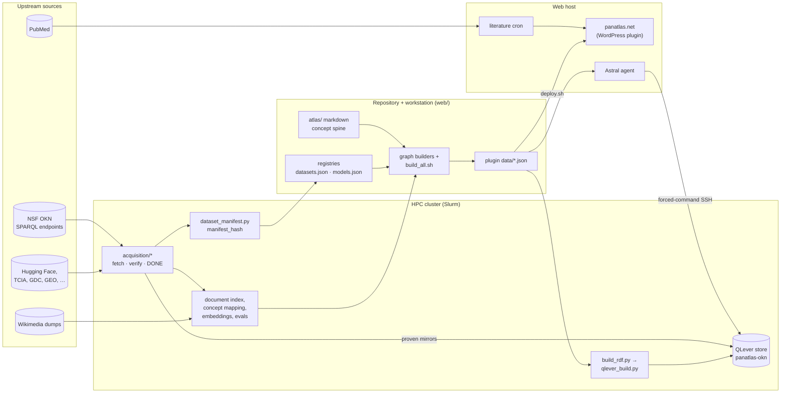
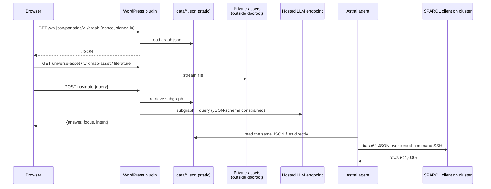

# Architecture

panAtlas has two architectures that need to be kept apart: the **target design** (a git-backed, federated markdown
fact-graph rendered to a static site) and **what runs today** (a build pipeline that compiles JSON registries and a
property graph, served by a WordPress plugin). This page describes both, how data moves from acquisition to the
site, and where each part runs.

## Components

| Component | Where it runs | What it does | Status |
|---|---|---|---|
| **Markdown fact-graph** (`atlas/`) | Git repository | Typed markdown pages (`concept-`, `document-`, `entity-`, `fact-`, `dataset-`, `item-`, `source-`, governance) with frontmatter edges, provenance-tagged bullets, a linter and a Wikipedia seeder | **Built as a seed**: 83 files, 51 concept pages; 75 pages `draft`, 1 `in_review`, none `verified` (repo at 57505c6). CI, pull-request verification and the static renderer are **designed** |
| **Registries** (`web/datasets.json`, `web/models.json`, `web/codesystems.json`, …) | Git repository | The dataset registry (`panatlas.datasets/1`, 200 entries at 57505c6), the model and embedding-space registry, code systems | **Built** |
| **Cluster-side builds** (`web/dgx/`, `web/acquisition/`, `web/rdf/`, `web/wikipedia_layer/`) | HPC cluster, inside Slurm jobs | Acquisition, manifests, document index, concept mapping, embeddings, evaluation ingest, universe projection, RDF export, SPARQL stores | **Built** |
| **Graph build** (`web/build_*.py`, `web/build_all.sh`) | A workstation with the repository | Compiles registries and cluster outputs into the served property graph and catalogs | **Built** |
| **Served data** (`web/wp-plugin/panatlas-explorer/data/*.json`) | Web host, inside the plugin | `graph.json`, `datasets.json`, `benchmarks_llm.json`, `mm_evals.json`, `evals_index.json`, `models.json`, `kg_graphs.json` | **Built**. Repo copy at 57505c6: 6,187 nodes, 17,119 edges, 622 catalog entries, 109 language benchmarks |
| **Site** (WordPress, `panatlas-explorer` plugin, `panatlas` theme) | Web host | panatlas.net: the explorer, universe, world map, mesh panel, gated REST API, public API, ORCID sign-in | **Built, live** |
| **Literature feed** (`web/pipeline/literature/`) | Web host, nightly cron | PubMed metadata per MeSH-grounded concept | **Built, live** |
| **Astral agent** (`web/astral/`) | Web host, loopback service behind the TLS virtual host | Exposes the atlas as read-only tools to the Astral agent platform | **Built, live** |
| **SPARQL stores** (QLever) | HPC cluster, a CPU-only Slurm job | `panatlas-okn` (panAtlas plus every proven NSF OKN mirror) and `wikidata` | `panatlas-okn` **served** (44 graphs, 6,994,341,217 triples); `wikidata` **in verification** as of 2026-10-17 |
| **Coverage service** (`web/coverage/`) | HPC cluster, loopback | Answers "how well does the atlas cover this area" against the Wikipedia layer | **Built** (2026-09-16) |
| **[Cresco](https://crescoedge.github.io/docs/) mesh** | HPC cluster, web host, and a controller node | Dataset managers report structure-only subgraphs; the hub shows them and folds permitted contributions | **Built, running**; see [Distributed](../distributed/index.md) |
| **Hosted LLM endpoint** | External to panAtlas, OpenAI-compatible | Backs the explorer's Navigator and model lens | **Used** at request time |

## Data flow: from acquisition to the site

Read the flow left to right:

1. **Acquire.** Each source has its own fetcher on the cluster that resumes, verifies every file, and writes a
   completion record only when the copy is complete ([Acquisition](../system/acquisition.md)).
2. **Register.** A dataset gets a registry entry with a URN, licence and access class, and an audit manifest whose
   hash pins the exact version on disk ([Dataset registry](../metadata/dataset-registry.md),
   [Manifests](../metadata/manifests.md)). Fold and register scripts write it into `web/datasets.json`.
3. **Build.** Heavy analysis runs on the cluster (document-to-concept mapping, embeddings, evaluation ingest). Its
   JSON outputs come to the repository, where the graph builders compile the served property graph and catalogs,
   and `build_all.sh` layers the curation passes on top and verifies the result ([Build pipeline](../system/build-pipeline.md)).
4. **Serve.** `deploy.sh` copies the served JSON and the front-end assets to the plugin on the web host. The site
   reads static files at request time; nothing on the cluster is called by a page view.
5. **Query.** The same graph is exported to RDF and loaded, with the OKN mirrors, into a SPARQL store on the cluster.
   Astral reaches the store; the public site exposes only the store's manifest ([Knowledge store](../system/knowledge-store.md)).

## Request paths at runtime

Three properties follow from this shape:

- **The site is a reader of files.** The WordPress database holds users, options and the audit log, not the atlas.
  The atlas is the JSON in the plugin's `data/` directory plus large assets outside the web root.
- **The cluster is never on a page view's critical path.** The only runtime call outside the web host is the
  Navigator and model lens to the hosted LLM endpoint. Astral's SPARQL and coverage tools are the exceptions on the
  agent side, and they go over a restricted SSH key, not an inbound port.
- **Two front doors with one data source.** The plugin's REST routes and the Astral agent read the same files; the
  agent does not call WordPress (`web/astral/atlas_store.py`).

## The architecture pivot

The first plan (`PLAN_v1_wordpress.md`, now history) built panAtlas as a WordPress application: custom post types
for nodes and datasets, custom MySQL tables for edges and runs, WordPress roles, and a pre-write veto filter. On
2026-07-26 the owner replaced the substrate with a federated markdown graph on the Atlas model (`ARCHITECTURE.md`).
The reason given is that a relational database behind an application server is single-tenant: it cannot be forked,
diffed, merged, or split by community, so community-scoped facts cannot federate.

| WordPress plan | Federated markdown design |
|---|---|
| Custom post types (`pa_node`, `pa_dataset`, …) | Typed markdown pages, one file per node |
| Edge table | Typed wikilink lists in frontmatter |
| Runs table | Out-of-graph append-only run store, plus verified `result-` summary pages |
| WordPress roles and capabilities | Git organisation and team membership, branch protection, CODEOWNERS |
| Pre-write veto filter | Linter in an editor hook and a required CI check on every pull request |
| REST API on WordPress | Static site (read), git pull requests (write), generated JSON (agents) |
| ORCID via a WordPress plugin | ORCID via OIDC on the git host |

The conceptual model survives unchanged: the curriculum graph, the jurisdiction-parameterised education ladder, the six
stratification axes, the assessment framework, the provenance ethos, ORCID identity and Wikipedia seeding. `PLAN.md`
(the current plan) builds on this decision and adds the two-layer design: a human-readable layer of concept and
document pages and a machine-readable layer of atomic `fact-` and `entity-` pages
([Graph schema](../metadata/graph-schema.md)).

### What actually runs today

!!! warning "The pivot is a design decision, not a migration that has happened"
    As of the repository at 57505c6 the live system is still a WordPress plugin serving JSON. Specifically:

    - **WordPress serves the site.** The `panatlas-explorer` plugin (version 0.2.2) registers the REST routes,
      shortcodes, roles and audit table; MySQL holds users and the `panatlas_audit` table.
    - **The property graph is compiled from JSON registries and cluster outputs**, not rendered from the markdown
      vault. `web/build_layered.py` reads the `atlas/20-concepts/` pages for the concept spine; the remaining
      `atlas/` page types (facts, entities, items) are not yet in the served graph.
    - **No CI, git-host ORCID login, pull-request verification or static renderer exists in the repository.**
      `atlas/tools/lint_panatlas.py` and `atlas/tools/seed_wikipedia.py` are the two built tools.
    - **No page in `atlas/` is `verified`.**
    - **Writes are proposals.** `POST /panatlas/v1/propose` records a proposal in the audit log for a curator; it
      edits nothing.

    The graph standards adopted the same day (`GRAPH_STANDARDS.md`) describe the served `graph.json` as a
    **projection** of an RDF graph, not a separate source of truth. That RDF form now exists: `web/rdf/build_rdf.py`
    exports the served graph as N-Quads, and the SPARQL store holds it.

## Layers of the graph

`GRAPH_STANDARDS.md` binds the representation to one RDF graph in three layers joined by concept IRIs: a terminology
backbone, a multi-modal instance layer, and a working property graph (what the explorer renders). The standard was
written for medicine, the domain built first, so it names the medical vocabularies (MeSH canonical, with SNOMED CT,
LOINC, RxNorm, UMLS and ICD cross-codes) and FHIR R4 for clinical records; the served graph already grounds other
domains in their own vocabularies, such as FoodOn for foods and Wikipedia for general concepts. `LAYERS.md` separates the same
system differently, into substrate (identity), connectivity (claims) and embeddings (one registered model per
modality). Both are explained in [Layers](layers.md); the vocabulary is in [RDF vocabulary](../metadata/rdf-vocabulary.md)
and the code systems in [Code systems](../metadata/codesystems.md).

## Where things run

| Place | What runs there |
|---|---|
| **The HPC cluster** | Acquisition jobs, manifest walks, document indexing, embeddings, evaluation harnesses and ingest, the universe projection, the Wikipedia layer chain, RDF export, SPARQL store builds and the serving job, the coverage service, a Cresco agent with the dataset managers. Compute runs in Slurm jobs; see [Build pipeline](../system/build-pipeline.md#rules-for-the-cluster). |
| **A workstation with the repository** | The graph builders in `web/`, `build_all.sh`, the render harness, `deploy.sh`. |
| **The web host** | WordPress and the plugin, the static data files, private assets outside the docroot, the nightly literature cron, the Astral agent service, the mesh daemon and a Cresco agent. |
| **A controller node** | The Cresco global controller for the region. |
| **External services** | The hosted LLM endpoint (Navigator, model lens), ORCID (sign-in), NCBI E-utilities (literature), upstream data hosts. |

## Distributed by design

panAtlas is built as a distributed system on the [Cresco](https://crescoedge.github.io/docs/) agent mesh. Datasets join the atlas where they sit, each
managed by its own `cresco-panatlas` plugin instance at the hosting site, and only structure crosses the mesh. The
hub on the web host pulls every manager's report, shows them in the Mesh view, and folds permitted contributions
into the graph. Remote panAtlas instances and computational resources are treated the same way, as peers on the
mesh.

This documentation covers the mesh, federation contract, dataset managers, agents and operations in its own
section, starting at [Distributed](../distributed/index.md).
