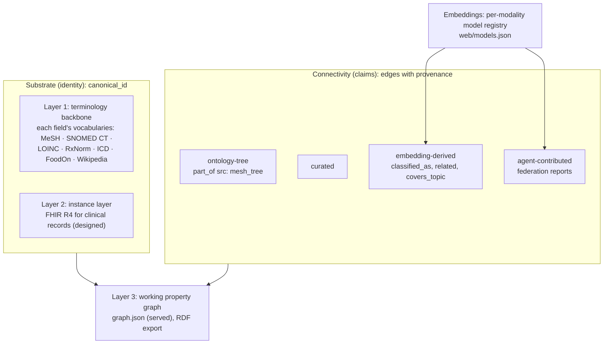
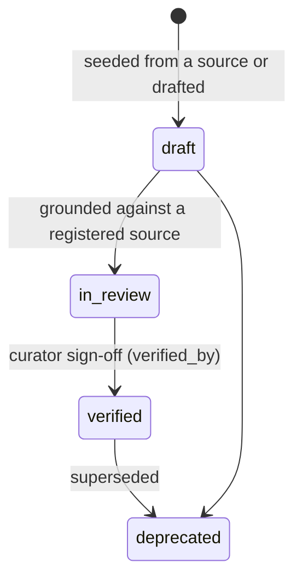

# Knowledge layers

panAtlas separates what a thing **is** from what is **claimed** about it, and claims that panAtlas
has **verified** from claims that were **seeded** from a source or **derived** by computation. The
word "layer" is used for several of these separations in the repository. This page reconciles them
with the code and states what lives in each layer today.

Sources: `GRAPH_STANDARDS.md` (decision record, adopted 2026-07-26, extended 2026-09-26),
`LAYERS.md`, `atlas/CLAUDE.md`, and the build scripts and data at repo HEAD `57505c6`. Counts were
computed on 2026-11-10.

## Four uses of "layer"

| Where | Layers | What it separates |
|---|---|---|
| `GRAPH_STANDARDS.md` | (1) terminology backbone, (2) clinical instance layer, (3) working property graph | Kinds of content in the one RDF graph |
| `LAYERS.md` | substrate, connectivity, embeddings | Identity, claims, and the models that produce claims |
| The markdown atlas (`atlas/CLAUDE.md`) | human-readable, machine-readable, evaluation, registry, governance pages | Page types of the git-backed fact graph |
| The `layer` attribute in `graph.json` | `foodatlas`, `concept`, `dataset`, `fndds`, `ontology`, `process`, `domain` | A display partition for the explorer ([Graph schema](../metadata/graph-schema.md)) |

These are not competing models. The first two describe the same graph from two angles (content
type, and identity versus claim). The atlas is where curated, verifiable facts are written. The
`layer` attribute is a user-interface grouping and carries no meaning beyond that.



## The three graph layers of `GRAPH_STANDARDS.md`

The decision: one RDF graph, three layers, joined by concept IRIs.

The decision record was written for medicine, the domain the atlas started with, and its wording is medical: layer 1
is "the medical concepts and entities" and layer 2 is the "clinical / multi-modal instance layer". The pattern itself
is domain-agnostic. Each domain's concepts come from that field's own vocabularies and join the same graph by
canonical identifier; the served graph already does this for foods (FoodOn, FoodData Central) and for general
concepts (Wikipedia). Backbones and instance models for other domains are not yet written into the standard.

| Layer | What it is | What lives in it today | Status |
|---|---|---|---|
| 1. Terminology / ontology backbone | Concepts and entities with stable identifiers from real vocabularies, SKOS-shaped. For medical concepts MeSH is canonical and the hierarchy comes from MeSH tree numbers | 3,390 nodes with a `mesh:` canonical id (among them 51 curated concepts, 142 MeSH tree expansions and 3,160 FoodAtlas diseases); 3,360 `part_of` edges from tree numbers; cross-codes; 15 code-system `authority` nodes; Wikipedia-grounded general concepts. See [Controlled vocabularies](../metadata/codesystems.md) | **Built** |
| 2. Clinical / multi-modal instance layer | Actual records whose codings carry concept IRIs that join layer 1. For medicine, FHIR RDF R4 (`ImagingStudy`, `Observation`, `Condition`, …) | The 13 FHIR resource types and 5 NACC record types as nodes; 36 `instantiates` edges saying which datasets would hold which resource. No instance records | **Designed** |
| 3. Working / evidence property graph | What the explorer renders: datasets, measured metadata, modality, embeddings, evaluation items and results. A projection of layers 1 and 2, not a separate source of truth | The served `graph.json` (6,187 nodes, 17,119 edges) and its RDF export in the named graph `https://panatlas.net/graph/panatlas` | **Built** |

The join is the reason this is one graph: a FHIR coding `a sct:…` or `a loinc:…` lands on the same
concept IRI as the backbone and as the mirrored external graphs. The concept IRIs in use are the
`rdf_iri_stem` values of `web/codesystems.json` ([RDF vocabulary](../metadata/rdf-vocabulary.md)).

### Source of record

Since 2026-09-26 every triple lives in exactly one named graph, and that graph is its source of
record. panAtlas curates, verifies and exports only `https://panatlas.net/graph/panatlas`. External
graphs (the NSF OKN graphs, Wikidata) are mirrored read-only under their publisher's graph IRI and
replaced wholesale when their agent syncs a new upstream version. panAtlas never edits an externally
maintained node or edge; it only links to it (`skos:exactMatch`, dataset and document annotations)
from its own graph. A dataset maintained elsewhere carries `maintained_externally: true` and a
`source_of_record` block ([Dataset registry](../metadata/dataset-registry.md)).

## Substrate, connectivity and embeddings (`LAYERS.md`)

### Substrate: identity

The substrate is the set of canonical grounded entities: what a thing *is*. A node's identity is its
`canonical_id` (`mesh:D051436`, `fhir:Condition`, `chebi:15377`, `foodon:…`). Two systems that emit
the same `canonical_id` are talking about the same entity, with no reconciliation. Ungrounded items
stay in a private namespace and do not enter the shared substrate until they are grounded. The
substrate answers only "does this entity exist, and what is it?"

In the served graph 5,013 of 6,187 nodes carry a `canonical_id`; the prefixes in use are `mesh`
(3,390), `foodon` (1,558), `wikipedia` (24), `fdc` (24) and `panatlas` (17, internal artifact-type
vocabulary). The other 1,174 nodes (datasets, benchmarks, models and other non-concept kinds, plus
118 concepts and 10 diseases) have none; see [Graph schema](../metadata/graph-schema.md).

### Connectivity: claims

Edges are attributed claims about how the substrate relates, not identity. Many overlapping
connectivity graphs can sit over one substrate, and a connectivity layer can be swapped or re-derived
without touching the substrate. `LAYERS.md` names four origins:

| Origin | Examples in the served graph | Marker on the edge |
|---|---|---|
| ontology-tree | `part_of` from MeSH tree numbers (3,360); FHIR `binds` (15) | `src: mesh_tree` |
| curated | `part_of` from curated pages (1,845); `prereq` (6) | `src: curated` |
| embedding-derived | `classified_as` from the corpus classification (1,749 with `n_docs`); `related` (31 with `sim`); benchmark `covers_topic` from the judge-gated item mapping (300 with `n`); `covers_topic` from arXiv lexical alignment (203) | `n_docs`, `sim`, `n`, `basis` |
| agent-contributed | Edges reported over the federation by site agents | `claims` (in agent reports) |

Every edge is meant to carry an `origin` and `evidence` (for example `{model, version, cosine}`), so
that connectivity merges as claims and conflicts surface instead of being overwritten.

!!! warning "The served graph does not carry `origin` and `evidence`"
    No edge in `graph.json` has an `origin` or `evidence` attribute. Provenance is partial and uses
    other names (`src` on 5,715 edges, `via` on 437, `basis` on 216); 10,863 edges carry none of the
    three. The attach process (below) implements the contract as one nested attribute,
    `claims: {origin, model, version, cosine, canonical_id}`, on the edges it reports.

### Embeddings and the attach process

Embeddings are how new items find their place in the connectivity graph. Two rules:

1. Each modality registers its own models in `web/models.json`.
2. An embedding is comparable only within one `(modality, model, version)` space. Cross-modality
   relation goes through the substrate (shared `canonical_id`), never through embedding arithmetic.

A registered model carries its space definition: dimension, pooling, concept anchors (one vector per
grounded concept, aligned by slug and `canonical_id`), the optional centroid taxonomy, and the
unknown cutoff. At HEAD only the text model is active (BioClinical-ModernBERT-large, version
`v3w-2026.07`, 1024-d); the imaging entry (RAD-DINO) holds embeddings but no anchors, and genomics
and structured data have no registered embedder ([Models and curriculum](../metadata/models-and-curriculum.md)).

The attach process (`web/embed_attach.py`) runs per agent, locally, in one model's space:

```
new item + embedding e (in model M's space)
        |  L2-normalise (and whiten with the anchors' mu/sd when present); cosine to M's anchors
        v
   top-k concepts by cosine
        |  >= M's cutoff (the whitened cutoff when whitened)?
        |-- yes -> classified_as edges, claims {origin: embedding, model, version, cosine, canonical_id}
        '-- no  -> UNKNOWN: no edge; the item stays in the agent's private namespace
```

Its output is connectivity, never substrate. A site's local agent (`web/pa_local_agent.py`) holds the
graph index and embedding cache, runs attach on local embeddings, and emits a structure-only report:
grounded nodes (`canonical_id`, `kind`, `label`), edges, and a sha256 content hash, with no
documents. The report travels the federation, where entities merge by `canonical_id` and connectivity
accumulates as attributed claims. See [Distributed panAtlas](../distributed/index.md) and
[The agent contract](../distributed/contract.md).

!!! warning "Imaging model named in `LAYERS.md`"
    `LAYERS.md` says imaging is embedded by the LeJEPA-3D CT encoder. The registry's imaging entry is
    stock RAD-DINO, with anchors held. `LAYERS.md` also says the local agent's report is served by a
    separate plugin; the plugin is outside this repository and was not checked here.

## Verified, seeded and derived facts

panAtlas's first principle (`atlas/CLAUDE.md`): **sources are evidence, not authority.** Citing a
source records where a claim was seen; it never makes the claim true. Only panAtlas verification, a
human `verified_by` sign-off, makes a page `verified`. FHIR records and vocabulary assertions enter
the same way, as evidence with provenance, and become panAtlas facts only after curator sign-off.

Three kinds of content therefore sit side by side, and the data marks which is which.

### Seeded: evidence waiting for verification

| Content | Marker |
|---|---|
| Concept pages seeded from Wikipedia | `status: draft`, `confidence: estimated`, a pinned `wikipedia: {title, oldid, retrieved}`, and a `needs-verification` callout: "Wikipedia saying it does not make it true" |
| Fact pages drafted by an agent | `status: draft`, and the claim tagged "UNVERIFIED (agent-drafted from model knowledge; NOT yet checked against a source)" |
| Datasets taken from the inventory | `built_by` "from the dataset inventory; not yet measured …" (88 nodes); `measured: false` (116) |
| Contamination labels that were guesses | Downgraded to `UNCHECKED` by `hygiene_enrich.py` (122 dataset nodes), with the guess kept as `contamination_prior` |
| Benchmark decontamination not yet run | `decontam.holdout_status: unchecked` (85 of 106 language benchmarks) |

### Derived: computed from other data

| Content | How it is derived | Marker |
|---|---|---|
| Concept hierarchy (medical concepts) | MeSH tree-number prefixes | `part_of` with `src: mesh_tree` |
| Disease specialty | MeSH tree number of the disease | `built_by: "…specialty by tree number"` |
| Corpus → concept | Corpus document classification (embedding cells + LLM-judged cell labels) | `classified_as` with `n_docs` |
| Concept relatedness | Cosine between concept anchors, kept at 0.72 or above | `related` with `sim` |
| Benchmark topics | Item → concept mapping (judge-gated) | `covers_topic` with `n`; node `topics_status` |
| Benchmark grounding | Rule: a benchmark reaches a MeSH-grounded concept through `covers_topic`, `tests` or `covers` | `grounded_in` with `via: mesh:<UI>` |
| Per-concept accuracy | Per-item correctness joined to the item mapping | `measured_on` with `acc`, `n`; `eval_accuracy` with `ckpt` |
| Artifact type of a benchmark | Rule from the `task_format` facet unless overridden | `artifact_type_via` |
| Composite model score | Mean over the fixed 21-benchmark battery | `overall`, `battery_n` |

A derived value is only as good as its inputs, and the inputs are named on the edge or node so the
value can be recomputed.

### Verified: checked, with the check recorded

There are two senses of "verified" in the data, and they must not be confused.

**Curator verification** is the `verified_by` sign-off that makes an atlas page `status: verified`.
At HEAD it has not happened for any page: of the 75 typed pages in the repository's markdown atlas,
74 have `status: draft` and 1 (a fact) has `status: in_review`; none is `verified`. 53 carry
`confidence: estimated` and 1 `confidence: measured`. No node or edge in the served graph has `verified_by`.

**Machine verification** is a recorded, repeatable check of a specific fact against its source.
This is what the served graph's verified content rests on:

| What | Check | Where recorded |
|---|---|---|
| MeSH groundings of curated concepts | UTS resolver, then one adversarial agent per concept confirming the descriptor with a live UTS call | `built_by` on 51 concept nodes |
| Artifact-type groundings | Live NLM MeSH lookup (`match=exact`) and Wikipedia REST, 2026-08-08; concept-identity judge, 2026-08-09 | `pipeline/groundings_verified.json`; `grounding_match`, `grounding_judge` |
| Curriculum facts | Every job id, config path and repository must exist in the vault (`check_curriculum_vault.py`, 61/61 on 2026-10-14) | Curriculum `verified` (date and method) |
| Dataset counts | Measured on the cluster, not estimated | `measured: true` (249 dataset nodes) |
| Imaging and pathology results | Training and evaluation verified before listing | `verified` on result records; `withheld` otherwise |
| Mirrored external graphs | Fingerprint, upstream slices, independent re-extraction, store round trip | `PROOF.json`; see [RDF vocabulary](../metadata/rdf-vocabulary.md) |

## The markdown atlas

The atlas in `atlas/` is the git-backed fact graph where verifiable facts are written as typed
markdown pages. Page types (`atlas/CLAUDE.md`):

| Layer | Page types | Pages at HEAD |
|---|---|---:|
| Human-readable | `concept-`, `document-` | 51 concepts, 1 document |
| Machine-readable | `fact-`, `entity-` | 3 facts, 4 entities |
| Evaluation | `dataset-`, `item-`, `model-`, `result-` | 1 dataset, 2 items, 0 models, 0 results |
| Registry | `source-` | 7 sources |
| Governance | `dispute-`, `curator-`, `domain-`, `jurisdiction-`, `strata-` | 2 domains, 1 jurisdiction, 2 strata |
| Navigation | `map-` (maps of content) | 1 |

Rules the linter enforces (`atlas/tools/lint_panatlas.py`; CI blocks on error):

1. Every page has frontmatter with `type`, `slug` (equal to the file name), `status`
   (`draft`, `in_review`, `verified`, `deprecated`) and `oneliner`.
2. Every wikilink in a frontmatter edge field resolves to an existing page.
3. `prerequisites` between concepts stay acyclic.
4. Every **verified** fact cites at least one registered `source-` page (the publish gate).
5. Every factual bullet carries a provenance tag: `src:<slug>@<ver>`, `conv:YYYY-MM-DD`, `web:<url>`,
   `wikidata:Q<id>` or `[[document-…]]`, optionally followed by `(confidence: …)`.
6. Held-out item answers never live in the public file.

A fact page is a typed triple: `fact_type`, `subject`, `predicate`, `object`, `polarity`,
`confidence`, with `about`, `elaborates`, `stated_in` and `cites_source` edges. The predicate must
be legal for the fact type, from `atlas/predicates.yaml`:

| `fact_type` | Predicates |
|---|---|
| `mechanism` | `inhibits`, `activates`, `agonist_of`, `antagonist_of`, `causes`, `mediated_by` |
| `association` | `associated_with`, `risk_factor_for`, `marker_of` |
| `dosage` | `dose_is`, `route_is`, `max_dose_is` |
| `contraindication` | `contraindicated_with`, `avoid_in` |
| `indication` | `first_line_for`, `second_line_for`, `indicated_for` |
| `diagnostic` | `localizes_to`, `confirmed_by`, `elevated_in`, `seen_on` |
| `temporal` | `precedes`, `rises_after`, `peaks_at` |
| `epidemiologic` | `prevalence_in`, `incidence_in` |
| `definitional` | `is_a`, `part_of`, `subtype_of` |

Edges live on the owning end only: a fact owns its `elaborates`, `about` and `stated_in` edges, and
concept, entity and document pages receive them through generated reverse-index blocks that are
never hand-edited.

`build_layered.py` reads the atlas concept pages (`atlas/20-concepts/*.md`) to build the concept
layer of the served graph: the page's `concept_kind` sets the node kind (`map` becomes `specialty`,
the Medicine page becomes `root`, a `gate` page becomes `gate`), and its `prerequisites` become
`prereq` edges. The verified MeSH mapping then supplies the canonical identity and the hierarchy.
The 51 concept pages at HEAD are the medical curriculum, so `root` is the root of that curriculum,
not of the atlas: the atlas itself sits under `atlas-root`, with one `domain` node per top-level
field ([Graph schema](../metadata/graph-schema.md)).


