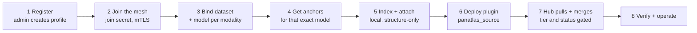

# Participating agents

A **participating agent** is a Cresco node that runs the `cresco-panatlas` plugin and contributes its own grounded,
structure-only subgraph to panAtlas. The hub's own dataset managers are participating agents of a special kind (one
plugin instance per dataset, configured by the hub). This page covers the plugin itself, the local agent kit an
outside site uses to build its report, the steps for connecting a new site, and the admin portal that lets it in.

Sources: `ThePanAtlas/cresco-panatlas` (plugin), `ThePanAtlas/agent-deployment` (onboarding kit and contract),
`web/federation/` and `web/dgx/pa_local_agent.py` in the hub repository.

## The `cresco-panatlas` plugin

An OSGi bundle (`io.cresco.panatlas`, version `0.1-SNAPSHOT`) modelled on the Cresco skeleton plugin. Four classes:

| Class | Role |
|---|---|
| `Activator` | Minimal bundle activator. The service is registered through Declarative Services |
| `Plugin` | `@Component` with `ConfigurationPolicy.REQUIRE` and `ServiceScope.PROTOTYPE`, so every configured instance is a separate plugin. It waits until the agent is active, then logs `PanAtlas federation reporter active on <region>_<agent>` |
| `ExecutorImpl` | Dispatches `EXEC` messages by their `action` parameter. Annotated `@CrescoCapabilities(namespace = "panatlas", target = "plugin")`, so its actions appear in the mesh capability inventory. All other message types return `null` |
| `GraphReporter` | Loads the report, enforces the contract, stamps identity and computes the hash |

### Actions

| Action | Parameters | Returns | Use |
|---|---|---|---|
| `getgraphmanifest` | none | `agent_id`, `node_count`, `edge_count`, `content_hash` (or `error`) | Cheap change check before a full pull |
| `getgraphinventory` | `since_hash` (optional) | `report` (compressed JSON) and `content_hash`. If `since_hash` equals the current hash: `unchanged = "true"` and `content_hash` only. On failure: `error` | Full report pull by the hub |

### Configuration keys

| Key | Required | Meaning |
|---|---|---|
| `pluginname` | yes | `io.cresco.panatlas` |
| `panatlas_source` | effectively | Path to the report JSON on the agent's filesystem. If it is unset or missing, the plugin logs a warning and reports an **empty** subgraph |
| `panatlas_graph_version` | no | Copied into the report's `graph_version`. Default `unversioned` |
| `panatlas_dataset_id` | hub managers | The dataset URN (`panatlas:dataset:<slug>`). The hub finds managers by this key |
| `panatlas_modalities` | hub managers | Comma-separated modalities |
| `panatlas_model.<modality>` | hub managers | The registered `model@version` per modality. Non-scalar model descriptions are serialised as compact JSON, because Cresco plugin configuration must be flat scalars |
| `panatlas_manifest` | hub managers | Path to the dataset's manifest file |
| `persistence_code` | no | `10` asks the agent to restore the instance after a restart. **The hub leaves it unset**; see [Operations](operations.md#persisted-plugin-runaway) |

The plugin reads only `panatlas_source` and `panatlas_graph_version`. The other keys exist so that an instance
describes itself in the controller's plugin listing, where the hub finds its URN.

### What the reporter does on each call

1. Identity: `agent_id = "agent-" + region + "_" + agent` from the Cresco plugin builder.
2. Load `panatlas_source` if it exists, then walk the whole tree and **throw** on any forbidden field name (`text`,
   `body`, `raw`, `content`, `document`, `excerpt`, `abstract`, case-insensitive) at any depth.
3. Take `nodes` and `edges` (empty arrays if absent).
4. Build the reply object: `agent_id`, `graph_version`, `generator = "cresco-panatlas/0.1"`, `nodes`, `edges`.
5. `content_hash = "sha256:" + SHA-256( JSON(nodes) ‖ JSON(edges) )`, the two serialisations concatenated.

!!! warning "`content_hash` is not comparable across implementations"
    Three components compute a `content_hash`, and they canonicalise differently:

    - **Plugin (Java):** SHA-256 of `nodes` bytes concatenated with `edges` bytes. Jackson's `ORDER_MAP_ENTRIES_BY_KEYS`
      does not reorder the keys of an already-parsed `ObjectNode`, so key order follows the source file.
    - **Validator (`pa_agent.py`):** SHA-256 of `{"nodes": …, "edges": …}` with sorted keys and compact separators.
    - **Local agent (`pa_local_agent.py`):** SHA-256 of the same object with sorted keys and default separators.

    Each hash is stable for its own producer, so change detection (`since_hash`) works. The same subgraph does
    **not** hash to the same value across the three, so do not compare hashes between them.

!!! note "Plugin README status line is out of date"
    The `cresco-panatlas` README still says "Not yet run on a live mesh". The bundle has served the hub's dataset
    managers on the live mesh since 2026-07-31.

### Build and deploy

```bash
# JDK 21, Maven, and io.cresco:library:1.3-SNAPSHOT installed locally (build CrescoEdge/library first)
mvn package bundle:bundle        # -> target/panatlas-0.1-SNAPSHOT.jar
```

Deploy the bundle to a running agent through the Cresco controller (plugin upload, then add an instance with its
configuration). The hub does this with `pycrescolib` in `web/mesh/deploy_managers.py`; see
[Dataset managers](dataset-managers.md#3-deployment-and-self-healing-every-15-min-web-host). On a Cresco build with
the 1.3 secure defaults, an uploaded jar is installed only if it is signed and verifies against the agent's
`plugin_signing_truststore` ([Signed plugins](https://crescoedge.github.io/docs/security/signed-plugins/)). The
bundle is not signed today; see [Cresco for panAtlas](cresco.md#version-and-security-build).

## The local agent kit

A site that is not the hub builds its report with the **local agent**: `pa_local_agent.py`, pure NumPy and the
standard library. It keeps the site's graph index and embedding cache **on the site**, and only the structure-only
report leaves it.

**Store layout** (default `~/.panatlas-agent`):

```text
config.json                     agent_id, site, model, created
cache/  models.json             the hub's model registry (cached)
        <model>.npz             concept anchors for the site's model
index/  nodes.json              id -> {canonical_id, kind, label, grounding}
        by_canonical.json       canonical_id -> id
        concepts.json           concept -> member ids (from part_of / classified_as / covers edges; 5,000 per concept)
        adjacency.json          id -> [{to, rel, cosine?, model?}]
reports/report.json             the structure-only report for the plugin
```

**Commands:**

| Command | Arguments | Does |
|---|---|---|
| `init` | `--agent-id`, `--site`, `--model`, `--models`, `--anchors`, `--now` | Creates the store and caches the model registry and anchors |
| `index` | `--graph` | Indexes the site's graph (nodes and edges in report form) |
| `attach` | `--embeddings` (`.npy` [m, d]), `--ids`, `--topk` (default 3) | Relates new embeddings to concepts through the cached anchors and adds `classified_as` edges with `cosine` and `model` |
| `report` | `--version` (default `local`) | Writes `reports/report.json`: grounded nodes only (`canonical_id`, `kind`, `label`), every edge, `claims = {origin: "embedding", cosine, model}` on attach edges, and a `content_hash`. Runs the structure-only check |
| `status` | | Prints the store, index, cache and report state |
| `serve` | `--graph`, `--version`, `--interval` (default 5 s) | Watches the graph file and re-indexes and re-reports when it changes |

**Attach** (`embed_attach.py`) L2-normalises the embeddings and anchors, computes cosine similarity, keeps the top
`k` concepts at or above the model's `cutoff` and emits `classified_as` edges carrying
`{origin, model, version, cosine, canonical_id}`. Anything below the cutoff is reported as **unknown**, with its best
cosine and no edge. `build-anchors` mints a model's anchors as an `.npz` (`vecs`, `slug`, `canonical_id` plus
`model`, `version`, `dim`): one vector per grounded concept, the mean of its passage embeddings.

!!! warning "The published kit is behind the hub repository"
    `agent-deployment/agent/` holds older copies of `pa_local_agent.py`, `embed_attach.py` and `models.json`. The hub
    copies (`web/dgx/pa_local_agent.py`, `web/embed_attach.py`, `web/models.json`) add the **model-space guard**:
    `attach` takes the embedding model's identifier and raises `MODEL-SPACE MISMATCH` if it differs from the
    anchors' model. The kit's `attach` checks only the dimension, although `CONNECTING.md` already describes the
    guard. The kit's `models.json` also lists an older imaging model. Sync the kit from the hub before onboarding a
    site. The kit's Cresco links (`crescoedge.github.io/quickstart/…`) also return 404; the documentation is now at
    `crescoedge.github.io/docs/`. Its `examples/cresco.env` names the identity keys `regionName` and `agentName`;
    Cresco's parameters are `regionname` and `agentname`
    ([Configuration](https://crescoedge.github.io/docs/getting-started/configuration/)), which is how the panAtlas unit
    files set them.

## Connecting a new site

The end-to-end path from `agent-deployment/CONNECTING.md`:



1. **Register and be permitted.** Send the request form (`examples/register-request.md`): display name, purpose,
   institution, host, optional URL, owner name and ORCID, a private contact email, the vocabularies your
   identifiers use, approximate node and edge counts, and the dataset, modalities and registered model per
   modality. You receive your `region` and `agent` names (identity `agent-<region>_<agent>`), your tenant, your
   starting tier, your status (`pending` until an admin permits you) and the discovery join secret for your tier.
2. **Join the mesh.** Configure and start a Cresco agent (`examples/cresco.env`): its region and agent names,
   `regional_controller_host`, `is_global=false` and the join secret for your tier (`discovery_secret_agent`). Keep
   the secret in an owner-only file or a `CRESCO_<NAME>` environment variable, not on the command line
   ([Deployment](https://crescoedge.github.io/docs/operations/deployment/#securing-a-fabric)). The kit also sets
   `broker_security_enabled`, `broker_require_client_auth` and `tenant_namespacing` to `true`, with the comment "turn
   ON for a real medical federation". In Cresco 1.3 those three are already the defaults
   ([Secure defaults](https://crescoedge.github.io/docs/security/secure-defaults/)) and apply to every federation,
   whatever its domain. The kit's fourth setting, `security_regional_ca=true`, is opt-in regional-CA enrollment,
   available in the standard profile only ([Security profiles](https://crescoedge.github.io/docs/security/profiles/)).
3. **Bind your dataset and models.** One plugin instance is one dataset. Declare `panatlas_dataset_id`,
   `panatlas_modalities` and `panatlas_model.<modality>` for each stream, choosing the most specific registered
   model that applies.
4. **Get the anchors** for the exact model you use, distributed with the registry and versioned with the model.
   Cache them with `init`.
5. **Index and attach** with the local agent, then `report`.
6. **Deploy the plugin**, pointing `panatlas_source` at `~/.panatlas-agent/reports/report.json`.
7. **The hub pulls and merges**: substrate by `canonical_id`, connectivity per model space, gated by tier and
   status. A model not registered for its modality is quarantined. See [Federation](federation.md#how-the-hub-merges).
8. **Verify and operate.** `getgraphmanifest` returns your identity, counts and hash. Keep `serve` running so the
   report follows your graph. When a model version changes, re-embed and re-attach in the new space; old edges are
   marked superseded. A new dataset is a new plugin instance.

**Troubleshooting** (from `CONNECTING.md`):

| Symptom | Cause and fix |
|---|---|
| Report has 0 edges | No embeddings attached yet, or `attach` refused a model mismatch |
| Edges quarantined at the hub | The declared model is not registered for that modality |
| Nothing merges | `status` is not `active`, or the join or mTLS enrollment failed. Cresco's own refusals and their fixes are in [Cresco troubleshooting](https://crescoedge.github.io/docs/operations/troubleshooting/) |
| `MODEL-SPACE MISMATCH` | Embeddings from one model attached to another model's anchors |

## The admin portal

The site's explorer plugin includes a **federation admin portal** (`includes/federation-admin.php`): a WordPress
admin page plus three REST routes in the `panatlas/v1` namespace. The registry it maintains,
`wp-content/uploads/panatlas/federation/agents.json`, is the same file `merge_reports.py` reads.

| Method | Route | Permission | Does |
|---|---|---|---|
| `GET` | `/federate/agents` | public | The agent directory. The public view drops `private{}` and reduces `token` to its `prefix`. An admin sees full profiles but never the token hash |
| `POST` | `/federate/agents/register` | `pa_admin` | Creates a profile (`agent_id` must match `^agent-[a-z0-9-]+$`; 409 if it exists). Tier defaults to `provisional`, status is always `pending`. Mints a token `pat_` + 40 characters, stores only its 10-character prefix and SHA-256, and returns the plain token **once** |
| `POST` | `/federate/agents/update` | `pa_admin` | Sets `tier` and/or `status`, or `rotate: true` to mint a new token (returned once). Stamps `updated_at` |

The admin page lists agents with **Permit** (set `active`), **Suspend** and **Revoke**. Every register and update is
written to the site audit log (`panatlas_audit`, events `fed_register` and `fed_update`).

!!! note "What the token is for"
    Tokens were designed for the HTTP submission route (`POST /federate`), which is not built. On the Cresco path,
    identity comes from the mesh (the node's certificate, admitted with its join secret and checked by mutual TLS),
    and the registry's `tier` and `status` gate the merge.
