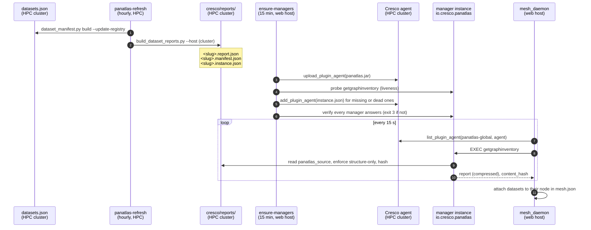

# Dataset managers

Every dataset in the registry is managed by its **own `cresco-panatlas` plugin instance**, running on the Cresco
agent at the site that hosts the dataset. A manager owns exactly one dataset. It serves that dataset's grounded,
structure-only report, stamped with the dataset's URN and `manifest_hash`, and the hub reaches it over Cresco
messaging: no cron scrape and no raw HTTP.

This is what "a dataset joins the atlas where it sits" means in practice: the data stays on the cluster, the
manager sits next to it, and the atlas knows the dataset through the manager.

## The life of a manager



### 1. Registry and manifest (hourly, HPC cluster)

`panatlas-refresh.timer` (15 min after boot, then hourly) runs two steps in the cluster's panAtlas directory:

```bash
python3 dataset_manifest.py build --registry datasets.json --root <cluster project storage> \
        --out cresco/manifests --update-registry
python3 build_dataset_reports.py --registry datasets.json --out <cluster project storage>/panatlas/cresco/reports \
        --host <cluster host>
```

The first **rebuilds** every dataset's manifest and writes the new `manifest_hash` into the registry. The second
regenerates every cluster-hosted manager's payload.

!!! warning "The hourly job rebuilds, it does not audit"
    `build --update-registry` makes whatever is on disk the new baseline. Drift (a moved, grown or edited file)
    changes `manifest_hash` silently instead of failing, and nothing on a schedule calls `dataset_manifest.py audit`
    (exit 0 match, exit 3 drift). The design documents also say the hub checks a reported `manifest_hash` against the
    registry and quarantines on mismatch; `merge_reports.py` does not. To detect drift, run `audit` before the
    rebuild. See [Manifests](../metadata/manifests.md).

A full re-walk of the very large CT corpus runs separately, weekly, as a Slurm
job (`panatlas-ct-rewalk.timer`, Sundays 03:00), and its partitions are re-derived without another walk.

### 2. The payload triplet

`web/build_dataset_reports.py` writes three files per dataset, **flat**, named by slug:

| File | Content | Read by |
|---|---|---|
| `<slug>.report.json` | The structure-only subgraph: the dataset node, one node per modality, one per `model@version`, one per grounding vocabulary, and the edges between them | The manager, at **every** call |
| `<slug>.manifest.json` | The dataset's audit manifest, copied from the registry | Audit; `panatlas_manifest` config key |
| `<slug>.instance.json` | The plugin configuration for this dataset's manager | `deploy_managers.py` |

The layout is flat rather than one directory per dataset because `filerepo` catalogued files by basename, and
recursive sub-directories collided. The slug in the filename and the URN inside each file keep identity
unambiguous. Field-level schemas are in [Wire contract](contract.md#dataset-manager-report).

The report skeleton is deliberately minimal and grounded: which modalities the dataset has, which registered model
embeds each, which vocabularies ground it. Grounded **concept** connectivity (embedding attach in the dataset's model
space) is layered in per dataset by dropping a `<slug>/grounded.json` that is merged into the report. CT-RATE's
imaging anchors were planned first.

### 3. Deployment and self-healing (every 15 min, web host)

`panatlas-ensure-managers.timer` (10 min after boot, then every 15 min) runs `ensure_managers.sh`, which runs
`web/mesh/deploy_managers.py`:

1. **Upload** the bundle (`panatlas.jar`) to the cluster agent and read its coordinates (`pluginname`, `md5`,
   `version`).
2. **List** existing managers and map each dataset URN to its `plugin_id`, by finding `panatlas:dataset:` in the
   instance's `configparams`.
3. **Probe liveness.** Send every listed manager `getgraphinventory`. A manager that is listed but does not answer is
   removed and re-added. *Presence is not liveness*: see
   [Operations](operations.md#listed-but-not-answering). `PANATLAS_NO_PROBE=1` skips this step for a fast pass.
4. **Add missing managers.** For every `*.instance.json` whose report's dataset `host` is this agent, add an
   instance unless one for that URN exists (`--replace` removes and re-adds). The script merges the uploaded jar's
   coordinates into the configuration. Persistence (`persistence_code=10`) is **off** unless `PANATLAS_PERSIST=1`.
   The timer, not the agent, guarantees that managers come back.
5. **Verify.** Wait 5 s, re-list, probe every manager this run is responsible for, and **exit 3** if any does not
   answer. The script does not trust add replies: on 2026-09-24 to 09-26 every add returned `{}`, the script printed
   "deployed 94" and exited 0 every 15 minutes, and the site showed 0 datasets for two days.
6. On exit 3, `ensure_managers.sh` restarts the web host's Cresco agent, retries once and restarts the mesh daemon.
   A one-hour cooldown stops a fault on the cluster side from turning this into a restart loop.

Running `deploy_managers.py` by hand is safe at any time. It is idempotent by URN.

### 4. Serving (on every call)

The manager does no work until it is called. On each `getgraphmanifest` or `getgraphinventory` it re-reads
`panatlas_source`, enforces the structure-only contract, recomputes `content_hash` and replies. A refreshed report
is therefore served at the next call without redeploying the manager.

!!! note "`graph_version` is fixed at deploy time"
    The report's `graph_version` comes from the instance configuration (`panatlas_graph_version`, set to the
    dataset's `manifest_hash` when the instance was created). The **dataset node inside the report** carries the
    current `manifest_hash` from the hourly refresh. After a manifest changes, the two disagree until the manager is
    redeployed with `--replace`. Treat the dataset node's `manifest_hash` as authoritative.

### 5. The hub's pull loop (web host)

`web/mesh/mesh_daemon.py` runs as `panatlas-mesh.service` on the web host and keeps `mesh.json` current for the
site's **Mesh view**:

| Every | It does |
|---|---|
| continuously | Subscribes to `route_lsa` link-state gossip on the data plane (the live path). Gossip older than 60 s is dropped |
| 3 s | Polls the global controller's `getnetworkstate` (fallback when there is no fresh gossip) |
| 15 s | Lists `io.cresco.panatlas` instances on each manager-hosting agent, pulls `getgraphinventory` from each, takes the `type == "dataset"` node, deduplicates by URN and groups datasets by agent |
| 1.5 s | Writes `mesh.json` atomically (temp file, then rename) |

On any connection failure the daemon keeps the last good dataset map, so a short outage does not blank the view.
Restarting the daemon **resets** that map, so a low count just after a restart is expected. A count that stays at
0 is the listed-but-not-answering failure.

## Scale on the mesh

| Date | Managers answering | Event |
|---|---|---|
| 2026-07-31 | 22 (21 on the cluster agent, `nacc` on the web host) | First deployment, MsgEvent pull replaces `filerepo` |
| 2026-09-12 | 33 | Ten renal and two neuropathology datasets integrated |
| 2026-09-17 | 33 | After the persisted-plugin runaway was fixed. The web host agent held **0** managers that day; the `nacc` manager was no longer deployed |
| 2026-09-20 | 65 | Recovery from listed-but-not-answering; liveness probe added |
| 2026-09-26 onward | one per cluster-hosted registry entry | Every mirrored Open Knowledge Network graph is also a registered dataset (`okn-<sn>`) with its own manager |

At repo HEAD the registry holds **200** entries: 194 hosted on the HPC cluster, 1 on the web host and 5 with no host
(not deployable). 46 of them are Open Knowledge Network graphs. See [Dataset registry](../metadata/dataset-registry.md).

## Knowledge-graph agents

The NSF Open Knowledge Network mirror applies the same idea to external graphs (`web/acquisition/okn/okn_agent.py`,
owner order 2026-09-26). Each connected graph is **its own panAtlas agent**, with:

- its own version state (`pav:version`, `pav:lastUpdatedOn`, `dct:modified` and VoID counts from the upstream
  `okn-void` graph) and an **independent update cycle**: `tick` checks every agent and submits one Slurm sync per
  changed graph;
- its own provenance (title, homepage, funding award, licence, endpoints and authoritative namespaces, from the
  upstream registry);
- a declared **source of record**. Every triple from graph G is asserted by `okn:G@<version>`. Every node is
  maintained by the graph whose authoritative namespace covers it. panAtlas curates only nodes and edges whose source
  of record is panAtlas. Mirrored content is read-only and replaced wholesale when its agent syncs a new version;
- a registry entry (`panatlas_entry.json`), which makes it a dataset with its own manager on the mesh.

Per-agent state lives under `data/sources_staging/okn/agents/<sn>/` (`state.json`, `provenance.json`, `sor.json`,
`check.json`, `panatlas_entry.json`). See [Acquisition](../system/acquisition.md) and
[Knowledge store](../system/knowledge-store.md).
