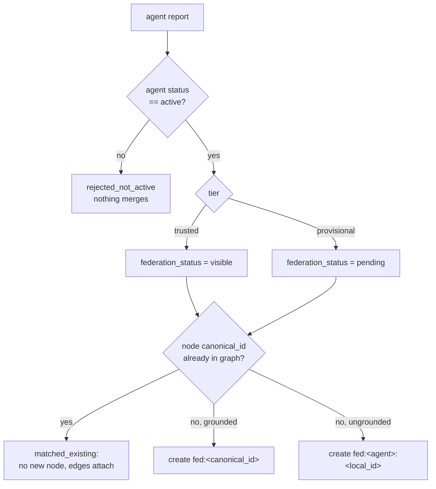

# Federation model

Federation is how independent sites contribute to **one** canonical panAtlas without giving up their data. The
design decisions were locked on 2026-07-29 (`FEDERATION.md`):

- **Hub-and-spoke** topology: one canonical hub (panatlas.net), many agents.
- **Structure and metadata only**: no raw documents, no protected health information.
- **Tiered trust**: trusted agents are visible on arrival, provisional agents are queued as claims.
- **[Cresco](https://crescoedge.github.io/docs/)** as the base framework, with the reporter written as a native
  Cresco plugin.

## Join keys: the ontology is the protocol

Every grounded panAtlas node carries a **canonical identifier** from its field's own vocabulary: `mesh:D051436` for
a medical concept, a FHIR code, a ChEBI or FoodOn identifier for a chemical or a food, a Wikipedia identity for a
general concept. Those identifiers are the **join keys** of federation, in every domain. Two agents that both emit
`mesh:D051436` are provably describing the same concept, so their contributions merge with no reconciliation step.

A node with no canonical identifier is **ungrounded**. It carries a `local_id`, is namespaced to its agent, and
never enters the shared concept hierarchy (for medical concepts, the MeSH tree). See [Identifiers](../metadata/identifiers.md) and
[Code systems](../metadata/codesystems.md) for the identifier schemes.

## Substrate and connectivity

Two kinds of contribution are kept apart throughout (`LAYERS.md`, `agent-deployment/CONNECTING.md`):

| | Substrate | Connectivity |
|---|---|---|
| What | Entity **identity**: grounded nodes keyed by `canonical_id` | **Relationships**: edges between nodes |
| How it merges | By identity. An existing entity is deduplicated and never duplicated | As **attributed claims** layered on top, each edge carrying `reported_by` |
| Conflicts | Base identity and label win | Conflicting claims are kept side by side, never overwritten |

## The model-space rule

Embeddings are comparable **only within one registered `(modality, model, version)` space**. Dimension equality is
not enough; the model identifier is the real guard. Relations across models or modalities go through shared
grounding (`canonical_id`), **never** through cosine similarity across spaces.

- The hub's model registry (`web/models.json`) lists the registered model or models per modality, each with its
  anchors and its cutoff. Fields are in [Wire contract](contract.md#model-registry-modelsjson).
- The attach step (`web/embed_attach.py`) refuses to attach embeddings whose declared model differs from the
  anchors' model (`MODEL-SPACE MISMATCH`), and raises on a dimension mismatch.
- A stream declared with a model the registry does not know for that modality has its edges **quarantined** at the
  hub. The grounded identifiers still merge.
- Each site uses the **most specific** registered model that applies to a stream (a specialised encoder where one
  exists, else the modality's general model) and records it.

## Trust tiers and status

Cresco decides whether a node may join the mesh. panAtlas decides whether its claims may enter the atlas. Two
independent fields on the agent profile control that:

| Field | Values | Effect |
|---|---|---|
| `tier` | `trusted` | Contributions merge into the **visible** graph immediately, attributed to the agent |
| | `provisional` (default) | Contributions land as `federation_status: pending`: hidden by default, held for a curator. A provisional agent can never add a new node to the concept hierarchy (`FEDERATION.md` names the MeSH tree) without a valid `canonical_id` |
| `status` | `pending` (on registration) | Registered but not permitted. Nothing merges |
| | `active` | Permitted. **Only active agents contribute** |
| | `suspended`, `revoked` | Contributions stop merging at once |

An agent missing from the registry is treated as **provisional and pending**, so nothing it sends merges. Admins set
tier and status in the **federation admin portal** on the site (see [Participating agents](agents.md#the-admin-portal)).

## What crosses the wire

| Crosses | Never crosses |
|---|---|
| Dataset descriptor (URN, name, modality, item and file counts, `manifest_hash`, access tier) | Documents, report text, abstracts |
| Grounded canonical identifiers and labels (labels capped at 200 characters) | Pixels, volumes, signals |
| Edges (`from`, `to`, `rel`) and numeric or enumerated `claims` | Embeddings |
| Model stamps (`model@version`) and similarity scores on attach edges | Anything under a data use agreement, PHI or licence-restricted content |
| `content_hash`, `graph_version`, `agent_id` | Credentials (a join secret stays with the site; a token is shown once at minting) |

**Enforcement, defence in depth.** These field names are rejected **anywhere** in a payload, at any depth:
`text`, `body`, `raw`, `content`, `document`, `excerpt`, `abstract`. The check runs in four places:

1. `web/build_dataset_reports.py` refuses to write such a report;
2. the local agent (`pa_local_agent.py`) refuses to emit one;
3. the `cresco-panatlas` plugin (`GraphReporter.assertStructureOnly`) refuses to serve one and reports an error;
4. the validator `web/federation/pa_agent.py` refuses to submit one.

`claims` values are restricted to numbers, strings and booleans by `report.schema.json`.

## How the hub merges

The hub-side merge is `web/federation/merge_reports.py`. It reads the current `graph.json`, a directory of agent
reports and the agent registry, and writes `merged_federation.json`: the **new** nodes and edges to add, each
attributed and tier-gated. `web/build_layered.py` then folds in the **visible** ones when it compiles the graph.

The rules, as `merge_reports.py` implements them:

1. **Gate.** A report from an agent whose `status` is not `active` contributes nothing
   (`stats.rejected_not_active`).
2. **Resolve each identifier** in this order: an existing graph node `id` → that node; an existing `canonical_id` →
   the node that carries it; otherwise `fed:<agent_id>:<id>`, namespaced to the agent.
3. **Nodes.** A node whose `canonical_id` is already in the graph is an existing entity (`matched_existing`): its
   edges attach and no duplicate is created. A new grounded node becomes `fed:<canonical_id>`. A new ungrounded node
   is namespaced to the agent. New nodes carry `federation_status`, `reported_by: [agent]` and
   `origin: "federation"`. `grounding` is set to `mesh` when the identifier starts with `mesh:`.
4. **Edge endpoints.** An endpoint that resolves to a `fed:` identifier with no node gets a minimal node (kind
   `cluster` for `local:` identifiers, else `concept`).
5. **Edges** are deduplicated on `(from, to, rel)`. An edge already in the base graph is dropped (`dup_edges`). When
   several agents report the same new edge, the edge keeps one record and `reported_by` lists every agent. Only
   `cosine` and `model` survive from an edge's `claims`, as `evidence`.
6. **Visibility.** `build_layered.py` adds only `federation_status == "visible"` nodes and edges to the served graph
   and records the counts as `federation.visible_nodes` and `federation.visible_edges` in the build stats. Pending
   claims stay in `merged_federation.json` for curator review.

!!! warning "Design versus code: `claims_by_agent`"
    `FEDERATION.md` §5 says each agent's `claims{}` attach to the merged node as `claims_by_agent[agent_id]`. The
    merge code does **not** carry node claims. It records attribution (`reported_by`) and keeps only `cosine` and
    `model` from edge claims. Node-level claims from agents are currently dropped at merge.

## Two report shapes on the federation path

Two producers emit reports in **different shapes**. Both pass through the same plugin.

| Producer | Node keys | Edge keys | Validates against `report.schema.json`? |
|---|---|---|---|
| Participating agents (`pa_local_agent.py`, own pipelines) | `canonical_id` or `local_id`, `kind`, `label`, `grounding`, `host`, `claims` | `from`, `to`, `rel`, `claims` | Yes, the intended shape. The local agent omits `reported_at`, which the schema requires, so the validator adds it at submission |
| Dataset managers (`build_dataset_reports.py`) | `id`, `type`, `label`, `modality`, `host`, `access`, `item_count`, `file_count`, `manifest_hash` | `source`, `target`, `rel` | **No.** The hub reads these directly (`mesh_daemon.py` looks for `type == "dataset"`). They are not passed through `merge_reports.py` |

[Wire contract](contract.md) documents both shapes field by field.

## Designed, not built

| Item | Where designed | State at repo HEAD |
|---|---|---|
| `POST /panatlas/v1/federate` (HTTP snapshot submission with a bearer token) | `FEDERATION.md` §3, §6; `pa_agent.py --submit` | **Not built.** The site registers only `/federate/agents`, `/federate/agents/register` and `/federate/agents/update`. Reports reach the hub by **MsgEvent pull** instead |
| Push change notifications on a `panatlas.graph` data-plane topic | `DATASET-MANAGERS.md` | **Not built.** The plugin has no publisher. The hub polls every manager every 15 s, and `since_hash` lets a manager skip an unchanged report |
| `filerepo` transport for reports | `DATASET-MANAGERS.md` | **Built, then withdrawn** (2026-07-31) after it took the cluster agent down. See [Operations](operations.md#a-second-filerepo-bundle) |
| Curator review queue UI for pending claims | `FEDERATION.md` Phase 2 | Not built. Pending claims are held in `merged_federation.json` |
| Signed reports, delta reports, consume-back, hub-to-hub peering | `FEDERATION.md` Phase 3 | Not built |
| Raw-data transfer between trusted nodes | `cresco-panatlas` README | Designed as a separate, explicit path over `filerepo` and the data plane, gated by tenant and tier. Never part of a report. Not built |

## Where this is going

The direction (owner, 2026-10-08 and 2026-10-25) is that remote panAtlas instances and computational resources are
**peers on the same mesh**. A dataset registered at any site, through the manager beside it, is known and linked
everywhere while it stays at the site under its owner's control. The pieces that exist today, a manager per
dataset, a global rollup and attributed merge by canonical identifier, are what that rests on. Peering between hubs
is the Phase 3 item above.
