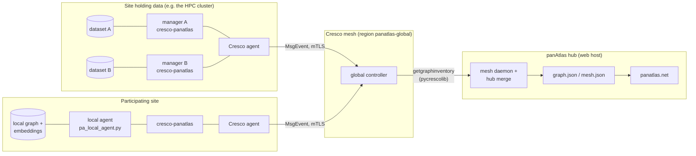

# panAtlas is a distributed system

panAtlas runs on [Cresco](https://crescoedge.github.io/docs/), the hierarchical agent mesh, and that matters more
than any other fact about how it is built. Shared infrastructure means **shared datasets and one global
understanding of them**: a dataset joins the atlas **where it sits, under its owner's control**, and from then on it
is known, linked and findable by every participant and every agent on the mesh. The data itself does not move.

This section explains how that works, from the mesh up.

## The idea in one picture

Only **structure** crosses the mesh: identifiers, counts, edges, model stamps and hashes. Documents, pixels,
embeddings and anything carrying protected data (protected health information, for example) or licensed text never
do. That rule is enforced
in code at three points (the report builder, the Cresco plugin and the hub merge), so a misconfigured source can
not leak.

## What is distributed

| Part | Where it runs | What it does | Status |
|---|---|---|---|
| **Dataset managers** | One `cresco-panatlas` plugin instance per dataset, on the Cresco agent at the site that holds the data | Serves that dataset's structure-only report (`getgraphmanifest`, `getgraphinventory`), stamped with its URN and `manifest_hash` | **Built, running.** Measured on the mesh: 22 (2026-07-31), 33 (2026-09-17), 65 (2026-09-20) |
| **Knowledge-graph agents** | One agent per mirrored NSF Open Knowledge Network graph (`okn_agent.py`), each also a registered dataset with its own manager | Tracks its upstream graph's version and provenance, syncs it independently, and declares its source of record | **Built.** 42 graphs on 2026-09-26, 43 from 2026-10-02 |
| **Participating agents** | Any Cresco node that joins the region and runs `cresco-panatlas`, usually with the local agent kit | Contributes its own grounded subgraph; trust tier and admin status decide whether it merges | **Built and documented.** No external site contributes yet |
| **The hub** | The web host's Cresco agent + `mesh_daemon.py` + the site | Pulls every manager's report over the control plane, shows datasets per node in the Mesh view, folds permitted contributions into the graph | **Built.** Pull runs every 15 s |
| **Supervision** | systemd units on the HPC cluster login node and the web host | Restarts wedged agents, re-adds missing managers, rebuilds manifests hourly | **Built**, with a guard for each of the six recorded outages; see [Operations](operations.md) |
| **Storage** | [GaiaKeep](https://gaiakeep.github.io/docs/), the global file system for agents, on the same mesh (storage core release 1.3, 2026-10-01) | The intended durable, versioned backend for panAtlas datasets; the panAtlas index estate is among the candidates for GaiaKeep's first real data | **GaiaKeep built; the panAtlas binding measured and designed, nothing stored yet**; see [Storage on GaiaKeep](storage.md) |

!!! note "What is built and what is designed"
    Every claim in this section says which it is. The **pull path** (hub → global controller → manager, over
    MsgEvent) is built, deployed and measured. The original HTTP submission endpoint (`POST /federate`), push
    change-notifications on the data plane, signed reports and hub-to-hub peering are **designed, not built**.
    [Federation](federation.md) lists each one.

## Why Cresco

panAtlas does not build its own transport, identity or trust. Cresco already provides:

- a `global → region → agent` hierarchy that rolls inventories up the tree;
- a certificate-bound identity for every node, admitted by an authenticated discovery exchange (a join secret in the
  standard profile, the operator's PKI in production), with mutual TLS on every broker connection;
- end-to-end, recipient-bound message authentication and signed plugin installs, on by default since the Cresco 1.3
  hardening;
- per-tenant isolation in the broker;
- a control plane (MsgEvent RPC) and a data plane (pub/sub topics);
- self-describing plugin actions that any client, or any AI agent, can call as tools.

Federation therefore needs only one plugin, `cresco-panatlas`, plus a hub-side client. The same mesh carries
GaiaKeep storage and other workloads, so a site that joins for one purpose can share datasets with the atlas with
no new infrastructure. [Cresco for panAtlas](cresco.md) explains the parts used.

## Reading order

1. [Cresco for panAtlas](cresco.md): the mesh concepts this design relies on.
2. [Federation model](federation.md): join keys, trust tiers, merge rules, what crosses the wire.
3. [Dataset managers](dataset-managers.md): one manager per dataset, the hub's pull loop, the Mesh view.
4. [Participating agents](agents.md): the plugin internals, the local agent kit, and how a new site connects.
5. [Wire contract and schemas](contract.md): every field of every message and file on the federation path.
6. [Operations](operations.md): supervision units, failure modes and recovery runbooks.
7. [Storage on GaiaKeep](storage.md): how the index estate binds to the archive on the same mesh.
