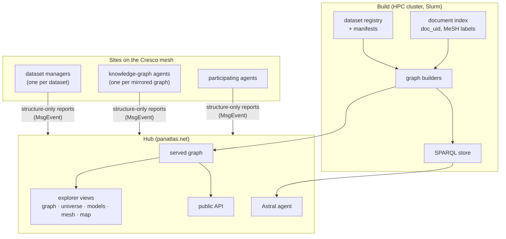

# panAtlas

panAtlas is a **reference atlas for multi-modal evaluation**, medicine first. It maps a domain as a
provenance-first knowledge graph that links concepts, datasets, models, their training curricula and the benchmarks
that measure them. With that map, an evaluation can say **where** in the domain it was measured, **on what** and
**for whom**, instead of reporting one context-blind number.

It is a **distributed system that runs on [Cresco](https://crescoedge.github.io/docs/)**. Every registered dataset
is managed by its own Cresco plugin running beside the data, at the site that holds it. The managers report
structure, never content, up the mesh to one atlas. Shared infrastructure therefore also means **shared datasets
and one global understanding of them**, while every dataset stays where it is, under its owner's control.

## What it is made of

| Part | One line | Read |
|---|---|---|
| Knowledge graph | Typed nodes and edges, every one with provenance; grounded in MeSH and other code systems | [Knowledge layers](concepts/layers.md), [Graph schema](metadata/graph-schema.md) |
| Dataset registry | Every dataset with a stable URN, location, modality, licence and an auditable `manifest_hash` | [Dataset registry](metadata/dataset-registry.md), [Manifests](metadata/manifests.md) |
| Document index | Content-hash identity (`doc_uid`) and MeSH labels for every document in the training estate | [Document index](metadata/document-index.md) |
| Evaluation layer | Benchmarks, results and model curricula: what each model was trained on, when, where and with what | [Benchmarks](metadata/benchmarks.md), [Evaluation records](metadata/evaluation-records.md), [Models and curriculum](metadata/models-and-curriculum.md) |
| Distributed layer | Cresco mesh, dataset managers, federation, supervision | [Distributed system](distributed/index.md) |
| Knowledge store | The panAtlas graph plus mirrored NSF Open Knowledge Network graphs, served over SPARQL | [Knowledge store](system/knowledge-store.md), [RDF vocabulary](metadata/rdf-vocabulary.md) |
| Site and API | panatlas.net: explorer views, ORCID sign-in, a public API and an agent interface | [The site](system/web-site.md), [Public API](system/public-api.md), [Astral](system/astral.md) |

## Principles

- **Provenance first.** Every fact says where it came from, and every number says when it was measured.
- **Describe once, evaluate many times.** A dataset, model or benchmark is described once, as metadata, and every
  evaluation refers to that description.
- **Blanks are tracked as rigorously as facts.** "We do not know what this model was trained on" is a recorded,
  comparable property, not a gap in a table.
- **Structure crosses the wire, content does not.** Federation carries identifiers, counts, edges and hashes.
  Documents, images and protected data never leave their site.
- **Comparable only within one space.** Embeddings are compared only within one registered `(modality, model,
  version)` space. Everything else joins through shared identifiers.

[Purpose and principles](concepts/purpose.md) has the full statement.

## Where to start

- **Understand the system:** [Architecture](concepts/architecture.md), then [Distributed system](distributed/index.md).
- **Connect a site or a dataset:** [Participating agents](distributed/agents.md) and
  [Wire contract](distributed/contract.md).
- **Use or extend the metadata:** [Metadata overview](metadata/index.md).
- **Run it:** [Build pipeline](system/build-pipeline.md) and [Operations](distributed/operations.md).

!!! note "How this documentation is kept honest"
    Each page says whether something is **built**, **measured** or only **designed**, and dates its numbers. Where
    a design document and the code disagree, the page describes what the code does and marks the difference with a
    warning. The sources are the panAtlas repositories (`ThePanAtlas/panatlas`, `cresco-panatlas`,
    `agent-deployment`) at the commit named in the page, plus the dated project record.
