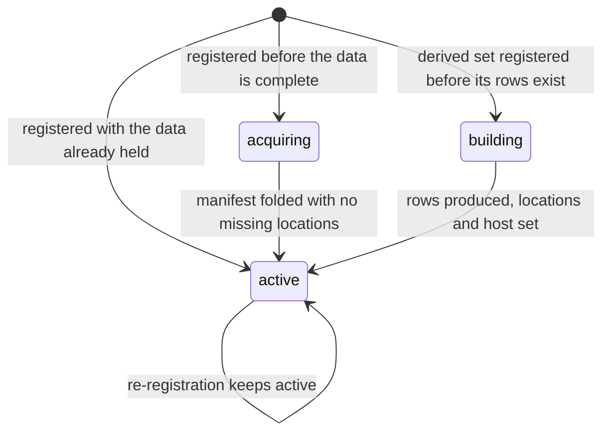

# Acquisition and licence

!!! info "Status"
    **Built:** the registry status field and its transitions, acquisition records, completion summaries,
    fold-in, the upstream licence table (`web/licence/licence_registry.json`), dataset-level licence fields,
    and the per-document licence columns on the estate document index (measured 2026-09-23 over 93,056,465
    rows). **Designed, not built:** the per-user, per-project entitlement layer for restricted data
    (`PLAN-restricted-data-umls.md` phases P2 to P6), and any training-set assembler that reads the
    per-document licence column. Registry counts are at repository HEAD `57505c6` (2026-10-31).

This page covers three kinds of metadata that decide what may be done with a dataset: where it is in its
lifecycle (status and acquisition records), what licence governs it (per dataset and per document), and who
may see it (access class and, for restricted data, entitlements).

## The status lifecycle

`status` on a registry entry has three values at HEAD:

| Status | Entries | Meaning |
|---|---:|---|
| `acquiring` | 46 | registered, data not yet held or not yet verified complete; `manifest` is `null` |
| `building` | 5 | a derived dataset whose rows do not exist yet; `locations` empty and `host` `null` so no manifest, report or manager is produced |
| `active` | 149 | data is held; the entry may have a manifest and a manager |

There is no `acquired` or `complete` top-level status. `complete` is a value of `acquisition.status`
(below). No code path moves an entry out of `active`: there is no retired, removed or superseded state, and
retired slugs are simply absent from the registry.



How each transition is made:

- **Registration** writes the initial status. Fragments for downloads (`web/datasets_renal.json`,
  `web/datasets_tcga.json`) arrive as `acquiring`; `web/register_openh.py` writes `acquiring` with
  `manifest: null` and keeps it until the download's `DONE` marker exists and its manifest is folded;
  `okn_agent.py describe` writes `active` when the graph's agent holds a verified version
  (`state.json` `current_version`), else `acquiring`.
- **Fold-in** (`web/fold_manifests.py` and its TCGA and renal predecessors) sets `status: active` only when the
  folded manifest's `missing_locations` is empty, and sets `acquisition.status: complete`. See
  [Manifests](manifests.md#where-manifests-are-computed).
- **Re-registration never demotes.** `register_fragment.py` and `register_tcga.py` keep `active` and the
  completed acquisition fields when an entry is already active; `register_openh.py` keeps `status` once a
  manifest exists; `register_okn.py` keeps an existing `manifest`, `linked_nodes` and `manifest_full_walk`.

State combinations in the registry at HEAD:

| `status` | `acquisition` | `manifest` | Entries |
|---|---|---|---:|
| acquiring | absent | `null` | 46 |
| building | absent | `null` | 5 |
| active | `status: complete` | summary | 67 |
| active | absent | summary | 54 |
| active | `{}` | summary | 6 |
| active | `{}` | `null` | 9 |
| active | `{}` | absent | 6 |
| active | object without `status` | absent | 5 |
| active | `status: complete` | `null` | 1 |
| active | free-text `status` | absent | 1 |

The 22 `active` entries without a manifest are model outputs, derived sets and evaluation suites registered
as active without a file walk (listed on [Dataset registry](dataset-registry.md#counts-at-head)).

!!! warning "OKN mirrors: registry says `acquiring`, the project record says served"
    All 46 OKN entries are `acquiring` with `source_of_record.held_version: null`. The project's dated record
    states that the local SPARQL store has served 44 OKN graphs, each proven to round-trip exactly, since
    2026-10-03. The registry entries were generated by `okn_agent.py describe` before those copies were held
    and have not been regenerated and re-merged (`register_okn.py`) since. Treat the OKN `status` and
    `held_version` fields as stale until `describe` is re-run.

The served catalog adds three status values that are not part of the registry lifecycle, on catalog-only
corpus entries: `listed` (228), `measured` (133), `on-disk` (61). See
[Dataset registry](dataset-registry.md#catalog-only-entries-and-fields).

## Acquisition records

`acquisition` is an object on 95 registry entries (21 of them `{}`). It records how the data was fetched and
when the fetch finished. Its fields are not fixed by a schema; this is the union at HEAD.

| Field | Present | Type | Meaning | Written by |
|---|---:|---|---|---|
| `status` | 69 | string | `complete` (68) or a free-text verification statement (1). Code also writes `pending` (`register_openh.py`, before download) and `incomplete` (`fold_renal_manifests.py`, when a location is missing); neither occurs at HEAD | fold scripts, registering scripts |
| `finished` | 68 | string | when the fetch finished; two formats occur: `YYYY-MM-DD HH:MM:SS` (cluster local time) and ISO 8601 with offset | fold scripts (from the completion summary) |
| `summary` | 57 | string | root-relative path of the completion summary used for the fold | `fold_manifests.py`, `fold_tcga_manifests.py` |
| `completion_summary` | 11 | string | the same, under the name `fold_renal_manifests.py` uses (one entry carries both keys) | `fold_renal_manifests.py` |
| `started` | 39 | date | fetch start | fragments, `register_openh.py` |
| `driver` | 34 | string | the fetch script (root-relative path) | fragments |
| `log` | 34 | string | the fetch log (for downloads, the shared estate log `data/sources_staging/_downloads/manifest.jsonl`) | fragments |
| `program` | 39 | string | the programme the data was acquired for | fragments |
| `vault` | 39 | string | knowledge-vault pages for the acquisition | fragments |
| `jobs` | 2 | list | `"<job> <purpose>"` strings | fragments |
| `source`, `revision` | 1 each | string | upstream repository and pinned revision | `register_arxiv.py` |
| `method`, `order`, `purpose`, `result`, `verification`, `completed`, `elapsed_s`, `estate_log` | 1 each | string or integer | transfer method, config order, why it was fetched, outcome, how files were verified, completion date, wall time, estate log path | fragments, `register_arxiv.py`, `register_openh.py` |

### Completion records

A completion summary is written by the fetcher or finaliser on the cluster when a download ends, and is the
input to fold-in. Three shapes are in use:

=== "Per-dataset manifests (renal)"

    `web/acquisition/renal/completion_summary.json` (repository mirror):

    | Key | Meaning |
    |---|---|
    | `finished` | finish time |
    | `manifests` | `{slug: {file_count, total_bytes, manifest_hash, missing_locations, computed_at}}` |
    | `log_tail` | the last fetch-log records: `{name, status, bytes, detail, t}` (80 records; `status` is `ok` 76, `start` 3, `partial` 1) |

    Recorded result: 10 manifests, 48,281 files, 6.86 TB, 0 missing locations, finished 2026-09-06 06:09:30.

=== "Per-dataset list (TCGA, default for `fold_manifests.py`)"

    | Key | Meaning |
    |---|---|
    | `finished` | finish time |
    | `datasets[]` | `{slug, file_count, total_bytes, missing, hash}` per dataset |

    Fold-in refuses a dataset whose manifest hash differs from `hash`.

=== "Whole download (OpenH-RF, `openh_fetch.py finish`)"

    | Key | Meaning |
    |---|---|
    | `repo`, `revision` | upstream repository and pinned revision |
    | `files`, `bytes` | files and bytes in the upstream tree |
    | `lfs_files_sha256_verified`, `git_files_sha1_verified` | files verified by each hash kind |
    | `n_missing_or_unverified`, `missing_or_unverified` | count and first 50 paths |
    | `partial_files` | count of `.part` / `.incomplete` files |
    | `extra_files` | first 50 files not in the upstream tree |
    | `checked` | when the check ran |

    `finish` writes a `DONE` marker (the summary plus `"verified": true`) only when nothing is missing,
    unverified, partial or extra. `fold_manifests.py` accepts this shape only under the same condition.

The per-file fetch log (`manifest.jsonl` on the cluster) is append-only JSON lines; the renal fetcher writes
`{name, status, …, t}` records. Its full schema is not in the repository.

### Verification at acquisition

Content is verified when data is acquired, against the publisher's own checksums, not by the manifest (which
does not read content; see [Manifests](manifests.md#honest-limits)). What each recorded acquisition verified:

| Acquisition | Verification recorded |
|---|---|
| OpenH-RF (2026-10-11 to 2026-10-15, jobs 231465 to 231468) | every one of 19,662 files against the pinned Hugging Face tree: sha256 for LFS files, git blob sha1 otherwise; mismatches deleted and refetched; `DONE` only at 19,662 of 19,662; 34 manifests, 0 missing locations |
| arXiv corpus | `acquisition.result`: all nine configs, 3,745 Parquet shards, 0 errors; 16.08 TB on disk matches the card |
| CPTAC-LUAD slides | `md5sum -c` against each package's own sums: 508 of 508 and 1,137 of 1,137 (jobs 220431, 220430) |
| TCGA slides | GDC data endpoint, md5-verified (`source_of_truth`) |
| OKN graphs | a graph is done only if its line count equals the endpoint's `COUNT(*)`, nothing is malformed and lines are distinct or the repeats are confirmed by the endpoint; `PROOF.json` records fingerprint, upstream, re-extraction and store round-trip checks (`web/acquisition/okn/README.md`) |
| UMLS 2026AA (job 237451, 2026-10-16) | every zip member CRC, the release's inner md5 files, and all 56 RRF files equal to the release's own file list in rows (392,875,930) and size; the fetch fails if any path is group- or world-readable |

## Licence metadata

### The rule: licence is recorded per document and applied late

Owner policy of 2026-09-23 (`web/licence/licence_registry.py` docstring; `web/estate_doc_index.py` docstring):

1. **Ingest is never gated by licence.** Register, manifest, federate and index first.
2. **The licence is a per-document attribute**, recorded at ingest on the estate document index.
3. **The licence is applied at two moments only**: when documents are shared outward, and when a training set
   is assembled. Both read the per-document column; neither is decided at ingest.

"Not training-eligible" is therefore never a reason to leave data out of panAtlas. Inclusion and training
eligibility are separate questions:

| Question | Where it is recorded | Decided when |
|---|---|---|
| Is the data in panAtlas? | the registry entry and its manifest | at registration |
| Did a model train on it? | registry `used_in_training`; the document ledger (`doc_uid` membership in V4/V5) | after training, from the training record |
| May it go into a training set? | per-document `license_*` columns on `estate_doc_index.parquet` (text); per-case governance columns such as `pretrain_eligible` and `held_out_eval` in a corpus's own case manifest (imaging) | at training-set assembly |
| May it be shared? | the same licence columns, plus the dataset's `access` class | at sharing |

!!! note "No assembler reads the licence column yet"
    At HEAD no repository script filters a training set or an export by `license_status` or `license_scope`.
    The column is recorded and measured; its use at assembly time is a rule for whoever builds the next mix.

### Upstream licence table

`web/licence/licence_registry.json` (built by `web/licence/licence_registry.py`, `checked: 2026-09-23`) is the
evidence layer. Each upstream records where its licence statement was read:

| Field | Meaning |
|---|---|
| `name` | upstream name |
| `license` | the licence as the source states it (empty when none is stated) |
| `license_id` | normalised id (SPDX where one exists, `custom-…`, `LicenseRef-…`, `MIXED`, or empty) |
| `basis` | `file:<root-relative path>` (a card or LICENSE shipped with our copy) or `web:<url>` (a primary page); several separated by ` ; ` |
| `status` | `verified` · `conflicting` (primary sources disagree; both recorded) · `not-found` (no statement where one should be; never guessed) · `internal` (generated inside the programme) |
| `note` | qualifications |
| `scope` | `dataset` · `document` (licence varies per document) · `derived` (outputs of a model or a mix) · `internal` |
| `checked` | date read |

At HEAD: 67 upstreams; status `verified` 48, `not-found` 10, `conflicting` 8, `internal` 1; scope `dataset` 57,
`document` 6, `derived` 3, `internal` 1.

The table also routes every estate source to its upstream:

| Route table | Form | Meaning |
|---|---|---|
| `pretrain` | `{source: "fixed:<upstream>" \| "pmc" \| "medrxiv" \| "medlineplus"}` | one upstream for every document of the source, or a per-document resolver |
| `leaf` | `{sft source: upstream}` | an SFT source whose every row has one upstream |
| `label` | `{row label prefix: upstream}` | upstream for an SFT row's own label; longest prefix wins |

!!! warning "Upstream count differs from the project record"
    The project's licence reference (2026-09-23) reports 66 upstreams (47 verified). The repository file at
    HEAD has 67 (48 verified). One verified upstream was added after that record; the per-document counts
    below are from the 2026-09-23 build and predate it.

### Dataset-level licence fields

Registry entries carry the licence of the dataset as a whole (field-by-field table on
[Dataset registry](dataset-registry.md#licence-fields)). `web/licence/apply_registry_licences.py` copies the
verified upstream record onto the 13 text-dataset entries whose slug maps to exactly one upstream, and writes
the PMC entry as `license_scope: document` with `license_id: PMC-OA-groups`. The nine `document`-scope
entries at HEAD are PMC, the arXiv corpus, DailyMed and six JK-Decide entries. OKN entries take the licence
their publisher declares (`license_status: declared-by-publisher`) or record `not-found`;
`upstream_licence_flag` marks three OKN graphs whose declared licence does not cover content they embed
(credentialed clinical relations, terminology identifiers, or third-party records).

Registry values at HEAD: `license_status` `verified` 46, `not-found` 25, `declared-by-publisher` 22,
`conflicting` 2, three free-text values; `license_scope` `dataset` 98, `document` 9.

### Per-document licence on the estate index

`estate_doc_index.parquet` (on the cluster, 93,056,465 rows; schema on [Document index](document-index.md))
carries six licence columns on every row. `web/licence/estate_licence_build.py` fills them:

| Column | Meaning |
|---|---|
| `tier` | `embedded` (from `master_doc_index.parquet`) or `reference` (arXiv, never embedded) |
| `license` | the licence text(s) of the resolved upstream(s), joined by ` \| ` |
| `license_id` | the upstream id(s), joined by ` \| `; for medRxiv the per-preprint code mapped to `CC-BY`, `CC-BY-NC`, `CC-BY-ND`, `CC-BY-NC-ND`, `CC0`, `CC0 (medRxiv cc0_ng)`, `no-reuse-licence` |
| `license_scope` | the upstream's scope; `mixed` when a row resolves to more than one upstream; `unknown` when the status is `not-found` or nothing resolved |
| `license_status` | the upstream's status; `conflicting` when more than one upstream; `not-found` if any resolved upstream is `not-found`; `unresolved` when no upstream was found |
| `license_upstream` | upstream key(s), joined by `\|` |
| `license_resolved_by` | how the upstream was found (table below) |

Resolution, in order, per row:

| `license_resolved_by` | Applies to | Rule |
|---|---|---|
| `source-route` | pretrain sources with a `fixed:` route | the source's single upstream |
| `pmc-record` | PMC | the NLM Open Access group (commercial, non-commercial, other) on the row's stage-3 record |
| `medrxiv-api` | medRxiv | the preprint's licence from the medRxiv API, by DOI |
| `medlineplus-url` | MedlinePlus | by URL path: encyclopedia and drug-information pages are copyrighted, the rest public domain |
| `sft-row-label` | SFT rows | the row's own upstream label |
| `sft-duplicate-trail` | SFT rows | the labels or leaf upstreams of every exact-duplicate copy (the dedup `dup_of` trail); precedence: a specific upstream, then an instruction-following mix, then programme-internal |
| `arxiv-metadata` | arXiv | `metadata.license` per paper; `document` + `verified` when present, `unknown` + `not-found` when null |
| (empty) | anything unresolved | `unknown` / `unresolved` |

Measured 2026-09-23 (`web/licence/estate_licence_rollup.json`):

| Measure | Rows |
|---|---|
| Total | 93,056,465 (embedded 89,907,669 · reference 3,148,796) |
| `license_status` | verified 85,128,342 · conflicting 3,117,740 · not-found 2,120,877 · internal 1,850,711 · unresolved 838,795 |
| `license_scope` | dataset 58,145,222 · document 27,920,759 · unknown 2,959,672 · derived 2,172,658 · internal 1,850,711 · mixed 7,443 |
| `license_resolved_by` | source-route 54,112,889 · pmc-record 23,585,101 · sft-duplicate-trail 6,585,363 · arxiv-metadata 3,148,796 · sft-row-label 3,140,952 · medrxiv-api 1,643,554 · (empty) 838,710 · medlineplus-url 1,100 |
| Largest `license_id` values | PMC-OA-commercial 16,046,523 · PhysioNet-CHDL-1.5.0 14,968,249 · custom-NLM-PubMed-terms 14,333,458 · ODC-By-1.0 7,906,368 · PMC-OA-noncommercial 6,357,130 · CC-BY-4.0 5,817,067 |
| Largest `unknown` sources | dailymed 1,604,636 · arxiv_complete 452,715 · several SFT mixes (332,401; 293,620; 126,808; …) |

A row count is not a document count for chunked sources: PMC's 23,585,101 rows are 7,420,701 articles.

!!! warning "Two builders write `estate_doc_index.parquet` with different schemas"
    `web/estate_doc_index.py` (built 2026-09-23 09:13, per `web/estate_doc_rollup.json`) writes six columns,
    `doc_id, source, role, tier, license, license_scope`, with `license_scope` in `{document, dataset,
    unrecorded}`; it found no registry licence string for any embedded source, so all 89,907,669 embedded rows
    were `unrecorded`. `web/licence/estate_licence_build.py` (built 2026-09-23 21:50) overwrites the same file
    with the full schema and a different scope vocabulary (`dataset, document, unknown, derived, internal,
    mixed`). The second build is the current file. The policy text still describes the first vocabulary.
    Re-running `estate_doc_index.py` would silently replace the licence columns with the older, poorer ones.

## Restricted data

### Access classes today

Every registry entry has an `access` class (values and counts on
[Dataset registry](dataset-registry.md#access)). Restricted classes at HEAD: `restricted` 16,
`credentialed-phi` 3, `credentialed` 2, `institutional` 2, `registered (Kaggle account, competition rules
accepted)` 1, `restricted (in-house training data)` 1, `mixed (per member)` 1.

The rule today is all-or-nothing: restricted datasets are **catalogued as metadata only and never served**.
Their registry metadata is visible; their data is not available through panAtlas at all. The public API
(`web/wp-plugin/panatlas-explorer/includes/public-api.php`) is anonymous and rate-limited per client per
minute; its dataset routes return a fixed whitelist of metadata fields for every catalog entry, restricted
ones included, with cluster paths and job numbers scrubbed from strings. The Astral assistant attaches a
"metadata only" note to every non-`public` record. The explorer's full graph and catalog views are gated by
an identity allowlist (`PLAN-restricted-data-umls.md` §1, 2026-10-11). No per-user or per-project control
exists.

### The entitlement model (designed)

`PLAN-restricted-data-umls.md` designs a restricted-data layer, with the UMLS Metathesaurus as its first
dataset and the same layer intended for every later restricted dataset. Only the licence-fact and
acquisition phases are done.

| Phase | Work | State |
|---|---|---|
| P0 | licence facts | **done** 2026-10-11 |
| P1 | acquire the release in a Slurm job, verify it, restrict the directory | **passed** 2026-10-16 (job 237451): release 2026AA |
| P2 | load verbatim into a separate restricted SPARQL store, one named graph per source restriction level | next; not built |
| P3 | entitlement registry, enforcement in the SPARQL client, audit log | designed |
| P4 | internal relations with provenance; promotion of SRL-0-only edges to the public graph | designed |
| P5 | explanations for entitled users, with the licence notice | designed |
| P6 | compliance: acknowledgement with year and version, annual report, notice before distribution | designed |

The design's metadata, without any restricted content:

**Entitlement registry** (`restricted/entitlements.json`, private, on the cluster only, never in the public
repository or on the web host):

```text
users:     <identity> -> {name, institution, uts_account: yes/no + date checked, grants: [...]}
projects:  <id>       -> {title, purpose, members: [<identity>], datasets: [urn], allowed_srl: [0,1,2,3], expires}
datasets:  urn        -> {licence, terms_section_refs, notice_text, max_srl_by_institution, us_only: [SAB...]}
```

**Access predicate.** A user may read a restricted graph only if all hold: the user is a member of a project;
the project lists the dataset; the user's own grant allows that source restriction level; for the most
restrictive category, the user belongs to the licensee's institution; for the US-only category, the use is in
the US. The default is deny, and every grant carries dates so it can be audited.

**Per-fact provenance.** Every loaded triple is tagged with its source vocabulary and the source restriction
level (SRL) read from the release's own source table, not from a hand-made list, and keeps the release's
concept, atom and relation identifiers so the source of every fact can be traced. Relations panAtlas derives
go in a separate derived graph and record the identifiers, sources and highest SRL they depend on; only edges
derived from SRL-0 sources alone may be promoted to the public graph.

**Licensing obligations recorded as metadata:** acknowledgement of the source with year and version on every
derived record and answer; a notice and source list shown before a user first sees restricted content; an
annual usage report; notice to the licensor before any application using the data reaches anyone outside the
licensee.

!!! warning "Directory mode differs from the plan"
    The plan specifies a group of licensed users with mode 0750. The acquisition (P1) made `restricted/`
    mode 0700, readable by the licensee's account only, because the licence is held by one individual and
    only that individual holds a licensor account. Wider access waits on each additional user holding their
    own licence.

!!! danger "What never appears in panAtlas outputs"
    No restricted release content (terms, definitions, synonym strings, relation rows) is published,
    committed, logged or placed in the public graph or catalog. `PLAN-restricted-data-umls.md` §7 calls for a
    regression test asserting that no restricted graph IRI, restricted string or definition text appears in
    the public `graph.json` or catalog; that test is designed, not built. There is no registry entry for the
    restricted release at HEAD.

The codes panAtlas already shows on concepts (concept identifiers and cross-codes obtained through the
licensor's lookup service) are covered on [Code systems](codesystems.md).

Related pages: [Dataset registry](dataset-registry.md), [Manifests](manifests.md),
[Document index](document-index.md), [Identifiers](identifiers.md), [Code systems](codesystems.md).
