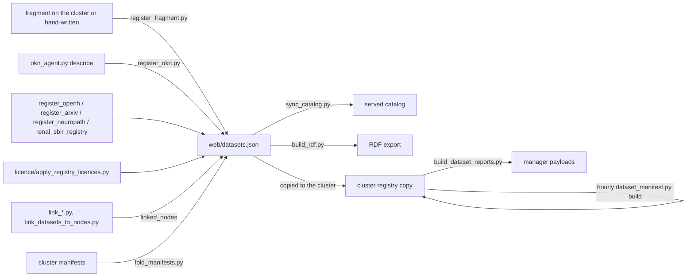

# Dataset registry

!!! info "Status"
    **Built and in use.** The registry is `web/datasets.json` (schema `panatlas.datasets/1`). Every count on
    this page was computed with `python3` over the repository at HEAD `57505c6` (2026-10-31) by walking all
    `web/datasets*.json` files and enumerating every key path. Nothing here is projected. Field meanings come
    from the scripts that write and read each field; where no script defines a value set, the page says so.

The registry is the authoritative list of datasets in the panAtlas federation. One entry describes one
dataset, identified by its URN ([Identifiers](identifiers.md#dataset-urn)) and audited by its manifest
([Manifests](manifests.md)). Each entry is also the configuration source for that dataset's manager plugin
([Dataset managers](../distributed/dataset-managers.md)).

## Files and how they merge

There are three kinds of registry file. They share one entry schema.

| File | Role | Entries at HEAD |
|---|---|---:|
| `web/datasets.json` | **The registry.** Every registered dataset, each once. All tooling reads this file. | 200 |
| `web/datasets_*.json` | **Fragments.** A batch of entries produced by one acquisition or programme, kept beside the registry as the record of what that batch registered. | 65 (subset of the 200) |
| `web/wp-plugin/panatlas-explorer/data/datasets.json` | **The served catalog.** The registry plus catalog-only entries and catalog-only fields, read by the site's Datasets view, the public API and the Astral assistant. | 622 |

A cluster-side copy of the registry also exists in `<cluster project storage>/panatlas/datasets.json`. It holds
only the entries hosted on the HPC cluster that have managers (22 at first registration, 66 on 2026-09-17 per
the project record). The hourly manifest refresh rewrites that copy, not the repository file; see
[Manifests](manifests.md#where-manifests-are-computed).

### Fragments

Every fragment URN is also in `web/datasets.json`; the union of all nine files is exactly the 200 registry
URNs. Fragments are merged by upsert keyed on `urn`:

- `web/register_fragment.py <fragment.json>` (general) and its predecessor `web/register_tcga.py`. New URNs are
  appended. For existing URNs the fragment entry replaces the registry entry, except that `manifest` and
  `linked_nodes` are kept from the registry when set, and, if the registry entry is already `active`, its
  `status` stays `active` and its `acquisition.status`, `acquisition.finished` and `acquisition.summary` are kept.
  The script then copies the fragment to `web/<basename>` (it never overwrites another fragment's copy) and
  asserts no duplicate URN.
- The fold scripts (`web/fold_manifests.py`, `web/fold_tcga_manifests.py`, `web/fold_renal_manifests.py`) write
  manifest and status updates into `web/datasets.json` and into fragments that carry the dataset.

| Fragment | Entries | Status at HEAD | With manifest | Purpose (from the fragment's `meta`) |
|---|---:|---|---:|---|
| `web/datasets_bench.json` | 4 | 4 active | 3 | benchmark datasets for the WSI embedding-stack study |
| `web/datasets_fm_suite.json` | 6 | 6 active | 0 | predictor (tabular / time-series) evaluation suite, registered 2026-10-28 |
| `web/datasets_jkdecide.json` | 13 | 8 active, 5 building | 0 | JK-Decide decision-model programme |
| `web/datasets_kos_v6.json` | 2 | 2 active | 0 | V6 model lineage: training input and evaluated outputs |
| `web/datasets_renal.json` | 10 | 10 active | 10 | renal-biomarker acquisition, 2026-09-04 |
| `web/datasets_stack_embeddings.json` | 11 | 11 active | 0 | tile embeddings derived for the WSI embedding-stack study |
| `web/datasets_tcga.json` | 17 | 17 active | 17 | TCGA slide-truth acquisition, 2026-09-17 |
| `web/datasets_tcga_slides.json` | 2 | 2 active | 2 | TCGA diagnostic and tissue whole-slide images |

!!! warning "Fragments drift from the registry"
    At HEAD, 48 of 65 fragment entries are identical to their registry entries. The other 17 differ only in
    fields filled after registration: all 17 lack the `acquisition` key that the registry carries as `{}`
    (6 predictor-suite, 5 JK-Decide and 6 embedding-stack entries), and the 6 embedding-stack entries also
    have no `manifest` while the registry has one. Fragments are a historical record of a batch. Read
    `web/datasets.json` for current state.

The fragment top-level block is `meta` with keys `schema`, `description`, `host_default`, `root_default`,
`measured`, `manifest_tool`, `models_registry`, `benchmark_field`, `subset`, `program`, `fragment`, `created`,
`updated`, `acquisition_driver`, `acquisition_log`, `vault` (each fragment carries a subset). One fragment,
`web/datasets_kos_v6.json`, uses top-level `schema` and `note` instead of `meta`.

### The registry's `meta` block

| Key | Meaning |
|---|---|
| `schema` | `panatlas.datasets/1` |
| `description` | one entry per dataset = one manager plugin instance; the URN is the global handle; audit = recompute the manifest over `locations[]` and diff `manifest_hash` |
| `host_default` | the HPC cluster host that holds most datasets |
| `root_default` | the estate root on that host; every relative `locations[]` path resolves against it (`web/dataset_manifest.py` uses it when `--root` is absent) |
| `measured` | `2026-07-30`, the date of the first inventory |
| `manifest_tool` | `web/dataset_manifest.py` |
| `models_registry` | `web/models.json` |
| `benchmark_field` | the definition of the `benchmark` field (see below) |

## Counts at HEAD

| Measure | Value |
|---|---|
| Entries | 200 |
| `status` | active 149 · acquiring 46 · building 5 |
| Entries with a manifest summary | 127 (61 have `manifest: null`, 12 have no `manifest` key) |
| Active entries without a manifest | 22 (JK-Decide and JevBench 7, predictor suite 6, derived embedding sets 5, V6 lineage 2, DailyMed 1, CPTAC-LUAD 1) |
| Files and bytes under the 127 manifests | 993,790 files · 123,417,710,829,304 B (123.4 TB) |
| Manifests computed between | 2026-07-31 and 2026-10-15 (the repository holds snapshots; see [Manifests](manifests.md)) |
| Distinct top-level keys | 78 |
| Distinct key paths (all nesting levels, list elements counted separately) | 1,103 |

The 46 `acquiring` entries are all OKN knowledge-graph mirrors; see
[Acquisition and licence](acquisition-and-licence.md#the-status-lifecycle).

## Field reference

**How to read the tables.** *Present* is the number of the 200 registry entries that carry the key (an entry
whose value is `null` counts as present). *Required* means present in all 200; no JSON Schema enforces it, but
every tool assumes it. *Writes* names repository scripts that set the field; "fragment" means the value
arrives in a fragment produced outside this repository (on the cluster, or hand-written) and is merged by
`register_fragment.py`. *Reads* names consumers. Every field is also copied into the served catalog by
`web/sync_catalog.py` and into the RDF export where noted. `public-api.php` is
`web/wp-plugin/panatlas-explorer/includes/public-api.php`; its `/datasets/{slug}` route serves only a fixed
whitelist of fields (marked **API**).

### Identity and description

| Path | Type | Present | Meaning | Values / example | Writes | Reads |
|---|---|---:|---|---|---|---|
| `urn` | string | 200 (required) | global dataset handle | `panatlas:dataset:ct-rate` | every registering script | every tool; upsert key; **API** |
| `slug` | string | 200 (required) | URN suffix; file and node stem | `ct-rate` | every registering script | every tool; **API** |
| `name` | string | 200 (required) | human title, often with scale in it | `KiTS23 kidney tumor segmentation challenge (CT + kidney/tumor/cyst masks)` | registering scripts | reports (`label`), RDF `dct:title`, **API** |
| `modality` | list of string | 200 (required) | data types the dataset contains; 27 distinct values (table below) | `["imaging-ct", "text", "structured"]` | registering scripts | reports (modality nodes), manager config `panatlas_modalities`, RDF, **API** |
| `modality_detail` | string | 176 | free-text description of what the modality holds | `chest CT (3D volumes -> per-slice RAD-DINO)` | registering scripts, `okn_agent.py` (first 600 characters of the upstream description) | catalog `desc` default, **API** |
| `modalities_detail` | object `{modality: string}` | 1 | per-modality description (CT-RATE only) | keys `imaging-ct`, `text`, `structured` | hand-written | **API** |
| `kind` | string | 9 | what sort of record the entry is, where it is not plain data | `external-benchmark` 3 · `model-evaluation-output` 2 · `benchmark-task-suite` 2 · `collection` 1 · `model-training-input` 1 | fragments | **API** |
| `owner` | string or null | 200 (19 null) | who owns the data: an upstream organisation or the producing group | `NCI Genomic Data Commons (TCGA program; external, open access)` | registering scripts; OKN entries from the upstream contact label | **API**, Astral |
| `owner_contact` | string or null | 50 (19 null) | contact for the owner (OKN entries copy the upstream contact) | a URL or address | `okn_agent.py`, `register_openh.py`, `register_arxiv.py`, `register_neuropath.py` | none in code |
| `citation` | string | 77 | how to cite the dataset | `Heller et al., KiTS23 (kits-challenge.org/kits23)` | registering scripts | **API** |
| `vault` | string | 104 | pointer to the project knowledge-vault pages for this dataset | `<vault>: <page>, <page>` | registering scripts | `sync_catalog.py` (`vault_page` default) |
| `notes` | string or list | 7 | free-text notes | | fragments | none |
| `why` | string | 1 | why the dataset was acquired | | fragment | none |
| `open_questions` | list of string | 1 | unresolved questions about the data | | fragment | none |
| `caveats` | list of string | 1 | known defects of the corpus (arXiv) | | `register_arxiv.py` | **API** |

### Location and hosting

| Path | Type | Present | Meaning | Values / example | Writes | Reads |
|---|---|---:|---|---|---|---|
| `locations` | list of string | 200 (required; 5 empty) | files or directories that make up the dataset, relative to the estate root (absolute paths are allowed: 8 paths in 2 entries) | `["data/sources_staging/kits23/raw/kits23"]` | registering scripts | `dataset_manifest.py` (the manifest walk), `link_renal.py` |
| `host` | string or null | 200 (5 null) | host that holds the data; `null` means the data does not exist yet | the cluster host 194 · the web host 1 · `null` 5 | registering scripts | `build_dataset_reports.py --host` filter, RDF, manager deployment |
| `host_note` | string | 6 | why the host is what it is (or null) | `rows not produced yet; …` | fragments | none |
| `disk_owner` | string | 2 | storage project that owns the files, when outside the estate root | | hand-written | none |
| `id_namespace` | string | 194 | prefix that scopes item ids of this dataset | `ctrate:` | registering scripts | `build_layered.py`; see [Identifiers](identifiers.md#item-namespaces-and-item-ids) |
| `source_of_truth` | string | 134 | the file or upstream record that is authoritative for this dataset's contents and counts | `data/sources_staging/kits23/raw/kits23 (raw pull; counts from the source API on 2026-09-04 …)` | registering scripts | none |
| `plan_docs` | list of string | 1 | planning documents for the dataset | | hand-written | none |

An empty `locations` list together with `host: null` is deliberate. The five `building` JK-Decide entries use
it to stay out of manifests, manager reports and manager deployment until their rows exist; their
`audit_scope` notes that an empty `locations` list on the cluster copy alone would let `fold_manifests.py`
flip the entry to `active`.

### Role, split and benchmark flags

| Path | Type | Present | Meaning | Values / example | Writes | Reads |
|---|---|---:|---|---|---|---|
| `role` | string | 179 | how panAtlas uses the dataset (13 values, table below) | `reference` | registering scripts | RDF, `mesh_daemon.py` |
| `split_role` | string | 195 | what this entry is relative to a train/eval split | `canonical` | registering scripts | **API** |
| `benchmark` | boolean or object | 177 | `true`: a pure-evaluation dataset with no training portion. Absent: not a benchmark. Object: a verified benchmark record (below) | `false` 149 · `true` 17 · object 11 | registering scripts | `sync_catalog.py` (`dtype`), **API** |
| `benchmark.basis` | string | 11 | why the dataset is flagged a benchmark | `flagged benchmark because 100% of its cases are held out …` | hand-written | none |
| `benchmark.node` | string | 11 | the graph node of the benchmark | `bench-<slug>` | hand-written | none |
| `benchmark.suite` | string | 11 | the published suite it belongs to | | hand-written | none |
| `benchmark.task` | string | 11 | the evaluated task | | hand-written | none |
| `benchmark.tests` | list of string | 11 | what the benchmark tests (concept or specialty names) | | hand-written | none |
| `benchmark.evaluates` | list of string | 11 | specialties evaluated | `["Radiology", "Cardiology"]` | hand-written | none |
| `benchmark.held_out` | string | 11 | the held-out fraction and how it was established | `954/954 cases held out …` | hand-written | none |
| `benchmark.split_col` | string or null | 11 (10 null) | column in the source manifest that carries the split | `spie_split` | hand-written | none |
| `benchmark.status` | string | 11 | verification state of the benchmark claim | `verified` 9 · `needs-verification` 2 | hand-written | none |
| `used_in_training` | boolean | 59 | whether panAtlas models trained on this dataset | `false` 58 · `true` 1 | `okn_agent.py`, `register_arxiv.py`, fragments | RDF, **API** (the catalog's own value wins; see below) |
| `audit_scope` | string | 46 | what the hourly manifest covers when it is not the whole dataset, and why | `hourly manifest over the partition inventory file; …` | `register_neuropath.py`, `register_arxiv.py`, hand-written | none (documentation for auditors) |

!!! warning "`benchmark` is documented as a boolean"
    `meta.benchmark_field` describes `benchmark` as an optional boolean. Eleven entries carry an object
    instead. Code that tests `if d.get("benchmark")` (for example `sync_catalog.py`) treats the object as
    true, which is the intended reading.

### Modality, embedding and grounding

| Path | Type | Present | Meaning | Values / example | Writes | Reads |
|---|---|---:|---|---|---|---|
| `embedding_models` | object | 166 (12 are `{}`) | the embedding space used for each data stream | `{"imaging-ct": "imaging-rad-dino-ct@raddino", "text": "text-bioclinical-modernbert-large@v3w"}` | registering scripts | `build_dataset_reports.py` (model nodes, `panatlas_model.<modality>`) |
| `embedding_models.<modality>` | string `model@version` or null | 148 entries | one space per modality; `null` = no encoder registered yet | keys: `knowledge-graph` 46 · `imaging-ultrasound-rf` 34 · `imaging-ct` 33 · `text` 31 · `structured` 5 · `imaging-wsi` 2 · `imaging-cxr` 1 · `imaging-mr` 1. Values: `null` 101 · `imaging-rad-dino-ct@raddino` 33 · `text-bioclinical-modernbert-large@v3w` 18 · `text-bioclinical-modernbert-large` 1 | | |
| `embedding_models.<encoder>` | object | 6 entries | per-encoder record for pathology tile embeddings, keyed by encoder name (an entry may list several encoders) | keys `prov-gigapath` 5 · `phikon-v2` 4 · `virchow2` 4 · `uni2-h` 3 · `h-optimus-0` 3 · `gigapath`, `phikon_v2`, `uni_v2`, `hoptimus0` 1 each | `datasets_stack_embeddings.json` and `datasets_tcga.json` fragments | `build_dataset_reports.py` serialises it as compact JSON |
| `embedding_models.<encoder>.tile_dim` | integer | | output dimension | `1024`, `1536`, `2560` | | |
| `embedding_models.<encoder>.levels` | list | | `tile` and/or `slide` | | | |
| `embedding_models.<encoder>.source` | string | | upstream model repository | `owkin/phikon-v2` | | |
| `embedding_models.<encoder>.token` | string | | which output token was kept | `CLS`, `pooled`, `CLS\|\|mean-patch-tokens` | | |
| `embedding_models.<encoder>.norm` | string | | input normalisation | `imagenet`, `h-optimus` | | |
| `embedding_models.<encoder>.precision` | string | | inference precision | `fp32`, `fp16` | | |
| `embedding_models.<encoder>.eval_transform` | string | | image transform at inference | `Resize(224)/CenterCrop(224)` | | |
| `embedding_models.<encoder>.input_convention` | string | | tiling pipeline the features were computed under | `trident (refreshed 2026-09-18, job 220280)` | | |
| `embeddings` | object | 1 | a materialised embedding store that is a retrieval asset, not a grounding path | keys `model`, `cache`, `count`, `materialized`, `shape`, `id_scheme`, `role`, `catalog` | hand-written | none |
| `grounding` | string | 160 | how the dataset links to the concept substrate, in prose | `mesh+umls (radiology report side); RAD-DINO CT space (volume side); …` | registering scripts | `build_dataset_reports.py` (vocabulary nodes: it searches the text for `mesh`, `umls`, `foodatlas`, `fdc`, `nacc`, `v628`; none found = `ungrounded`), **API** |
| `node_linkage` | string | 1 | how items link to graph nodes | | hand-written | none |
| `linked_nodes` | list | 130 | graph nodes this dataset is linked to, as summarised for the catalog card | `[{"id": "concept-radiology", "label": "Radiology", "via": "modality"}]` | `link_datasets_to_nodes.py`, `link_renal.py`, `link_neuropath.py`, `link_openh.py`, `build_artifact_types.py` | catalog card, Astral, **API** |
| `linked_nodes[].id` | string | 339 items | graph node id | | | |
| `linked_nodes[].label` | string | 339 items | node label at link time | | | |
| `linked_nodes[].via` | string | 339 items | why the link exists (table below) | `metadata` | | |
| `artifact_type_ids` | list of string | 11 | artifact types (`atype-*` nodes) the dataset contains | `["atype-typed-decision"]` | `build_artifact_types.py`, fragments | catalog |
| `ontology_alignment` | object | 1 | field-by-field alignment of a native corpus manifest to FHIR resources and terminologies | keys `_intent`, `patient`, `imaging_study`, `acquisition_params`, `findings`, `report_text`, `anatomy`, `scores`, `provenance_only` | hand-written | none |
| `structure` | object | 1 | column groups of a 66-column case manifest | keys `record`, `identity[]`, `acquisition[]`, `demographics[]`, `clinical[]`, `derived_qc_masks[]`, `governance_splits[]` | hand-written | none |

`linked_nodes` contains one bare string (`dataset-dailymed`) instead of an object. Of the 339 object items,
277 name a node that exists in the served graph at HEAD; 62 do not. The linkers only add a link when the target
exists, so the 62 were valid when written and their targets have since been removed or renamed.

**Strata axes.** The registry has no top-level strata field. The one place stratification keys appear is
`structure.governance_splits` on the CT native corpus entry: `role`, `split`, `held_out_eval`,
`pretrain_eligible`, `ctrate_split`, `rex_split`, `nlst_split`, `native_split`, `native_split_provenance`,
`split_status`, `spie_split`, `strata_key`. These name columns of that corpus's case manifest, not registry fields.

### Scale

| Path | Type | Present | Meaning | Writes | Reads |
|---|---|---:|---|---|---|
| `scale` | object | 199 | measured or declared counts, one key per measure | registering scripts, fragments | `build_dataset_reports.py` (`item_count`: the first of `volumes`, `studies`, `entities`, `foods`, `worklist_cases`, `axial_cases`, `papers`), Astral, **API** |

`scale` has no fixed schema: 149 distinct keys occur. The most common are `files` (60), `bytes` (58),
`distinct_subjects`, `properties`, `triples_held`, `triples_upstream` (46 each, the OKN mirrors), `patients`
(40), `hdf5_files` (34), `cases` (32), `embeddings_present`, `eval`, `held_out_eval`, `train_ssl` (31 each, the
CT partitions), `bytes_human` (16), `records_basis` (14), `encoders` (10).

??? note "All 149 `scale` keys with entry counts"
    `files` (60), `bytes` (58), `distinct_subjects` (46), `properties` (46), `triples_held` (46),
    `triples_upstream` (46), `patients` (40), `hdf5_files` (34), `cases` (32), `embeddings_present` (31), `eval`
    (31), `held_out_eval` (31), `train_ssl` (31), `bytes_human` (16), `records_basis` (14), `encoders` (10),
    `records` (7), `records_planned` (6), `series` (6), `tasks` (6), `images` (5), `slides` (5), `wsis` (5),
    `bytes_expected` (4), `kinds` (4), `domains` (3), `nuclei` (3), `projects` (3), `studies` (3), `rois` (2),
    `specs_default` (2), `splits` (2), `svs_files` (2), `templates` (2), `tiles` (2), and one entry each:
    `abnormality_findings`, `anchor_pool_measured`, `anchored_documents_planned`, `by_task`,
    `bytes_total_excl_pdf`, `bytes_total_with_pdf_card`, `bytes_v11`, `bytes_v12`, `card_quantification`,
    `cases_manifest`, `cases_test_manifest`, `cases_test_withheld`, `cases_train`, `cases_train_manifest`,
    `catalog_files`, `classes`, `classes_flat`, `cohorts`, `combined_dia_cases`, `configs`,
    `count_reconciliation`, `datasets`, `date_range`, `decontam`, `discovery_phospho_bytes`,
    `discovery_proteome_bytes`, `discovery_proteome_files`, `docs`, `documents_planned`, `entities`,
    `estate_tasks`, `files_atec23`, `files_panda`, `files_tcga_wm`, `foods`, `groups`, `host_measured`,
    `hovernet_files`, `in_ct_corpus`, `jevbench_items_per_run`, `jevbench_per_item_runs`, `lfs_files`,
    `lifecycles`, `magnifications`, `manifest_files_v12`, `manual_patches`, `medical_share_non_probe_pool`,
    `methylation`, `mix_v1_rows`, `mix_v1_rows_planned`, `mutation_maf`, `native`, `openml_tasks`,
    `page_images`, `page_subjects_radiology`, `papers`, `parquet_shards`, `pathology_reports`, `patients_note`,
    `patients_v11`, `patients_v12`, `phases`, `pool_files_expected`, `pool_rows`, `probe_rows`,
    `problems_basis`, `problems_by_dataset`, `problems_measured`, `provgigapath_files`, `qc_cases`,
    `records_expected_pool`, `records_expected_probe`, `records_planned_outside_pool_runner`, `regions`,
    `regions_malignant`, `regions_nonmalignant`, `reports`, `requests_per_spec`, `rnaseq_gene_quant`, `roles`,
    `rows_total_excl_pdf`, `rppa`, `samples`, `samples_gse53757`, `schema_version`, `series_cdc_ilinet`,
    `series_cdc_nhsn_resp`, `series_mimic_ed_vitals`, `site_institutions`, `site_measurements`, `slices`,
    `slices_train`, `smoke_rows_measured`, `source_lines`, `sources`, `subsets`, `test_by_class`, `test_cores`,
    `test_tiles`, `tiers`, `tile_rows_flat_test`, `tile_rows_flat_train`, `tiles_per_slide_cap`, `tokens`,
    `train_by_class`, `train_tiles`, `uuid_named_slides_v12`, `volumes`, `wsis_test_tiled`, `wsis_tiled`,
    `wsis_total`, `wsis_train_tiled`, `wsis_v11`, `wsis_v12`.

Treat `scale` as a measured-facts bag. By key, 117 keys hold integers, 12 hold strings (for example
`bytes_human`, `records_basis`, `patients_note`, `date_range`), 19 hold nested objects (for example `by_task`,
`phases`, `train_by_class`), one holds a list (`magnifications`) and one a float. The four OKN keys
(`triples_held`, `triples_upstream`, `distinct_subjects`, `properties`) are strings or `null` when upstream
publishes no count, so do not sum them without a type check.

### Relationships between entries

| Path | Type | Present | Meaning | Values / example | Writes | Reads |
|---|---|---:|---|---|---|---|
| `part_of` | string (URN) | 44 | the parent collection this entry is a component of | OpenH-RF subsets → `panatlas:dataset:openh-rf` (33); JK-Decide components → `panatlas:dataset:jk-decide` (10); 1 other | `register_openh.py`, `register_neuropath.py`, fragments | `sync_catalog.py` (`part_of_corpus`) |
| `corpus` | string | 64 | the corpus this entry belongs to, with a description | starts with `panatlas:dataset:openh-rf` (33) or `panatlas:dataset:heartlens-ct3d-native (CT foundation corpus; …)` (31) | `register_openh.py`, hand-written | Astral |
| `members` | list of URN | 2 | the components of a collection entry | the CT native corpus and OpenH-RF corpus entries | hand-written, `register_openh.py` | none |
| `partition_of` | string (URN) | 31 | the corpus this entry is an exact on-disk partition of | `panatlas:dataset:heartlens-ct3d-native` | hand-written (no repository script) | none |
| `partition_path` | string | 31 | the partition's directory (for one entry, directory + an embedding directory) | `vision_encoder/data/heartlens_ct3d_native/cases/nlst` | hand-written | none |
| `partitions` | object | 1 | on the parent: `note`, `sources` (32) | | hand-written | none |
| `derived_from` | list of URN | 17 | datasets this entry was computed from | `["panatlas:dataset:hest-bench"]` | fragments | none in code (see the dangling-URN warning in [Identifiers](identifiers.md#dataset-urn)) |
| `corpus_membership` | string or list | 2 | training corpora this dataset entered | `["KOS-V5"]` | hand-written | Astral, **API** |
| `models_trained` | list of string | 2 | models trained on this dataset | | hand-written | **API** |
| `models` | list of string | 1 | model nodes whose outputs this entry holds | `["model-kos-v6", …]` | fragment | none |
| `models_registry` | string | 1 | pointer into `web/models.json` | `web/models.json predictors` | fragment | none |
| `benchmarks` | list of string | 2 | benchmark node ids evaluated on or produced from this dataset | | hand-written | none |
| `harness` | string | 2 | evaluation harness used | | hand-written | none |
| `external_sources` | string | 2 | upstream identifiers of externally sourced tasks (OpenML ids) | | fragment | none |

### Provenance and contamination

| Path | Type | Present | Meaning | Writes |
|---|---|---:|---|---|
| `provenance` | object (24) or list (1) | 25 | how a derived dataset was produced | fragments, `register_openh.py` |
| `provenance.producer` | string | 23 | producing script(s) | |
| `provenance.computed` | string | 23 | date computed | |
| `provenance.program` | string | 17 | programme that commissioned it | |
| `provenance.inputs` | string or list | 10 | inputs read | |
| `provenance.dry_run_outputs[]` | list of objects | 10 | trial outputs with `path`, `rows`, `files`, `bytes`, `sha256`, `note` | |
| `provenance.builder` | string | 8 | builder id with commit, e.g. `jkdecide.pool_runner@1+<sha>` | |
| `provenance.jobs[]` / `provenance.job` | list / string | 6 / 2 | Slurm jobs that produced it | |
| `provenance.input_convention` | string | 5 | input preprocessing convention | |
| `provenance.harness` | string | 2 | evaluation harness with commit | |
| `provenance.excluded_inputs` | list | 1 | inputs deliberately left out | |
| `provenance.card`, `.site`, `.code`, `.revision`, `.revision_last_modified`, `.listed` | object / string | 1 each | upstream dataset card fields, project site facts, code repository, pinned revision and the date the file tree was listed (OpenH-RF) | `register_openh.py` |
| `provenance[]` (list form) | list of `job:<n>` | 1 | jobs only | fragment |
| `contamination` | object (12) or string (2) | 14 | contamination status of this dataset against evaluation sets, or of encoders trained on it | `link_renal.py`, `hygiene_enrich.py`, fragments |
| `contamination.screened_against[]` | list | 11 | what the dataset was screened against | |
| `contamination.result` | string | 10 | outcome of the screen | |
| `contamination.note` / `.notes` / `.caveat` / `.caveats` / `.known` | string | 4 / 1 / 2 / 1 / 1 | qualifications | |
| `contamination.method`, `.measured`, `.not_checkable`, `.corpus_level`, `.rule`, `.validity_note` | string | 1 each | method, what was measured, what cannot be checked | |
| `contamination.per_encoder.<encoder>` | string | 1 entry | per-encoder verdict (`CLEAN -- …`, `CONTAMINATED -- …`) | |
| `verification` | object | 1 | checksum verification of a delivered package: `method`, `at`, and per release `{ok, failed, job}` | fragment |

### Licence fields

| Path | Type | Present | Meaning | Values | Writes | Reads |
|---|---|---:|---|---|---|---|
| `license` | string | 157 | the licence as the source states it, or a note | free text | registering scripts, `licence/apply_registry_licences.py` | RDF (`dct:license` if it is a URL, else `licenseStatement`), `estate_doc_index.py`, **API** |
| `license_id` | string | 48 | normalised licence id | `CC-BY-4.0` 35 · `PhysioNet-CHDL-1.5.0` 3 · `CC-BY-NC-SA-4.0` 2 · `PMC-OA-groups`, `custom-NLM-PubMed-terms`, `Apache-2.0`, `ODC-By-1.0`, `custom-ClinicalTrials.gov-terms`, `custom-common-crawl`, `CC-BY-SA-4.0`, `MIT (repo only)` 1 each | `apply_registry_licences.py`, `register_openh.py` | **API** |
| `license_status` | string | 98 | evidence state of the licence | `verified` 46 · `not-found` 25 · `declared-by-publisher` 22 · `conflicting` 2 · 3 free-text values | `apply_registry_licences.py`, `okn_agent.py`, `register_openh.py` | RDF, **API** |
| `license_scope` | string | 107 | whether the licence applies to the dataset or per document | `dataset` 98 · `document` 9 | same | RDF |
| `license_basis` | string | 49 | where the licence was read: `web:<url>` (44) or `file:<path>` (5) | | same | none |
| `license_checked` | date | 49 | when the licence was read | `2026-10-11` 34 · `2026-09-23` 14 · `2026-10-03` 1 | same | none |
| `license_note` | string | 47 | qualification | | same | **API** |
| `upstream_licence_flag` | string or null | 46 (43 null) | a licence risk in an upstream graph (OKN only) | 3 entries flagged | `okn_agent.py` | none |
| `license_distribution` | object | 1 | licence → document count (arXiv) | | `register_arxiv.py` | none |
| `license_permissive_docs` | integer | 1 | documents under permissive licences (arXiv) | | `register_arxiv.py` | none |

Licence semantics, the status vocabulary and the per-document rule are on
[Acquisition and licence](acquisition-and-licence.md).

### Source of record (externally maintained datasets)

| Path | Type | Present | Meaning | Values |
|---|---|---:|---|---|
| `maintained_externally` | boolean | 46 | the upstream, not panAtlas, maintains the content; panAtlas holds a read-only mirror | always `true` |
| `source_of_record` | object (46) or string (1) | 47 | who is authoritative for the content | 46 OKN objects; 1 string naming a pinned Hugging Face revision |
| `source_of_record.system` | string | 46 | authority system | `okn` |
| `source_of_record.graph` | string | 46 | upstream graph short name | `babel` |
| `source_of_record.agent` | string | 46 | the panAtlas agent that mirrors it | `okn-agent:<graph>` |
| `source_of_record.upstream_version` | string or null | 46 (3 null) | upstream version | `v0.0.1` |
| `source_of_record.upstream_last_updated_on` | string or null | 46 (4 null) | upstream timestamp | ISO 8601 |
| `source_of_record.held_version` | string or null | 46 (46 null) | version of the verified copy panAtlas holds | `null` = none held |
| `source_of_record.endpoint` | string or null | 46 (4 null) | upstream SPARQL endpoint | URL |
| `source_of_record.registry_file`, `.registry_commit` | string | 46 | upstream registry record and its commit + timestamp | |
| `source_of_record.funding`, `.homepage` | string or null | 46 | upstream metadata | |
| `source_of_record.authoritative_namespaces[]` | list of `{prefix, iri}` | 46 (82 items) | IRI namespaces whose nodes this graph maintains | |
| `source_of_record.authoritative_declared` | boolean | 46 | `true` (27) if upstream declared the namespaces, `false` (19) if panAtlas defaulted to `<base><graph>/` | |
| `source_of_record.external_authority` | object | 1 | the real authority when OKN hosts someone else's dump: `authority`, `acquire`, `note` | Wikidata |

All OKN fields are generated by `okn_agent.py describe` from the upstream registry and merged by
`register_okn.py`; `build_rdf.py` maps `source_of_record` onto `pa:sourceOfRecord` and the version fields (see
[RDF vocabulary](rdf-vocabulary.md)).

### Acquisition and manifest

| Path | Type | Present | Meaning |
|---|---|---:|---|
| `status` | string | 200 (required) | lifecycle state: `active` 149 · `acquiring` 46 · `building` 5 |
| `acquisition` | object | 95 (21 are `{}`) | how the data was fetched and when it finished |
| `manifest` | object or null | 188 (127 objects, 61 null) | the audit manifest summary |
| `manifest_full_walk` | object | 33 | a full-walk manifest kept when the hourly manifest covers an inventory file instead |

The `acquisition.*` subfields and the status lifecycle are documented on
[Acquisition and licence](acquisition-and-licence.md#acquisition-records); `manifest.*` and
`manifest_full_walk.*` on [Manifests](manifests.md#manifest-summary-fields).

### Single-entry blocks (arXiv corpus)

The arXiv corpus entry carries document-index fields no other entry has: `documents` (3,148,796),
`documents_with_text` (2,856,227), `doc_index` (`panatlas/arxiv_doc_index.parquet`), `doc_index_builder`
(`acquisition/arxiv/arxiv_doc_index.py`), `estate_tier` (`reference`), and `alignment`, the summary of its
Wikipedia and MeSH alignment: `method`, `built`, `papers`, `wiki_linked`, `wiki_linked_fraction`,
`wiki_distinct_primary_pages`, `wiki_by_basis`, `mesh_appropriate`, `mesh_appropriate_by_basis`,
`mesh_descriptors_seen`, `wiki_top_primary`, `mesh_top_primary`, `by_archive`, `not_applied`, and
`embedding` (`method`, `papers`, `band_counts`, `distinct_primary_pages`, `distinct_primary_pages_nonweak`,
`top_primary_nonweak`, `top_cell_concepts`, `by_archive`, `known_limitation`). Written by
`web/register_arxiv.py` and `web/fold_arxiv_alignment.py`. See [Document index](document-index.md).

## Enumerations

### `access`

| Value | Entries |
|---|---:|
| `open` | 148 |
| `internal` | 23 |
| `restricted` | 16 |
| `credentialed-phi` | 3 |
| `public` | 3 |
| `credentialed` | 2 |
| `institutional` | 2 |
| `mixed (per member)` | 1 |
| `registered (Kaggle account, competition rules accepted)` | 1 |
| `restricted (in-house training data)` | 1 |

`access` is free text with a conventional vocabulary. Exact-match filters (the public API's `access=` filter)
will miss the three parenthesised variants. `open` and `public` are both used for openly available data.

!!! warning "Astral treats only `public` as unrestricted"
    `web/astral/tools.py` attaches its "metadata only" note to every record whose `access` is anything other
    than `public`, including the 148 `open` entries. The registry convention is `open`; the code expects
    `public`.

### `role`

| Value | Entries | | Value | Entries |
|---|---:|---|---|---:|
| `reference` | 71 | | `evaluation-outputs` | 2 |
| `reference+train_ssl` | 34 | | `reference+train_ssl(wsi)` | 1 |
| `train_ssl` | 23 | | `train_ssl+segmentation_eval` | 1 |
| `derived` | 21 | | `training` | 1 |
| `eval` | 16 | | `evaluation` | 1 |
| `benchmark` | 5 | | `training-corpus` | 1 |
| `train_ssl+eval` | 2 | | absent | 21 |

No script defines `role`. By usage: `reference` is held for linking and lookup, `train_ssl` is used for
self-supervised pretraining, `eval`/`evaluation`/`benchmark` are evaluation-only, `derived` is computed from
other entries, and `+` joins two uses.

### `split_role`

`canonical` 167 · `derived` 17 · `evaluation` 5 · `held-out` 2 · `evaluation-output` 2 · `train` 1 ·
`external-test` 1 · absent 5. `canonical` means the entry is the dataset as published, not a split of it.

### `modality`

27 distinct values over 220 list items: `knowledge-graph` 46 · `imaging-ct` 39 · `text` 34 ·
`imaging-ultrasound-rf` 34 · `imaging-pathology-annotation` 11 · `structured` 8 · `embedding-pathology-tile` 6 ·
`imaging-mr` 5 · `imaging-pathology-wsi` 5 · `imaging-pathology-embedding` 5 · `imaging-pathology-tile` 4 ·
`metadata-evaluation` 4 · `imaging-wsi` 3 · `time-series` 3 · and one each of `imaging-cxr`,
`omics-transcriptome`, `omics-genomic`, `omics-proteome`, `omics-proteome-ms`, `imaging-pathology-mask`,
`text-clinical-report`, `embedding-pathology-slide`, `metadata-clinical`, `imaging-pathology-roi`,
`imaging-pathology-patch`, `spatial-transcriptomics`, `clinical-outcome`. 17 entries list more than one
modality; the most common combination is `imaging-ct` + `imaging-mr` (4).

The modality granularity rule (`PLAN-dataset-plugins.md` §11) is fine-grained by encoder type. Two
near-synonyms coexist: `imaging-wsi` and `imaging-pathology-wsi`.

### `linked_nodes[].via`

`metadata` 110 · `modality` 81 · `derived_from` 52 · `finding-label` 22 · `label` 21 · `training-source` 19 ·
`part_of` 10 · `decontaminated_against` 10 · `evaluated` 2 · `target_of` 1 · `trained` 1 · and ten one-off
values beginning `site scope` (5) or `README title:` (5) from the OpenH-RF linker.

## Catalog-only entries and fields

`web/sync_catalog.py` upserts every registry entry into the served catalog by URN. For URNs already in the
catalog it replaces the entry with the registry entry but preserves the catalog-only fields listed below. For
new URNs it appends the entry with those fields defaulted (`desc` from `modality_detail`, `stage: dataset`,
`used_in_training: false`, `dtype: benchmark` if `benchmark` is truthy else `source`, `part_of_corpus` from
`part_of`, `vault_page` from `vault`). At HEAD the 200 registry entries are identical in the catalog apart
from these fields.

| Catalog field | Present (of 622) | Meaning | Values |
|---|---:|---|---|
| `desc` | 616 | short description | free text |
| `stage` | 622 | lifecycle in the training programme | `dataset` 394 · `sft` 107 · `corpus-available` 64 · `pretrain` 57 |
| `dtype` | 622 | catalog type | `source` 496 · `external` 73 · `benchmark` 49 · `model-corpus` 4 |
| `corpus_status` | 622 | where the source sits in the corpus pipeline | items: `staging` 79 · `v5-pretrain` 51 · `sources` 17 · `v4-pretrain` 14 · `incoming` 10 |
| `tier` | 620 | authority tier from the training manifests | `1` 21 · `2` 32 · `3` 3 · null or absent 566 |
| `model` | 622 | the in-house model that trained on it | null 513 · two model names (109) |
| `part_of_corpus` | 622 | parent corpus node | |
| `vault_page`, `vault_status` | 620 | knowledge-vault page and its status | `stable` 172 · `superseded` 110 · `draft` 11 · null or absent 329 |
| `used_in_training` | 622 | preserved from the catalog even when the registry carries the field | boolean |
| `artifact_types`, `artifact_type_ids` | 143 | artifact types (names and `atype-*` ids) | |
| `topic_concepts` | 38 | concept nodes for the source's topics | |
| `domain_mix` | 8 | `[domain, percent]` pairs | |
| `_corpus_synced`, `_train_synced` | 61 / 35 | provenance flags set by `build_all_datasets.py` and `build_train_sources.py` | `true` |

The 422 catalog-only entries are corpus sources and SFT mixes discovered by disk inventory and training
manifests (`web/build_all_datasets.py`, `web/build_train_sources.py`). Their `status` values are outside the
registry vocabulary: `listed` 228, `measured` 133, `on-disk` 61. `measured` and `on-disk` are written by
`build_all_datasets.py` (a measured document count exists, or not); no repository script writes `listed`. The
public stats route counts datasets by `status` over the catalog, so its totals mix both vocabularies.

!!! warning "`used_in_training` in two places"
    `used_in_training` is a registry field (59 entries) and also in `sync_catalog.py`'s list of catalog-only
    fields, so the catalog's existing value wins over a later registry change. At HEAD the two agree on all
    59 entries.

## Who writes what, in order

`register_fragment.py`, `register_tcga.py`, `register_okn.py`, `register_openh.py`, `register_arxiv.py`,
`register_neuropath.py` and `sync_catalog.py` assert URN uniqueness before writing; the fold scripts, the
linkers, `apply_registry_licences.py` and `dataset_manifest.py` do not (they never add entries). Writers use
different JSON indentation (`indent=1` or `indent=2`), so a diff of `web/datasets.json` after a run often
shows whitespace changes on every line; compare parsed JSON, not text.

Related pages: [Identifiers](identifiers.md), [Manifests](manifests.md),
[Acquisition and licence](acquisition-and-licence.md), [Document index](document-index.md),
[Graph schema](graph-schema.md), [Benchmarks](benchmarks.md),
[Models and curriculum](models-and-curriculum.md), [Dataset managers](../distributed/dataset-managers.md).
