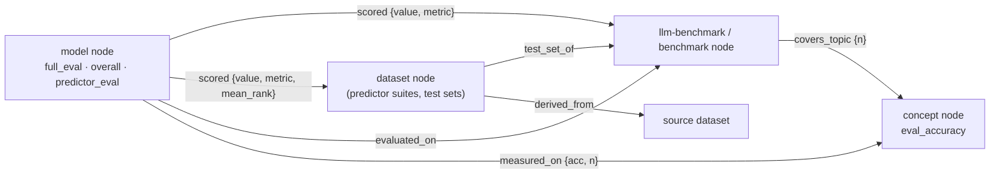

# Evaluation records

This page documents how panAtlas records evaluation results: the axes it evaluates along, every
field of every result record, the rules that keep a result off a leaderboard, and how one result
attaches to a model, a benchmark and a dataset. Benchmark descriptions are on
[Benchmarks](benchmarks.md); model and training records are on
[Models and curriculum](models-and-curriculum.md). Counts were computed with `python3` from the
files at repo HEAD `57505c6` on 2026-11-10.

## Evaluation dimensions

`docs/evaluation-dimensions-and-metadata.md` defines six axes. panAtlas is a map from evaluation
documents (benchmark items) to concepts, so any model that is tested, including one never trained on
panAtlas data, can be placed on the concept map.

| # | Dimension | What it relates | Where it lives in the data | Status |
|---|---|---|---|---|
| 1 | Document → concept | Each benchmark item → a MeSH or Wikipedia concept | `qconcept` and `qconcept2` mappings; `covers_topic` edges; ontology facet `concept_fit` | Built for 21 (first mapping) and 20 (judge-gated) benchmarks |
| 2 | Concept × capability | What the item is about × what kind of task | Concept nodes × the `capability` facet and `tests` edges | Built |
| 3 | Model × (concept × capability) | Per-item correctness rolled up to per-concept accuracy | `eval_accuracy` on concept nodes; `measured_on` edges | Built for 5 model families on 5 medical QA benchmarks |
| 4 | Training ↔ evaluation overlap | Per-concept training exposure against evaluation accuracy | `trained_on`, `sft_trained_on`, `stage_trained_on` edges; concept `corpus_docs`; `stats.type_topic_gap` | Built for KOS models (training data known) |
| 5 | Decontamination | Evaluation item ↔ training-ledger membership | Benchmark `decontam` block | Checked for 16 of 106 language benchmarks |
| 6 | Benchmark characterization | The 26-dimension ontology | Registry `audit` and ontology facets | Built for 106 benchmarks |

## How a result attaches

A result is always the score of one model on one benchmark (or suite), measured on that benchmark's
items or on a dataset. The graph and the evaluation index express this with these structures:



| Pattern | Edges at HEAD | Meaning |
|---|---:|---|
| `model` `scored` → `llm-benchmark` | 6 | A reference score of one model release on one benchmark; carries `value`, `metric`, `variant` |
| `model` `scored` → `dataset` | 79 | A predictor model's aggregate score on a frozen suite dataset; carries `value`, `metric`, `mean_rank` or `ratio_to_published`, `src: link_predictors` |
| `model` `evaluated_on` → `llm-benchmark` | 8 | The model was evaluated on the benchmark (no score on the edge) |
| `model` `measured_on` → concept | 104 | Accuracy on the items mapped to that concept; carries `acc`, `n` |
| `dataset` `test_set_of` → `benchmark` | 14 | A dataset is the held-out test set of an imaging benchmark |
| `dataset` `derived_from` → `dataset` | 3 | A suite dataset was built from a source dataset |
| `model` `evaluated_by` → `eval-suite` | 2 | KOS models belong to the KOS evaluation suite |

Most scores are not edges. They are fields on model nodes (`full_eval`, `predictor_eval`), entries
in the benchmark registry (`model_scores`, `scores`), and records in `mm_evals.json`,
`predictor_evals.json` and `evals_index.json`, described below.

## Language-model battery: `full_eval.json`

`full_eval.json` is produced on the HPC cluster by `pipeline/ingest_full_eval.py`, which walks the two
harness result roots, maps each result directory to a canonical model (pinning the published KOS-V4
and KOS-V5 checkpoints, excluding unreleased and intermediate checkpoints), and extracts the headline
metric per benchmark. Shape:

```json
{
  "_labels": { "<model key>": "<display name>" },
  "<model key>": {
    "<category>": [
      { "benchmark": "MedQA", "metric": "acc", "value": 0.2789, "n": 1273, "higher_better": true }
    ]
  }
}
```

| Row field | Rows (of 1,142) | Meaning |
|---|---:|---|
| `benchmark` | 1,142 | Benchmark or sub-benchmark name as the harness reports it |
| `metric` | 1,142 | Metric name |
| `value` | 1,142 | Score |
| `higher_better` | 1,142 | Direction |
| `n` | 1,104 | Number of items scored |
| `source` | 30 | Where the value came from, when not the harness summary |

At HEAD the file holds 39 models. Categories and the number of models with each:
`knowledge-qa` 39, `reasoning` 39, `general-knowledge` 39, `biomedical-nlp` 39, `hallucination` 39,
`calibration` 39, `radiology` 38, `safety` 20, `long-context` 19, `instruction-following` 9,
`math` 3.

### Fields `attach_full_eval.py` writes on model nodes

| Field | Model nodes | Meaning |
|---|---:|---|
| `full_eval` | 39 | The model's entry from `full_eval.json`, by category |
| `overall` | 39 | Composite score: mean over the canonical battery (below), or null if fewer than 15 of the 21 benchmarks were run |
| `cat_scores` | 39 | Mean per category over the higher-is-better rows |
| `ece` | 39 | Expected calibration error from the `calibration` category (lower is better; kept out of `overall`) |
| `battery_n` | 39 | Number of canonical-battery benchmarks the model has |
| `params_b` | 39 | Parameter count in billions, from an override table or parsed from the label |

The canonical battery (`CANON` in `attach_full_eval.py`) is fixed at 21 benchmarks: MedQA, MedMCQA,
PubMedQA, MedXpertQA, AfriMed-QA; MMLU clinical knowledge, college medicine, college biology, medical
genetics, professional medicine, anatomy, nutrition, virology, high school biology; BC5CDR (chem NER),
NCBI-Disease (NER), BIOSSES (similarity), HoC (Hallmarks of Cancer); Med-HALT FCT, FQT and NOTA. The
composite is a per-benchmark mean, not a per-category mean, so a one-benchmark category cannot weigh
as much as an eleven-benchmark one. `docs/model-evaluation-system.md` section 4 records why: an
earlier per-category average ranked KOS-V4 above KOS-V5 because the two had run different tests.

## Per-concept accuracy: `concept_accuracy.json`

`pipeline/build_concept_accuracy.py` joins per-item correctness (`samples_*.jsonl`, by item index) to
the first item-to-concept mapping. Only clean one-to-one, count-matched joins are accepted.

```json
{
  "result": {
    "<family>": {
      "<bench>": {
        "<concept id>": { "n": 1090, "correct": 380.0, "acc": 0.3486 },
        "__ckpt": "<checkpoint that produced the samples>",
        "__n": 1273
      }
    }
  },
  "coverage": [ { "bench": "medqa", "family": "kos-v4", "ckpt": "...", "items": 1273, "overall_acc": 0.282 } ]
}
```

Families at HEAD: `kos-v4`, `kos-v5`, `kos-v6`, `biomedlm`, `qwen3-4b-instruct`.

`enrich_graph.py` folds this into the graph. It keeps only the five medical QA benchmarks (MedQA,
MedXpertQA, MedMCQA, PubMedQA, AfriMed-QA) and excludes `kos-v6` (`EXCLUDE_MODELS`, marked
"unreleased"). For each concept it writes:

```json
"eval_accuracy": {
  "<family>": { "acc": 0.1748, "n": 103,
                "benchmarks": { "medqa": { "n": 24, "acc": 0.2083, "ckpt": "<checkpoint>" } } }
}
```

and one `measured_on` edge per (model, concept) with `acc` and `n`. At HEAD 26 nodes carry
`eval_accuracy` (6 `concept`, 18 `specialty`, the `root` and the `gate`), and there are 104
`measured_on` edges. Every per-benchmark entry records `ckpt`, the exact checkpoint that produced it.

## Registry scores: `model_scores` and `scores`

Two fields of `benchmarks_llm.json` carry results (see [Benchmarks](benchmarks.md)):

| Field | Entries | Shape | Meaning |
|---|---:|---|---|
| `model_scores` | 23 benchmarks | `{<model name>: {value, metric}}` | Battery scores matched from `full_eval.json` by `reconcile_benchmarks.py` |
| `scores` | 7 benchmarks | `{<variant>: {value, metric, model, verified, source}}` | Verified reference scores of a KOS release (for example `V5-Instruct`) from the canonical harness |
| `verified_published` | 7 true | bool | The benchmark has a published reference score the harness is checked against |

## Imaging and multimodal: `mm_evals.json`

`web/wp-plugin/panatlas-explorer/data/mm_evals.json` is the generic registry for imaging and
multimodal evaluations. It is built on the cluster by `pipeline/build_mm_evals.py` (radiology) and
extended by `build_patho_evals.py` (pathology). `build_mm_evals.py` infers each evaluation's
`eval_type` from the structure of its result files, and modality follows from one rule table, so
nothing about modality is typed by hand.

### `eval_type_modality`

| `eval_type` | Input | Output | Modality |
|---|---|---|---|
| `encoder_linear_probe` | image | label | vision |
| `report_generation` | image | text | multimodal |
| `image_text_retrieval` | image+text | score | multimodal |
| `text_qa` | text | label | text |
| `text_generation` | text | text | text |
| `structured_extraction` | text | graph | text |
| `ner` | text | spans | text |

### Benchmark entries (17)

| Field | Entries | Meaning |
|---|---:|---|
| `id` | 17 | Benchmark id (the graph id is `bench-<id>` for WSI benchmarks) |
| `project` | 17 | Grouping: `Chest-CT-VL` 4, `CT-RATE` 2, `Pathology-WSI` 2, `Neuropathology-WSI` 2, `Pathology-FM-eval` 2, `RadGraph-XL`, `RadGraph-CXR`, `RadGraph2-CXR`, `Neuro-oncology-WSI`, `Neuropath-FM-eval` 1 each |
| `name` | 17 | Display name |
| `eval_type` | 17 | `encoder_linear_probe` 13, `structured_extraction` 3, `report_generation` 1 |
| `domain` | 17 | `radiology` 9, `pathology` 8 |
| `metric` | 17 | Metric with protocol, for example "macro AUPRC (frozen probe, patient-split)", "MulticlassAccuracy (kaiko-ai eva 0.4.5, n_runs=5)" |
| `models` | 17 | Result records, below (235 in total) |
| `withheld` | 17 | Integer: number of results evaluated but not listed (294 in total) |
| `withheld_note` | 17 | Why, for example "our models require verified training AND evaluation before listing" or an embargo note |
| `eval_source` | 10 | Harness that produced the numbers, for example the official `eva` 0.4.5 harness |
| `measures` | 5 | What the benchmark measures |
| `caveat` | 2 | Reading caveat |

### Result records (`models[]`)

| Field | Records (of 235) | Meaning |
|---|---:|---|
| `name` | 235 | Model id as evaluated |
| `score` | 235 | The headline value for the benchmark's `metric` |
| `external` | 235 | true (209) for models not built in-house |
| `provenance` | 235 | Free text: "registry model (training disclosed/known in the atlas)", "external comparator", "in-house (KOS)" and model-specific statements |
| `label` | 218 | Display label |
| `source` | 207 | Pointer to the model: `graph:<model node>` or `hf:<repo>` |
| `verified` | 204 | Boolean; true on every record that carries it |
| `n` | 157 | Items scored |
| `micro_f1` | 156 | Secondary metric (RadGraph) |
| `family` | 79 | `pathology-FM`, `pathology WSI FM`, `CT-VL 3D encoder`, `ViT-L encoder`, `VLM` |
| `published` | 48 | true (18) when the model is publicly released |
| `md5` | 47 | Checksum of the evaluated weights |
| `metric_note` | 40 | Context for the score, for example patient count |
| `balanced_accuracy`, `grade_balacc` | 13 | Secondary metrics (pathology) |
| `f1`, `dim`, `auroc`, `knn_acc`, `knn_f1`, `ami`, `prec`, `rec` | 1 to 8 | Further secondary metrics and the embedding dimension |

!!! warning "`mm_evals.json` has no `modality` field on benchmarks"
    `docs/model-evaluation-system.md` section 11 gives the shape as
    `{benchmarks:[{id, project, modality, domain, metric, models:[{name, score, ...}]}]}`. No
    benchmark entry carries `modality`; it is derived from `eval_type` through
    `eval_type_modality`, as `build_mm_evals.py` states. The shape also omits `eval_type`, `name`,
    `withheld`, `withheld_note`, `eval_source`, `measures` and `caveat`.

The pathology harness that feeds the `*-eva` entries is recorded in the vault
(`reference-pathology-fm-eval-harness`): kaiko-ai `eva` 0.4.5, frozen-encoder linear probe, a single
linear head, balanced accuracy on the official test split averaged over five runs, seed 42.
Embargoed in-house encoders are evaluated but not published; they are counted in `withheld`.

## Tabular and forecasting: `predictor_evals.json`

`web/predictor_evals.json` holds the predictor-model suites (tabular and time-series foundation
models with classical baselines). It is generated by `web/fm_suite/suite/export_panatlas.py` from
raw results that are kept on the cluster, not in the repository. Its `_note` states the protocol:
every model sees the same rows, folds and context; open-weight models only, run locally.

Top level: `_note`, `generated` (ISO timestamp, 2026-10-31 at HEAD), `benchmarks` (4 suites).

| Suite | Fields | Model fields |
|---|---|---|
| `fm-suite-tabular-medical` | `dataset`, `protocol`, `primary_metric`, `models`, `comparison`, `per_task_primary`, `per_task_all`, `task_meta` | `splits`, `ok`, `tasks_ok`, `mean_roc_auc`, `mean_log_loss`, `mean_balanced_accuracy`, `mean_r2`, `mean_fit_s`, `failed` (17 models) |
| `fev-bench` | `dataset`, `metric`, `models`, `per_task_error`, `task_meta` | `tasks`, `skill_vs_seasonal_naive`, `ratio_to_published` (28 models) |
| `fm-suite-ts-health` | `dataset`, `metric`, `models`, `per_task_error`, `task_meta` | `tasks`, `skill_vs_seasonal_naive` (29 models) |
| `tabarena-v0.1-lite` | `dataset`, `protocol`, `rows` | rows: `method`, `elo`, `elo_plus`, `elo_minus`, `ours` |

| Sub-field | Meaning |
|---|---|
| `dataset` | The registry URN of the frozen suite dataset, for example `panatlas:dataset:fm-suite-tabular-medical` |
| `protocol` | Frozen protocol, for example "42 tasks (37 OpenML medical + 5 estate); frozen 5-fold splits, 3 repeats when n < 2500; training context capped at 50,000 rows; … seed 0; no tuning" |
| `comparison` | `tasks` (tasks in the comparison, 41), `dropped` (tasks dropped for every model), `in_progress`, `held_out` (per model: task → failure reason) |
| `task_meta` | Tabular: `kind` (binary, multiclass, regression), `test_rows`, `features`, `metric`. Forecasting: `horizon`, `seasonality` |
| `per_task_primary`, `per_task_all`, `per_task_error` | Task → model → value |
| `metric` (forecasting) | "SQL (scaled quantile loss); skill = 1 - geometric mean of error / seasonal-naive error over the tasks" |

The model registry for these models is `models.json` → `predictors.models` (58 records: `id`,
`name`, `family`, `kind`, `role`, `source`, `embedding`, `open_weights`, `runs`, `status`, `results`,
`wrapper`, and for 12 `not_run_reason`). `link_predictors.py` puts them in the graph as
`model-predictor-*` nodes (46 at HEAD) with:

| Node field | Meaning |
|---|---|
| `role` | `foundation-model` or `baseline` |
| `family`, `source`, `open_weights`, `embedding` | Identity; `embedding` states that the model has no fixed embedding space |
| `predictor_eval` | Per suite: `tabular` (`mean_primary`, `mean_rank`, `tasks_won`, `beats_best_baseline`, `tasks`, `splits`, `ok`, `mean_roc_auc`, `mean_r2`, `tasks_ok`, `held_out_of_comparison`), `tabular_per_task`, `fev-bench` and `fm-suite-ts-health` (`tasks`, `skill_vs_seasonal_naive`, `ratio_to_published`) |
| `eval_status` | "evaluated on the frozen predictor suite (web/predictor_evals.json)" |

Each predictor model also gets a `scored` edge to the suite dataset node. The suite dataset gets
`derived_from` edges to the datasets its tasks were built from.

## The unified index: `evals_index.json`

`web/build_evals_index.py` builds `web/wp-plugin/panatlas-explorer/data/evals_index.json`, the one
evaluation index behind the public API (`docs/public-api.md`, version 1.1). It reads
`benchmarks_llm.json`, `full_eval.json` (through the graph), `mm_evals.json`,
`predictor_evals.json` and `models.json`, and computes ranks, leaders, baselines and headlines so the
API routes only filter and serve. By rule, internal fields, paths, hosts and job numbers are never
returned.

Top level: `generated`, `note`, `types`, `suites`, `models`, `tasks`, `vocab`.

| Key | Content at HEAD |
|---|---|
| `types` | 5 model types, each with `label`, `evaluated_models`, `evaluated_baselines`, `not_run`, `scored_benchmarks`, `benchmarks`: `language` 38 models / 26 benchmarks; `vision` 27 / 13; `multimodal` 1 / 1; `tabular` 11 + 6 baselines, 4 not run / 2; `forecasting` 24 + 5 baselines, 8 not run / 2 |
| `suites` | 142 suites (`language` 124, `vision` 13, `tabular` 2, `forecasting` 2, `multimodal` 1); 56 `scored`, 86 `cataloged` |
| `models` | 124 model records (`language` 38, `forecasting` 37, `vision` 27, `tabular` 21, `multimodal` 1); 112 `evaluated`, 12 `not-run` |
| `tasks` | Per-task results of the predictor suites |
| `vocab` | Query vocabulary: type words, domain words, aliases, task words |

Suite record fields: `id`, `name`, `type`, `domain`, `task_type`, `metric`, `higher_better`,
`rank_by` (`value`, or `mean_rank` for one suite), `what`, `how_to_read`, `run_status`, `kw`,
`n_models`, `ranking`; and on some `node`, `capabilities`, `cap_ids`, `headline`, `part_of`,
`dataset`, `n_tasks`, `best_baseline`, `value_metric`, `dropped_tasks`, `held_out`.

Model record fields: `id`, `name`, `type`, `types`, `role` (`model`, `foundation-model`,
`baseline`), `scores`, `n_benchmarks`, `status`; and on some `node`, `family`, `source`,
`open_weights`, `runs`, `published_leaderboard`, `not_run_reason`, `note`.

Score fields (1,426 scores): `suite`, `value`, `metric`, `rank`, `of`; and on some `published`,
`verified`, `ratio_to_published`, `mean_rank`, `held_out`, `tasks`, `same_tasks_leader`. Rows taken
from a published leaderboard for methods with no run of ours are kept in `published_leaderboard`,
apart from `scores` and from every count. Values are compared only within one benchmark.

## Keeping results honest: verification and withholding

| Mechanism | Where | Rule |
|---|---|---|
| `leaderboard_eligible` + `withheld_reason` | Curriculum record, copied to model nodes by `build_curriculum.py` | A model with `leaderboard_eligible: false` is shown for its curriculum only, not ranked. At HEAD: KOS-V6-Instruct ("contamination unchecked; V6 pretrain lineage still in flight"), `lesion_lg_cohort_reg_dino` ("intermediate checkpoint (iter 170k of 200k), no downstream KOS-run measurement"); KOS-V6 base is `true` |
| `verified` (curriculum) | `model_curriculum.json`, copied to model nodes as `curriculum_verified` (8 nodes) | Free text giving a date and a method, for example "2026-08-01 vault audit (two independent token censuses agree to 0.0001%)" |
| `verified` (result) | `mm_evals.json` result records, `evals_index.json` scores, registry `scores` | Boolean |
| `withheld`, `withheld_note` | `mm_evals.json` benchmarks | Count of results evaluated but not listed, and why: in-house models need verified training and evaluation before listing; embargoed models are never published |
| `comparison.held_out` | `predictor_evals.json` | A model that failed some tasks is held out of the cross-model comparison, with the failure reason per task; `evals_index.json` marks its scores `held_out` and names the leader on the same tasks |
| `not_run_reason` | `models.json` predictors, `evals_index.json` | Why a registered model has no result (licence gate, timeout, missing toolkit) |
| Checkpoint pinning | `eval_accuracy[...].benchmarks[...].ckpt`, `concept_accuracy.json` `__ckpt` | Every per-concept accuracy names the exact checkpoint |
| Exclusions | `enrich_graph.py` `EXCLUDE_MODELS = {"kos-v6"}`; `ingest_full_eval.py` | Unreleased and intermediate checkpoints stay out of comparisons |

## Strata and context axes

The context axes on which a result can be sliced today are the fields above: concept (topic),
capability, testing type, evaluation domain, artifact type, modality (through `eval_type`),
`model_stage`, `arm`, harness `tier`, provenance (`official` or `homegrown`), checkpoint and model
release (`variant`).

Population and setting strata are designed but not built for results. `ARCHITECTURE.md` and
`PLAN.md` define six strata axes as controlled `strata-` pages (geography, culture, population,
environment, care setting, equipment), a `dataset` page field `strata[]`, and a `result-` page type
with `context[]` (strata), `dataset_slice`, `score`, `safety_subscore` and a `run:<id>` provenance
tag. The repository's markdown atlas holds two strata pages (`strata-geography-us`,
`strata-care-setting-ed`, both `status: draft`) and no `result-` pages. The one `strata` field in
the served graph (on the KOS-V5 SFT mix node) counts SFT record kinds, not population strata.
