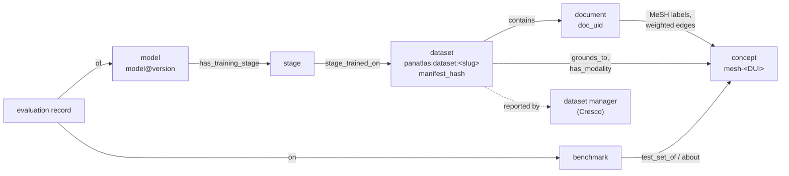

# Metadata

panAtlas is mostly metadata. It describes datasets, documents, models, training stages, benchmarks, results and
concepts precisely enough that an evaluation can be placed, compared and audited without moving the underlying data.
This section documents **every metadata family, field by field**: its schema, which script writes it, which script
reads it, and what values it holds at the repository commit each page names.

## The families and how they connect

| Family | Identity | Page |
|---|---|---|
| Identifiers | URNs, slugs, `doc_uid`, `manifest_hash`, MeSH slugs, `model@version`, job ids | [Identifiers](identifiers.md) |
| Datasets | `panatlas:dataset:<slug>` | [Dataset registry](dataset-registry.md) |
| Dataset contents | `manifest_hash` over `(relpath, size, mtime)` | [Manifests](manifests.md) |
| Acquisition, licence, entitlement | Per dataset and per document | [Acquisition and licence](acquisition-and-licence.md) |
| Documents | `doc_uid = blake2b-16(text)` | [Document index](document-index.md) |
| Graph nodes and edges | Node `id`, typed edges | [Graph schema](graph-schema.md) |
| Benchmarks | Benchmark node, ontology facets | [Benchmarks](benchmarks.md) |
| Results | Model × benchmark × dataset, with `verified` date and method | [Evaluation records](evaluation-records.md) |
| Models and training | Model record, curriculum stages | [Models and curriculum](models-and-curriculum.md) |
| Triples | Prefixes, classes, predicates, named graphs | [RDF vocabulary](rdf-vocabulary.md) |
| Vocabularies | MeSH, Wikidata, FHIR, LOINC and others | [Code systems](codesystems.md) |
| Federation messages | Reports, profiles, instance configuration, `mesh.json`, `models.json` | [Wire contract](../distributed/contract.md) |

## Rules every family follows

1. **Stable identity.** An identifier, once minted, is never reused for something else. Versions are explicit
   (`@v3w`, `manifest_hash`, `pav:version`), not implied by overwriting.
2. **Provenance on every fact.** Records say which script or job produced them, from what input, and when.
   Slurm job numbers are first-class provenance.
3. **Measured versus declared.** A count read from a source's own documentation is kept apart from a count measured
   on our copy, and the record says which one it is.
4. **Blanks are data.** Unknown values are recorded as unknown, with the reason (`curriculum_disclosed: false`,
   `withheld_reason`, the curriculum gap register), so that they can be compared and closed.
5. **Licence per document.** Licence and tier are recorded at ingest for every document, and consulted when
   something is shared or put into a training set. "Not training-eligible" is never a reason to leave data out of
   the atlas.
6. **Source of record.** Every mirrored node and edge names the graph that maintains it. panAtlas curates only
   what it is the source of record for.
7. **Structure only across sites.** The metadata that crosses the mesh is identifiers, counts, edges, model stamps
   and hashes, never content. See [Federation](../distributed/federation.md#what-crosses-the-wire).
