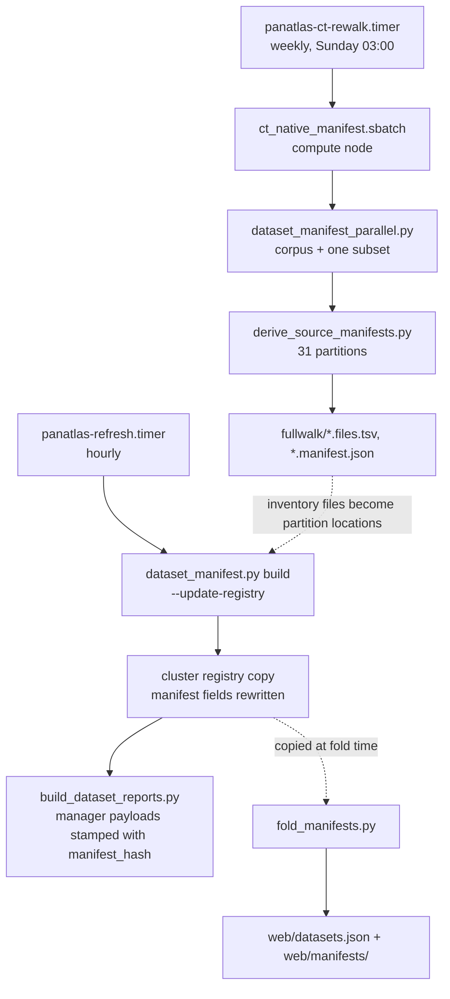

# Manifests

!!! info "Status"
    **Built and running.** The manifest builder and auditor (`web/dataset_manifest.py`), the parallel walker
    (`web/dataset_manifest_parallel.py`), partition derivation (`web/derive_source_manifests.py`) and the fold
    into the registry (`web/fold_manifests.py` and two older variants) are in the repository and run on the
    HPC cluster: hourly for every hosted dataset, weekly for the large CT corpus.
    **Measured:** 127 registry entries carry a manifest at repository HEAD `57505c6` (2026-10-31), covering
    993,790 files and 123.4 TB; the CT corpus full walk of 2026-09-17 is the largest single manifest.
    **Designed, not built:** content hashing of small or critical files, and hub-side verification of a
    manager's reported `manifest_hash` against the registry (see the warnings below).

A dataset is identified by its URN and **audited by its manifest** (`PLAN-datasets.md` §2). The manifest is a
canonical, sorted inventory of the files that make up the dataset, reduced to one hash. Recomputing it and
comparing the hash answers one question cheaply: is this dataset still the set of files we registered, or has
something been added, removed, moved, resized or touched?

## The canonical inventory

For a registry entry, `web/dataset_manifest.py` builds the inventory like this:

1. For each path in `locations[]`: an absolute path is used as is; a relative path is joined to the estate
   root (`--root`, or `meta.root_default` from the registry).
2. A path that does not exist is recorded in `missing_locations` and contributes nothing.
3. A path that is a file contributes itself. A directory contributes every file below it (`os.walk`, which
   does not descend into symbolic links to directories).
4. Each file contributes the tuple `(relpath, size, mtime)`: `relpath` is relative to the estate root,
   `size` is `st_size` in bytes, `mtime` is `int(st_mtime)` (whole seconds). A file whose `stat` fails is
   skipped silently.
5. The tuples are sorted.
6. The canonical text is one line per file, `relpath<TAB>size<TAB>mtime`, joined by `\n` with no trailing
   newline.
7. `manifest_hash = "sha256:" + sha256(canonical_text as UTF-8).hexdigest()`.

```python
entries.sort()
canon = "\n".join(f"{rel}\t{size}\t{mtime}" for rel, size, mtime in entries)
manifest_hash = "sha256:" + hashlib.sha256(canon.encode("utf-8")).hexdigest()
```

The hash is stable across runs and across machines that mount the data at the same root. File content is
**not** read.

### Output files

`build` writes two files per dataset into `--out` (on the cluster, `<cluster project storage>/panatlas/cresco/manifests/`):

| File | Content |
|---|---|
| `<slug>.files.tsv` | the full inventory, one `relpath<TAB>size<TAB>mtime` line per file, sorted, each line newline-terminated |
| `<slug>.manifest.json` | the summary (below), indented JSON |

The inventory files stay on the cluster. The repository keeps copies of the summaries only, in `web/manifests/`:
129 `<slug>.manifest.json` files and 32 `<slug>.fullwalk.manifest.json` files at HEAD.

## Manifest summary fields

The summary is what the registry stores in an entry's `manifest` field and what a manager reports.

| Field | Type | Meaning | Example |
|---|---|---|---|
| `urn` | string | the dataset URN | `panatlas:dataset:kits23` |
| `file_count` | integer | number of inventory lines | `6238` |
| `total_bytes` | integer | sum of `size` over the inventory | `52537716929` |
| `missing_locations` | list of string | `locations[]` entries that did not exist at build time | `[]` |
| `manifest_hash` | string | `sha256:` + 64 hex characters over the canonical text | `sha256:7658896b…` |
| `computed_at` | integer | Unix time, seconds, when the summary was written | `1788689368` |

Partition manifests cut from a full-walk inventory (`web/derive_source_manifests.py`) add two fields:

| Field | Type | Meaning |
|---|---|---|
| `derived_from` | string | the inventory the partition was cut from |
| `partition` | string | the root-relative prefix (or prefixes) the partition covers |

### `manifest_full_walk` in the registry

33 registry entries also carry `manifest_full_walk`: the manifest of the full data, kept when the hourly
`manifest` covers something smaller (an inventory file or index files; see
[Partitioned and inventory-file manifests](#partitioned-and-inventory-file-manifests)). It has the summary
fields above (`computed_at` is absent on one entry) plus:

| Field | Present | Meaning |
|---|---:|---|
| `locations` | 33 | the locations the full walk covered (the data itself, not the inventory file) |
| `computed` | 33 | free text: when, which tool, which job |
| `derived_from` | 31 | as above, on the 31 CT partitions |
| `partition` | 31 | as above |

Each of these entries also carries an `audit_scope` string that says, in prose, what the hourly manifest
covers and why. Read it before relying on an hourly hash.

## Commands

```bash
# build: compute manifests, write <slug>.files.tsv + <slug>.manifest.json, optionally fold into the registry
python3 web/dataset_manifest.py build --registry datasets.json --root <estate root> \
    --out <manifest dir> [--only slug1,slug2] [--update-registry]

# audit: recompute and compare against the stored baseline
python3 web/dataset_manifest.py audit --registry datasets.json --root <estate root> \
    [--manifests <manifest dir>] [--only slug1,slug2]
```

`build` prints one line per dataset (`files=`, `bytes=`, hash, and `MISSING=[…]` if any location is absent).
With `--update-registry` it writes each summary into the entry's `manifest` field and rewrites the whole
registry file (`indent=2`). Without it the registry is not touched.

If a directory sits where a `.files.tsv` or `.manifest.json` should be written, `build` moves it to
`<out>/_displaced/<slug>.<timestamp>` and continues. This guard was added after six such directories stopped
every hourly refresh from 2026-09-20 17:01 until 2026-09-23 (comment in `web/dataset_manifest.py`).

### Audit and exit codes

For each selected entry `audit` takes the baseline from the registry's `manifest` field, or, if that is
empty, from `<manifests>/<slug>.manifest.json`. It recomputes the manifest and compares only `manifest_hash`.

| Per-dataset line | Meaning |
|---|---|
| `OK    sha256:…` | recomputed hash equals the baseline |
| `DRIFT files±N bytes±N` followed by `was` / `now` hashes | hash differs; the file and byte deltas are reported |
| `NO BASELINE (build first)` | no stored manifest; counted as drift |

| Exit code | Meaning |
|---|---|
| `0` | every selected dataset matched (`all datasets verified`) |
| `3` | at least one dataset drifted or had no baseline (`N dataset(s) drifted or lack a baseline`) |

Any other non-zero code is an uncaught error (for example an unreadable registry). The audit says *that* a
dataset changed and by how many files and bytes. To find *which* files changed, diff the old and new
`<slug>.files.tsv`.

## Where manifests are computed



**Hourly, on the cluster.** `web/mesh/deploy/panatlas-refresh.timer` (15 minutes after boot, then every hour)
runs `panatlas-refresh.service`: `dataset_manifest.py build --registry datasets.json --root <estate root>
--out cresco/manifests --update-registry` against the **cluster copy** of the registry, then
`build_dataset_reports.py` for the hosted entries. The managers therefore report the hash computed in the last
hour.

!!! warning "The hourly job rebuilds; it does not audit"
    The refresh runs `build --update-registry`, which overwrites each entry's stored `manifest` with the new
    one. A changed dataset gets a new hash and nothing fails. No script or timer in the repository calls
    `dataset_manifest.py audit`. Drift is visible only by comparing hashes over time (for example the
    repository copy in `web/manifests/` against the cluster's current value, or a manager's reported hash
    against an earlier report). If you need a gate, run `audit` against a pinned baseline directory with
    `--manifests` and act on exit code 3.

!!! warning "Registry rewrites race"
    `--update-registry` rewrites the whole cluster registry file. An edit to that file made while the hourly
    build runs is lost when the build finishes. This happened in practice on 2026-09-12 (the project
    waited out the timer before editing). Stop the timer or edit between runs.

**On registration or acquisition, folded into the repository.** The repository's `web/datasets.json` is not
updated by the hourly job. Manifests reach it when an acquisition finishes and a fold script copies them in:

| Script | Input | What it writes |
|---|---|---|
| `web/fold_manifests.py <dir> [summary-file] [summary-path]` | a directory with a completion summary and `<slug>.manifest.json` files | for every matching entry in `web/datasets.json` and every `web/datasets_*.json`: `manifest` (the six summary fields), `status: active` if `missing_locations` is empty, `acquisition.status: complete`, `acquisition.finished`, `acquisition.summary`; copies the summary into `web/manifests/` |
| `web/fold_tcga_manifests.py` | TCGA completion summary | the same, for `web/datasets.json` and `web/datasets_tcga.json` |
| `web/fold_renal_manifests.py` | renal completion summary | the same, but writes `acquisition.completion_summary` instead of `acquisition.summary`, and `acquisition.status: incomplete` when locations are missing |

Checks the fold scripts make before writing: the manifest's `urn` equals the entry's (assertion); the
manifest's hash (and, for the TCGA and renal folds, its `file_count`) equals the completion summary's
(otherwise the fold stops); a whole-download summary with no per-dataset list is accepted only when it reports
zero missing, partial and extra files (otherwise nothing is folded). `web/test_fold_manifests.py` tests the
per-dataset form, the whole-download form and the refusal of an incomplete download
(`python3 -m unittest test_fold_manifests -v`).

At HEAD, every one of the 127 registry `manifest` hashes and 32 `manifest_full_walk` hashes equals its copy in
`web/manifests/` (159 comparisons, 0 mismatches). One `manifest_full_walk` (a neuropathology tile store) has
no repository copy. Two files in `web/manifests/` (`heartlens-ct.manifest.json`, `nlst-ct.manifest.json`)
belong to retired slugs and are not referenced by the registry. The summaries were computed between
2026-07-31 and 2026-10-15: the repository holds the value at fold time, not the current hourly value.

## Partitioned and inventory-file manifests

A single-threaded walk is fine for most datasets (CT-RATE: 52,602 files in 10.35 s, measured 2026-09-12). It
fails for very large trees. The CT native corpus (296,429 Zarr cases; the parallel walker's docstring
estimated "tens of millions" of chunk files, the walk counted 6,883,489) did not finish a login-node walk in
25 minutes, and a 1,387,222-file neuropathology tile store took
about 11 minutes, too long to repeat every hour. Three tools handle this.

### The parallel walker

`web/dataset_manifest_parallel.py` produces the same canonical inventory and hash as
`dataset_manifest.py build` for the same locations, using a process pool:

1. For each location, scan directories down to `--shard-depth` (default 3). Files above that depth are stat'ed
   in the main process; each directory at that depth becomes a pool task.
2. `--workers` processes (default 32) walk the shard directories with `os.scandir`, never following symbolic
   links, and return `(path, size, int(mtime))`.
3. Paths are made relative to `--root`, sorted, and hashed in a stream while `<slug>.files.tsv` is written.
4. `<slug>.manifest.json` gets the six summary fields.

Flags: `--slug`, `--urn`, `--root`, `--location` (repeatable), `--out`, `--workers`, `--shard-depth`,
`--chunksize` (default 64). It prints an `EFFECTIVE` line with every setting, progress every 5,000 shards, and
`DONE` at the end.

Equivalence was tested on one partition: the `cases/cads` directory gave the same 80 files, inventory and hash
from both tools (recorded 2026-09-17).

!!! warning "Symbolic links make the two walkers disagree"
    `dataset_manifest.py` lists a symbolic link to a file as a file and records the target's size and mtime
    (`os.walk` plus `os.stat`). `dataset_manifest_parallel.py` skips symbolic links entirely
    (`is_file(follow_symlinks=False)`). The "byte-for-byte compatible" claim in its docstring holds only for
    trees without file symlinks. Check for symlinks before mixing the two on one dataset.

### Weekly full walk and partition derivation

`web/mesh/deploy/panatlas-ct-rewalk.timer` (Sunday 03:00, persistent) submits
`web/mesh/deploy/ct_native_manifest.sbatch` to a compute node (96 cores, 200 GB, 8-hour limit). It runs:

| Step | Command | Fails with exit |
|---|---|---|
| 1 | parallel walk of the whole corpus, slug `heartlens-ct3d-native` | 2 |
| 2 | parallel walk of one subset entry over the corpus plus that subset's embedding directory | 3 |
| 3 | `derive_source_manifests.py` over both inventories | 4 |

and prints `CT_MANIFEST_OK` on success. Outputs go to `<cluster project storage>/panatlas/cresco/manifests/fullwalk/`.

`web/derive_source_manifests.py` uses the corpus layout `…/heartlens_ct3d_native/cases/<source>/<case>.zarr/…`.
Every registered CT sub-collection is exactly one `cases/<source>` directory, so its manifest is the subset of
inventory lines under that prefix, hashed the same way, with no second walk. The slug is `ct-` + the source
name with `_` replaced by `-`. One subset also owns an embedding directory, whose lines are merged in and
re-sorted. The script prints unmatched sources (directories with no registry entry) and a reconciliation:
shallow files + partition files must equal the inventory total.

Measured on 2026-09-17 (job 220015, 96 workers, 26 minutes):

| Measure | Value |
|---|---|
| Corpus full walk | 6,883,489 files · 25,938,581,260,036 B (25.94 TB) |
| Partitions derived | 31 registered `ct-*` entries |
| Reconciliation | 1,838 shallow files + 6,881,651 partition files = 6,883,489 |
| Proof of equivalence | the derived `ct-cads` hash equals a direct walk's hash |
| Not registered | `cases/ctrate` (1,711,569 files), the ingested CT-RATE subset already counted under `ct-rate` |

### What the hourly manifest covers for these entries

For the 31 partitions and the corpus entry, the registry `locations` point at the **inventory file**
(`panatlas/cresco/manifests/fullwalk/<slug>.files.tsv`), not at the data. The hourly manifest of such an entry
therefore has `file_count: 1` (all 31 partitions at HEAD) and hashes the inventory file's path, size and mtime.
The full manifest of the data is kept in `manifest_full_walk`, and the partition directory in `partition_path`.

The neuropathology tile store uses the same idea differently: its hourly manifest covers six tile-index CSV
files (6 files, 353,437,544 B), which enumerate every tile; the store itself (1,387,222 files, 93.3 GB) was
walked once on 2026-09-12 and is kept as `manifest_full_walk`, with no scheduled re-walk.

!!! note "What an inventory-file audit can and cannot detect"
    It detects that the weekly re-walk produced a different inventory (the inventory file changed). It does
    not detect a change to the data between re-walks, and for the neuropathology store it does not detect a
    change at all unless the index CSVs change. The `audit_scope` field on each entry states this.

## Who consumes the manifest

| Consumer | Uses |
|---|---|
| `web/build_dataset_reports.py` | stamps the manager's dataset node with `manifest_hash` and `file_count`; writes `<slug>.manifest.json` (the registry summary, or `{}`) beside the report; sets the plugin's `panatlas_graph_version` to the hash, or `unversioned` |
| `web/mesh/mesh_daemon.py` | shows the first 19 characters of each reported hash on the mesh view |
| `web/wp-plugin/panatlas-explorer/assets/app.js` | the "audited" badge and the manifest panel on each dataset card (files, bytes, hash, `computed_at` date, missing locations); "not audited" when there is no hash |
| `web/rdf/build_rdf.py` | emits `manifest_hash`, `file_count`, `total_bytes` as dataset properties (see [RDF vocabulary](rdf-vocabulary.md)) |

!!! warning "Hub-side verification is designed, not built"
    `PLAN-datasets.md` §2 and `DATASET-MANAGERS.md` say the hub's `merge_reports.py` verifies each reported
    `manifest_hash` against `web/datasets.json` and quarantines a mismatch. At HEAD,
    `web/federation/merge_reports.py` reads an agent registry for tier and status gating only; it does not
    open `web/datasets.json` and does not compare hashes. The stamp is carried end to end; the comparison is
    not made. See [Federation contract](../distributed/contract.md) and
    [Dataset managers](../distributed/dataset-managers.md).

## Honest limits

- **Content is not hashed.** Size and whole-second mtime are the per-file signature. Two files with the same
  path, size and mtime but different bytes produce the same hash. The manifest proves an inventory, not
  content, and cannot show that a file in one store is byte-identical to a file in another.
- **Metadata-only changes count as drift.** `touch`, or a copy that does not preserve mtimes, changes the hash
  with no change to content. Copy with `rsync -a` or `cp -p` to keep a hash.
- **The hash depends on the root.** `relpath` is relative to the estate root. Moving the whole estate keeps
  the hash only if the relative paths are unchanged; moving a dataset within the estate changes it.
- **Empty directories are invisible.** Only files are listed.
- **Unreadable files are dropped silently.** A file whose `stat` fails is skipped with no message; a
  permissions change can shrink the inventory.
- **Overlapping locations double-count.** If one location contains another, files under both appear twice.
- **Missing locations do not fail the build.** They are listed in `missing_locations`; the fold scripts keep
  such an entry out of `active`, but the hourly build does not.
- **Symbolic links** differ between the two walkers (above).
- **The hash is unkeyed.** Anyone who knows a dataset's file list can confirm it. See the storage rule on
  [Identifiers](identifiers.md#document-uid-doc_uid).

## Upgrade path

`PLAN-datasets.md` §2 names the planned upgrade: keep size and mtime as the cheap signature for bulk files,
and add sha256 for small or critical files (labels, splits, index CSVs, manifests of record), so that the
audit can prove content where it matters. This is **designed, not built**: neither walker reads file content.

Content is verified today at a different point, during acquisition, by each fetcher against the publisher's
own checksums, and recorded in the acquisition record rather than the manifest (see
[Acquisition and licence](acquisition-and-licence.md#verification-at-acquisition)). Examples: every OpenH-RF file
against its Hugging Face tree hash (sha256 for LFS files, git blob sha1 otherwise); CPTAC packages by
`md5sum -c` against the packages' own sums; the UMLS release by zip CRC and the release's own row counts.
A content column in `<slug>.files.tsv` for selected files would join the two.

Related pages: [Identifiers](identifiers.md), [Dataset registry](dataset-registry.md),
[Acquisition and licence](acquisition-and-licence.md), [Dataset managers](../distributed/dataset-managers.md).
