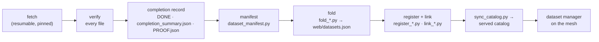

# Data acquisition

Every dataset panAtlas holds or mirrors arrives through an acquisition tool in `web/acquisition/<source>/`. The
scripts there are mirrors of what runs on the HPC cluster; on the cluster they are deployed to a downloads area in
project storage, and the data lands in a staging area beside it. This page describes the shared pattern, then each
tool. What the registry records about a dataset's origin and licence is in
[Acquisition and licence](../metadata/acquisition-and-licence.md); manifest fields are in
[Manifests](../metadata/manifests.md).

## The pattern

The tools differ by source, but they share these rules:

- **Pin the version.** A Hugging Face dataset is fetched at a fixed revision; an OKN graph at its published
  `pav:version`; a Wikimedia or NLM release by its date or release name.
- **Resume, never restart.** Fetchers keep what is already valid and fetch only what is missing.
- **Verify every file** against what the publisher states (hashes, CRCs, row counts, an independent second
  extraction), and delete or refetch anything that does not match.
- **Write the completion record last**, and only when every file is present and verified with nothing partial or
  extra. Downstream steps read the record, not the directory.
- **Run in Slurm** on a CPU partition, not on the login node ([Rules for the cluster](build-pipeline.md#rules-for-the-cluster)).
- **Use the provider's own tool and settings.** Never raise a service's concurrency.
- **Record the licence** per dataset, and per document where documents carry different licences.

### Completion records

| Record | Written by | Meaning |
|---|---|---|
| `DONE` | Each fetcher's finish step | The copy is complete and verified |
| `completion_summary.json` (or `completion_summary_partial.json`) | Finalizers | `{finished, datasets: [{slug, file_count, total_bytes, missing, hash}]}`, or a whole-download summary `{checked, n_missing_or_unverified, partial_files, extra_files}` |
| `PROOF.json` | `okn_prove.py` | The levels of exactness proof an OKN mirror passed |
| `agents/<sn>/state.json` | `okn_agent.py` | The version, counts and last sync result an OKN agent holds |

### Manifests and folding

`web/dataset_manifest.py` builds a canonical, sorted inventory of a dataset's files over its registered
`locations[]` as `(relpath, size, mtime)`, with counts and one `manifest_hash` (sha256 over the inventory). Its
`audit` mode recomputes the hash and exits 0 on a match and 3 on drift. File **content is not hashed** (datasets reach
hundreds of gigabytes); size and modification time are the per-file signature, which detects moves, growth and
edits but does not prove two files in different stores hold the same bytes.

For large trees, `web/dataset_manifest_parallel.py` shards the walk at depth 3 across a process pool and produces a
byte-identical canonical hash. `web/derive_source_manifests.py` cuts per-source manifests from one full-walk
inventory when a corpus is an exact partition by sub-collection, so the tree is not walked twice.

`web/fold_manifests.py <dir> [summary] [summary path]` is the general folder: for each dataset with a manifest it
copies the manifest into `web/manifests/`, sets the entry's `manifest` block (URN, file count, total bytes, missing
locations, hash, time), moves `status` from `acquiring` to `active` when nothing is missing, and sets
`acquisition.status` to `complete`. A whole-download summary is accepted only when it reports nothing missing,
partial or extra. `fold_renal_manifests.py` and `fold_tcga_manifests.py` are its source-specific predecessors.
`web/manifests/` held 161 files at 57505c6.

## NSF Open Knowledge Network mirrors

`web/acquisition/okn/` mirrors every deployed graph of the NSF Open Knowledge Network as an **independent agent**, and
proves each copy recreates its upstream exactly. One graph counts as deployed only if its own endpoint answers.
Measured: 42 graphs on 2026-09-26, 43 from 2026-10-02.

| Script | Role |
|---|---|
| `okn_fetch.py` | Extracts a graph from its public SPARQL endpoint in 1,000,000-triple N-Triples pages, four in parallel, and verifies it |
| `okn_prove.py` | Proves a held copy is exactly upstream's |
| `okn_agent.py` | The agents: upstream snapshots and versions, adoption, independent syncs, the six-hourly tick, store refresh |
| `deploy/panatlas-okn-tick.{service,timer}` | Runs the tick every 6 hours (00:17, 06:17, 12:17, 18:17) |

**Extraction.** A page is accepted only if it has exactly the expected line count, every line is one statement, and
the file ends in a newline. The public endpoints stop a query at about 30 s and append their error text to a
truncated stream with HTTP 200, so a short or junk-carrying page is refetched and then split into ten sub-slices,
recursively, down to 1,000 triples. A graph is `DONE` only if its lines equal the endpoint's `COUNT(*)`, nothing is
malformed and every line is distinct, or every repeated line is confirmed by the endpoint itself (the endpoints print
some distinct values identically).

**Proof** (`PROOF.json`):

| Level | Check |
|---|---|
| fingerprint | sha256 of the sorted distinct triples; per-predicate counts; blank-node count |
| upstream | Per-predicate counts equal the endpoint's; 20 random slices byte-identical at their offsets; 2,000 random triples byte-identical among the endpoint's objects for their subject and predicate |
| reextract | A second full extraction at a different page size (999,983) hashes identically |
| store | The triples exported back out of the local SPARQL store equal the source ([Knowledge store](knowledge-store.md#exactness-the-round-trip)) |

**Agents.** `okn_agent.py snapshot | check [SN..] | sync SN | adopt SN | describe [SN..] | tick | store`. Each agent
records its held version, provenance and source-of-record declaration under `agents/<sn>/`. Every triple extracted
from a graph has that graph as its source of record; panAtlas curates only nodes and edges whose source of record is
panAtlas, and replaces a mirror wholesale when its agent syncs a new upstream version. The `tick` snapshots upstream,
registers external dumps, and submits one independent `okn_sync_<sn>` Slurm job per changed graph; a sync that fails
any proof returns `current` to the previous version. When no OKN job is active and the held versions differ from the
served store, the tick submits a store build. `web/register_okn.py` upserts one registry entry per agent from the
entry its agent writes.

**Layout** (`data/sources_staging/okn/` in project storage): `upstream/` snapshots; `agents/<sn>/` state; `raw/<sn>/<version>/part_*.nt`
with `DONE` and `PROOF.json`, and `raw/<sn>/current` pointing at the held version; `raw/wikidata/<dump date>/` for the
Wikimedia dump (its source of record is Wikimedia, not OKN); `sor_index.json` mapping authoritative namespaces to
graphs.

Tests: `python3 -m unittest test_okn_fetch test_okn_prove test_okn_agent`. Fake endpoints reproduce truncation with
appended text, confirmed repeats, paging errors, a single altered literal, the memory cap and over-long argument
lists.

## OpenH-RF (ultrasound channel data)

`web/acquisition/openh/` acquires the Hugging Face dataset `nvidia/OpenH-RF` (CC BY 4.0) at a pinned revision.

| File | Role |
|---|---|
| `openh_hfdownload.sbatch` | The method of record: the official `hf download` with its own adaptive concurrency; `STEP=verify` and `STEP=finish` run the checks |
| `openh_fetch.py` | `verify` hashes every file against the repository tree (sha256 for LFS files, git blob sha1 for the rest) and deletes mismatches; `finish` writes `DONE` and `_meta/completion_summary.json` only when every file is present and verified with nothing partial or extra |
| `openh-rf-0ee6881e.json` | The tree facts: 19,662 files, 39,070,116,670,149 bytes, 33 subsets |

Result: download 2026-10-11 to 2026-10-15 (jobs 231465 to 231468, all exit 0); 19,662 of 19,662 files verified;
`DONE` 2026-10-15. Registered by `web/register_openh.py` (corpus plus 33 subsets), linked by `web/link_openh.py`, and
folded with `web/fold_manifests.py`: 34 manifests, 0 missing locations, all 34 entries `active`.

## Renal biomarker datasets

`web/acquisition/renal/` mirrors the tooling that pulled the raw data for a renal-biomarker project from GEO, GDC,
PDC, KiTS23, TCIA and PRIDE.

| File | Role |
|---|---|
| `renal_fetch.py` | Resumable downloader with one subcommand per source and tier; logs every file to a JSONL manifest |
| `run_renal.sh` | Launches streams A, B and C |
| `launch_d.sh` | Smoke-tests two repaired stages, then opens stream D and restarts the finalizer |
| `finalize_renal.sh` | Waits for `STREAM_{A,B,C,D}_DONE`, runs one idempotent sweep of every stage, builds the manifests and writes `completion_summary.json` |
| `probe_dgx.py` | Pre-launch environment probe |
| `completion_summary.json` | The finalizer's record: 10 manifests, 48,281 files, 6.86 TB, 0 missing locations (finished 2026-09-06) |

The registry entries are in `web/datasets_renal.json`, folded by `web/fold_renal_manifests.py` and linked by
`web/link_renal.py`.

!!! warning "Renal ran on the login node"
    `renal_fetch.py` says it runs on the login node, and `run_renal.sh` and `launch_d.sh` start the streams in `tmux`
    and the finalizer with `nohup` there. This predates the 2026-10-08 rule. New acquisitions follow the OpenH and
    UMLS pattern: an `sbatch` script on a CPU partition.

## arXiv

`web/acquisition/arxiv/` has no README. Its scripts acquire and align the Hugging Face snapshot
`secemp9/arxiv-complete` (3,148,796 papers):

| Script | Role |
|---|---|
| `arxiv_fetch.py` | Resumable acquisition in priority order, so atlas-relevant text lands first |
| `arxiv_doc_index.py` | One row per paper for the document estate, with the licence per document |
| `arxiv_lexalign.py` | Aligns every paper to Wikipedia and MeSH nodes with the estate's own lexical linkers (no embeddings) |
| `arxiv_embed_align.py`, `arxiv_embed_align.sbatch` | Embeds arXiv with the estate's recipe and aligns it exactly as the estate is aligned |
| `arxiv_align_summary.py`, `arxiv_embed_summary.py` | Roll the alignments up into what the served graph and catalog show |

`web/register_arxiv.py`, `web/fold_arxiv_alignment.py` and `web/link_arxiv.py` bring it into the registry and graph.
The corpus node carries no concept edges by design: arXiv's own categories are not MeSH-grounded.

## UMLS (licensed, internal only)

`web/acquisition/umls/` acquires the UMLS Metathesaurus as panAtlas's first **project-restricted dataset**, under a
personal licence held by the project owner. It is used only to relate things internally.

- The release is stored owner-only (mode 0700). The fetch fails if any path is group- or world-readable.
- Nothing from it is published, committed or logged. The licence key is read from a private file, never from a
  command line or a log.
- `umls_fetch.sbatch` runs as a Slurm job, never on the login node. It downloads the release archives through NLM's
  download API, checks every archive member's CRC and every published checksum, unpacks the Metathesaurus, and checks
  every RRF file against NLM's own `MRFILES.RRF` (rows exactly; size in bytes or characters as NLM counted them)
  before writing `DONE`.
- Release 2026AA passed this phase (P1) on 2026-10-16 (job 237451).

The next phases, a separate restricted SPARQL store and per-user entitlements, are planned in
`PLAN-restricted-data-umls.md` and not built. The restricted release is never served; the public graph carries only
cross-code identifiers and their IRI forms ([Code systems](../metadata/codesystems.md)).

## Document licences

`web/licence/` records a licence for every document in the estate, applying the policy that panAtlas ingests
everything and treats licence as a per-document attribute consulted when documents are shared or used for training:

| Script | Role |
|---|---|
| `licence_registry.py`, `licence_registry.json` | The upstream licence table and the route from each estate source to its upstream |
| `estate_licence_build.py` | One licence, one Wikipedia primary link and one MeSH concept per estate document |
| `pmc_licence_scan.py`, `pmc_licence_scan.sbatch` | Per-document PMC licence group |
| `medrxiv_licence.py` | Per-preprint licence from the medRxiv API |
| `sft_label_extract.py`, `sft_components.py` | Upstream labels and duplicate trails for fine-tuning data |
| `apply_registry_licences.py` | Writes each text dataset's verified licence onto its registry entry |

Measured 2026-09-23/24: the estate index holds 93,056,465 rows (89,907,669 embedded documents plus 3,148,796 arXiv
papers), with a licence on every row and 85,128,342 verified.

## After acquisition

Once folded and registered, a dataset is linked into the served graph, synced into the catalog, and deployed
([Build pipeline](build-pipeline.md#stage-3-register-link-fold-and-the-evaluation-index)). If it lives on a mesh
node, a dataset manager is deployed for it and its manifest is re-audited on a schedule
([Dataset managers](../distributed/dataset-managers.md)).
