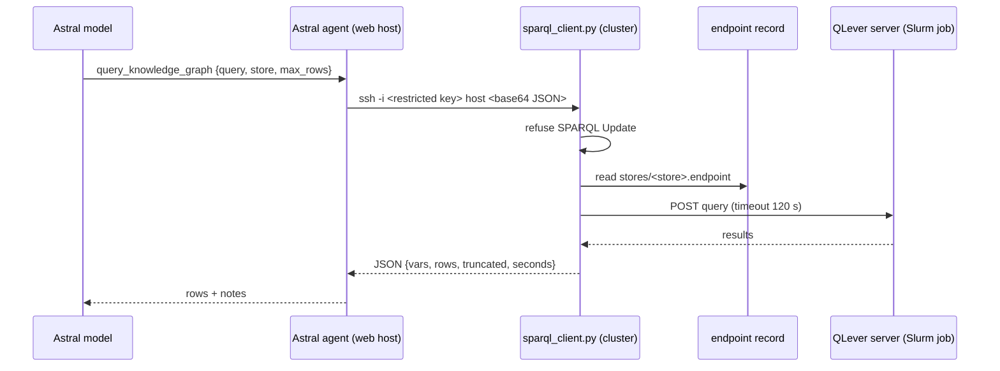

# Astral: the agent interface

The Astral agent (`web/astral/`) registers panAtlas with the Astral agent platform, so that Astral users can query
the atlas from chat and Astral's model can call panAtlas as tools. It is read-only and a bolt-on: it adds files under
`web/astral/` and changes nothing about the site. It does not call the WordPress REST API, and it writes nothing to
the database or to the plugin.

| Property | Value |
|---|---|
| Code | `agent.py` (service, handshake, identity), `skills.py` (tool definitions), `tools.py` (handlers), `atlas_store.py` (in-memory index) |
| Runs on | The web host, as a systemd service bound to loopback; Apache forwards two paths to it over the existing TLS virtual host |
| Reads | The plugin's `data/` directory: `graph.json`, `datasets.json`, `benchmarks_llm.json`, `mm_evals.json`, `models.json` |
| Reaches | The SPARQL store and the coverage service on the HPC cluster, over restricted SSH keys |
| Scopes | `tools:read` and `tools:search` only |
| Tests | `web/astral/tests/` (agent, authorised identities, SPARQL tool, WordPress link contract) |

## How it connects

The Astral orchestrator dials out to agents; it never accepts inbound agent connections. The web host accepts only
the standard web and SSH ports at the network edge, so the agent cannot listen on a port of its own. It binds a
loopback port and Apache forwards exactly two paths:

```
Astral orchestrator ──HTTPS──> https://panatlas.net/.well-known/agent-card.json
                    ──WSS────> wss://panatlas.net/agent ──> agent on loopback
```

1. The orchestrator requests the agent card without a credential. panAtlas answers 401 with
   `WWW-Authenticate: AstralAgentKey`.
2. An explicitly trusted orchestrator retries with `X-Astral-Agent-Key`. The agent validates it before returning the
   card or accepting the socket.
3. The orchestrator opens the WebSocket at `/agent`; the agent sends `register_agent` with its card.

**The WebSocket is required.** If it fails, the orchestrator's fallback registers the agent without a socket, which
looks like success but leaves every tool invisible to the model. The agent deliberately does not serve the
fallback card path, so that degraded mode cannot happen; the 404 for it in the logs is expected.

The agent key is defended three ways, and none may be relaxed without an equivalent replacement:

1. the application compares exactly one `X-Astral-Agent-Key` header in constant time;
2. Apache restricts both paths to the orchestrator's address;
3. the agent enforces its own peer allowlist (`PANATLAS_ALLOWED_PEERS`), reading the real client from an
   Apache-overwritten forwarding header only when the direct peer is loopback.

## The tools

`skills.py` defines fifteen tools:

| Tool | What it returns |
|---|---|
| `search_atlas_graph` | Keyword search across the graph nodes |
| `get_atlas_node` | One node in full, bulky blocks omitted by default |
| `traverse_atlas_relations` | Neighbours, filterable by relation type |
| `search_datasets` | Search the audited dataset catalog |
| `get_dataset_provenance` | The full reproducibility record for one dataset |
| `search_benchmarks` | Search the language-model evaluation register |
| `get_benchmark_detail` | One benchmark plus every model score held for it |
| `compare_models_on_benchmarks` | Head-to-head across benchmarks |
| `get_model_profile` | Architecture, training corpus, evaluation summary |
| `list_imaging_evaluations` | Pathology and radiology foundation-model results |
| `lookup_concept_grounding` | Concept to MeSH descriptor and tree numbers |
| `get_concept_coverage` | Which datasets cover a concept and which benchmarks test it |
| `get_area_coverage` | How well the atlas's documents cover a free-text area, against the Wikipedia layer |
| `query_knowledge_graph` | Read-only SPARQL over the knowledge store |
| `summarize_atlas_state` | Counts and coverage, for orientation |

!!! warning "Tool count"
    `web/astral/README.md` says "Fourteen tools" and then lists fifteen; the vault recorded fourteen on 2026-09-16,
    before `query_knowledge_graph` was added. The code defines fifteen.

Tool names avoid the prefixes Astral's high-risk gate refuses outright (`send_`, `post_`, `fetch_`, `upload_`,
`http_`, `delete_`, `drop_`, `wipe_`, `purge_`, `transfer_`, `pay_`, `deploy_`); a test enforces this. When a sibling
Astral checkout is present, the tests also validate every tool schema with Astral's own validator, which is what
closes the socket on a bad schema.

**Deliberately not exposed:** the `propose` write path; `navigate` and `model-lens` (both spend a server-side LLM
key, and wrapping an LLM in a tool called by an LLM is redundant); the federation registry (token hashes and contact
details); the mesh snapshot (internal topology); `whoami` (identity); and the audit table (per-user browsing history).

**Restricted datasets are catalogued, never served.** Records whose access tier is `restricted` or `credentialed*`
carry a fixed note that panAtlas holds metadata only.

### How the data is held

`atlas_store.py` loads the five JSON files into an in-memory index and re-reads a file only when its modification
time or size changes, so a site rebuild is picked up without a restart. After a WordPress plugin update, check that
the data directory still exists, because an update replaces the plugin directory.

## `query_knowledge_graph`: how Astral reaches the store

The SPARQL store runs on the HPC cluster and answers only inside the cluster network
([Knowledge store](knowledge-store.md)). The agent reaches it without an inbound port:



- **The key is restricted.** In `authorized_keys` the key may run only `sparql_client.py`, with no port forwarding,
  agent forwarding, X11 or terminal. The client accepts only a base64-encoded JSON object, never a shell command.
- **Requests.** `{"action": "describe", "store": …}` lists the named graphs with versions, sizes and proofs;
  `{"query": …, "store": …, "max_rows": …}` runs a query.
- **Read-only.** Any `INSERT`, `DELETE`, `LOAD`, `CLEAR`, `DROP`, `CREATE`, `ADD`, `MOVE`, `COPY` or `WITH`
  operation is refused, and the store has no update token.
- **Limits.** Rows are capped at 1,000 (default 200). The client waits at most 120 s for the store
  (`SPARQL_TIMEOUT`); the agent's SSH call times out at 150 s by default (`PANATLAS_SPARQL_TIMEOUT`). Queries up to
  20,000 characters are accepted.
- **Stores.** `store` is `panatlas-okn` (default) or `wikidata`. The client also knows a `wikidata-sample` store name.

Tool input:

| Field | Type | Notes |
|---|---|---|
| `query` | string | SPARQL, 1 to 20,000 characters |
| `store` | enum | `panatlas-okn` or `wikidata` |
| `describe` | boolean | `true` lists the named graphs instead of running a query |
| `max_rows` | integer | 1 to 1,000, default 200 |

Tool output: `store`, `vars[]`, `rows[]`, `n_rows`, `truncated`, `boolean` (for ASK), `graphs[]` (for describe),
`seconds`, and `notes[]`. The notes always restate three facts a model needs: each named graph is a source of record
(panAtlas's own graph, the OKN mirrors, Wikidata), panAtlas concepts link out by `skos:exactMatch` to MeSH and UMLS
IRIs, and the store prints numbers and points as folded values. Configuration comes from `PANATLAS_SPARQL_SSH_KEY`,
`PANATLAS_SPARQL_HOST` and `PANATLAS_SPARQL_KNOWN_HOSTS`; without them the tool answers "SPARQL store not configured".

!!! warning "Open decision: the SPARQL client runs on the login node"
    The forced-command key runs `sparql_client.py` on the cluster's login node. That conflicts with the rule that
    nothing but `squeue`, `sacct` and `sbatch` runs there. Whether the client should move into a Slurm job was left
    as an owner decision on 2026-10-17.

## `get_area_coverage`: the coverage service

`get_area_coverage` answers "how well does the atlas cover this area, and what nearby do we lack". It calls the W10
coverage service (`web/coverage/w10_coverage_service.py`) on the cluster over its own forced-command key
(`w10_client.py`), with the same base64-JSON pattern.

- Input: `text` (up to 2,000 characters) or a Wikipedia `page_id`; `k` (1 to 200, default 30); `space` (`auto`,
  `name` for title-only vectors, `desc` for title plus lead; `auto` picks by query length); `centre` (`none` or
  `own`); `uncovered` (0 to 50, default 10).
- Output: `verdict` (`well covered`, `partly covered`, `thin`, `unknown territory`), `summary`, `matches[]` with each
  article's evidence class from the Wikipedia layer (strong, medium, bridge, weak, none), `nearest_uncovered[]`,
  `nearest_covered[]`, `recipe`, `seconds`, `notes[]`.
- Method: embed the text with the estate encoder and rank by exact cosine against all 6,748,358 article vectors. The
  notes say it measures topical proximity, not truth.
- Measured 2026-09-16: identity recall@1 of 1.000 in both vector spaces (100 queries each); 1.2 s median latency;
  3.7 s end to end from the agent, 1.3 s of it in the service.

!!! warning "The coverage service also runs on the login node"
    It runs as a user service on the login node, loopback only, because it holds about 33 GB in memory and the web
    host does not have that. The 2026-10-17 restore record lists it among the login-node services disabled on
    2026-10-08.

## Identity: ORCID allowlist and the link flow

The agent does not call the plugin's access gate, because it reads the files directly. It enforces its own ORCID
allowlist (`PANATLAS_ALLOWED_ORCIDS`) on **every** `tools/call`. The list must carry the same iDs as the plugin's
gate; `tests/test_authorized_identities.py` fails if either side loses one.

An Astral user proves their ORCID iD through panAtlas:

1. In Astral's panAtlas detail, **Connect ORCID** opens `https://panatlas.net/?panatlas_astral_orcid_link=1` with a
   signed state from Astral.
2. The plugin checks the state, sends the user straight to the ORCID authorisation URL, and receives them back
   through the OIDC plugin's public callback. This avoids WordPress's restricted login and admin paths.
3. If the signed-in iD is on the allowlist, the plugin returns a short-lived signed handoff bound to that Astral
   user (provider `orcid`, issuer `https://orcid.org`) and writes `link_astral_orcid` to the audit log.
4. Astral stores the link and passes only that verified iD to the agent in `caller_info.verified_identity`.

Missing configuration, an invalid or replayed handoff, a missing or malformed identity and an unlisted iD all fail
closed. Tool arguments and unverified caller metadata never authorise a request. The agent card states the claim
requirement and the link URL but never publishes the allowlist or the link secret. The link secret is a separate
high-entropy value shared with Astral and held outside the repository.

The link was lost from the plugin when an older branch was merged on 2026-09-12 and restored on 2026-10-07.

## Making the tools available to every Astral user

Registration alone does not make tools callable. With Astral's safe-agents setting on, a tool is allowed for all
users only when the agent is both **public** and marked **safe**. The second flag is set from Astral's agent UI by
the agent's owner or a realm administrator who has already saved their own LLM credentials; otherwise the action
reports success and does nothing. Confirm the trust row exists afterwards (`web/astral/README.md` §4.4). Once both
are set, a new user resolves to `tools:read` and `tools:search` with no per-user grant; explicit per-user decisions
are kept.

## Operations

```bash
systemctl status panatlas-astral
journalctl -u panatlas-astral -f
curl -s localhost:<agent port>/healthz | python3 -m json.tool
```

| Symptom | Cause |
|---|---|
| `/healthz` 503 | Data unavailable, the agent key unusable, or the ORCID allowlist empty |
| Card fetched, tools absent in chat | The WebSocket did not connect |
| Socket closed with 1008 | Access control unconfigured, key mismatch, or a schema the orchestrator rejected |
| Tool call returns `-32001` | The Astral account has not connected ORCID, or the iD is not on the allowlist |
| Connect ORCID returns 403 before WordPress | The card still advertises a legacy admin URL; set `PANATLAS_ORCID_LINK_URL` to the front-controller form and restart |
| Tools visible but refused | The agent is not yet public and safe |

For local development the agent runs standalone against the committed data files
(`PANATLAS_DATA_DIR=../wp-plugin/panatlas-explorer/data`), and `web/astral/local/README.md` describes an end-to-end
test against a local Astral orchestrator in Docker with mock authentication.
