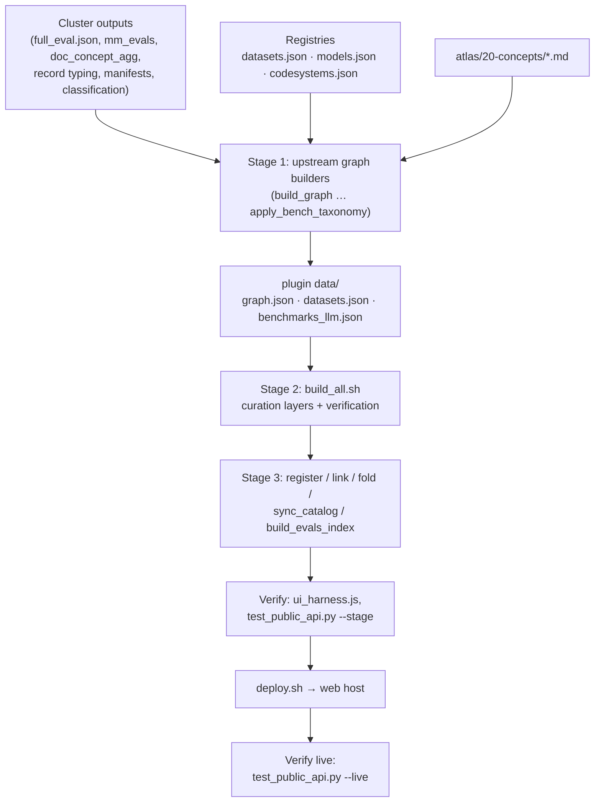

# Build pipeline

The served atlas is a set of JSON files compiled from registries and from analysis outputs. The work happens in
three places:

| Place | What is built there | Entry points |
|---|---|---|
| **HPC cluster**, inside Slurm jobs | Everything heavy: acquisition, manifests, the document index, concept mapping, embeddings, evaluation ingest, the universe projection, the Wikipedia layer, RDF and SPARQL stores | `web/dgx/`, `web/acquisition/`, `web/wikipedia_layer/`, `web/rdf/` |
| **A workstation with the repository** (`web/`) | The served property graph and catalogs, the curation layers, the evaluation index, verification | The graph builders, `web/build_all.sh`, `web/deploy.sh` |
| **The web host** | The nightly literature feed | `web/pipeline/literature/server/` |



!!! warning "There is no single end-to-end build script"
    `build_all.sh` is the ordered entry point for the curation layers only. It **assumes** the upstream graph
    builders have already produced `graph.json`, `datasets.json` and `benchmarks_llm.json` (its header says so), and
    it does **not** run the post-build register, link and fold steps or `build_evals_index.py`. Those are run by
    hand in the order given below. Most scripts declare themselves idempotent (nodes updated in place, edges
    de-duplicated), so re-running a step is safe.

## Stage 1: upstream graph builders

These produce the three files `build_all.sh` starts from. `build_all.sh` names them, in this order, as its
precondition. All write into `web/wp-plugin/panatlas-explorer/data/` unless noted.

| Script | What it does |
|---|---|
| `build_graph.py` | Compiles the first-interface inventory graph (`web/graph.json`) from the curated dataset catalog page in the knowledge vault. An intermediate, not the served graph. |
| `build_layered.py` | The core compiler. Builds the layered graph (concept, dataset and ontology layers, with modality as a facet) from the MeSH-grounded concept spine (`atlas/20-concepts/*.md` plus `concept_mesh_grounded.json`), code systems, FHIR, NACC, nutrition, FoodAtlas, FNDDS, the imaging registry, domains, measured corpus sources (`dgx_sources.json`), the document rollup and footprint, and merged federation output. Writes `data/graph.json`. |
| `build_all_datasets.py` | Exhaustive corpus-source accounting: every data source on disk, used or not, tagged with modality, status, location and scale. |
| `build_train_sources.py` | Wires the authoritative per-model training manifests (`v4_train_sources.json`, `v5_train_sources.json`) as `trained_on` edges, replacing partial ones. |
| `build_source_topics.py` | Propagates each training source's clinical domain onto the catalog entries. |
| `sft_wiring.py` | Wires the measured supervised fine-tuning inventory into the graph. |
| `build_corpus_structure.py` | Fixes the dataset model: a model has a few datasets (pretraining corpus, SFT set), each composed of sources. |
| `model_wiring.py` | Restores full graph stats and wires model to dataset and benchmark edges. |
| `build_benchmark_nodes.py` | Promotes benchmarks to first-class nodes: dataset `test_set_of` benchmark `tests` concept. |
| `build_concept_remap.py` | Wires the judge-gated item-to-concept mapping (`pipeline/qconcept2/*.jsonl`), including 120 general Wikipedia-grounded concepts. |
| `apply_bench_taxonomy.py` | Replaces arm groupings with two axes, testing type and domain, from `bench_taxonomy.json`. |

!!! warning "`build_layered.py` is not portable as written"
    It reads vault metadata from a hard-coded absolute path on one workstation, reads benchmark centroids from a
    temporary file, and writes a second copy of `graph.json` to a temporary preview directory. Running it on another
    machine needs those paths changed. `build_graph.py` and `pipeline/check_curriculum_vault.py` also read the
    knowledge vault, which is not part of this repository.

## Stage 2: `build_all.sh`

`web/build_all.sh` runs from `web/` under `set -euo pipefail`, so any failing step stops the build, except the one
step marked below. Graph paths are `wp-plugin/panatlas-explorer/data/…`.

| # | Command | Reads | Writes |
|---|---|---|---|
| 1 | `python3 build_artifact_types.py` | `pipeline/artifact_types.json` (33-type vocabulary, each grounded to a verified Wikipedia article and, where faithful, a MeSH descriptor), the v4/v5 training manifests, benchmark facets | Artifact-type nodes; `has_artifact_type` and `covers_topic` edges on pretraining sources, SFT sources and benchmarks; stamps `graph.json`, `datasets.json`, `benchmarks_llm.json`; `pipeline/corpus_type_profile.json` |
| 2 | `python3 build_curriculum.py` | `pipeline/model_curriculum.json` (schema `panatlas-model-curriculum/1`) | `training-stage` nodes with data, dates and jobs, system, config and codebase; edges `has_training_stage`, `stage_trained_on`, `follows`, `executed_on`, `built_with`; `curriculum_disclosed` on every model node |
| 3 | `python3 build_record_level.py` | `pipeline/doc_concept_agg.json` (per-document concepts, 89.9M documents across 136 sources), `pipeline/record_level/record_typing_results.json` (every SFT record typed on the cluster), training manifests | Corpus-level type × topic matrices with stated coverage; per-record type and register on SFT mix and source nodes; `pipeline/record_level/record_level_wired.json` |
| 4 | `python3 pipeline/existing_meta/merge_gap.py \|\| true` | Gap-classification worker shards | `pipeline/existing_meta/gap_classification.json` (26 sampled sources). **Failure is tolerated** (`\|\| true`): when labels are absent the build continues |
| 5 | `python3 build_existing_meta.py` | `pipeline/existing_meta/pretrain_classification.json`, `pretrain_holes_classification.json`, `gap_classification.json`, grounding verdicts | Per-source domain, data-type and register distributions wired to existing concept nodes; `existing_classification_wired.json`. Generates nothing new |
| 6 | `python3 build_native_meta.py` | `pipeline/existing_meta/source_native_meta.json` and the classification files | `native_fields`, `has_embeddings` and `doc_classification_status` (`full-population` or `source-level only`) on pretraining source nodes |
| 7 | `python3 build_field_values.py` | `pipeline/existing_meta/native_field_values.json` | Categorical counts, numeric summaries and identifier distinct-counts on pretraining source nodes |
| 8 | `python3 build_patho_evals.py` | `pipeline/patho_evals/*.json` (BACH, CRC and neuropathology results) | Pathology results reconciled into `mm_evals.json`; pathology benchmarks wired into the concept graph |
| 9 | `python3 build_eval_map.py` | `benchmark_ontology_facets.json`, `benchmark_audit.json`, `benchmark_suite_fit.json` | The `audit` block, including `audit.map` (a 2-D UMAP projection of each benchmark's facet vector, with a PCA fallback) in `data/benchmarks_llm.json`. Without it the Benchmarks map view is empty |
| 10 | `python3 pipeline/check_curriculum_vault.py` | `pipeline/model_curriculum.json`, the knowledge vault | Nothing. Exits 1 if any hard curriculum fact (SLURM job ids, config paths, codebase paths) is missing from the vault |
| 11 | `node pipeline/ui_harness.js` | `assets/app.js`, `data/graph.json`, `data/datasets.json`, `data/benchmarks_llm.json` | Nothing. Loads the front end against a stubbed DOM and drives every render path over the real data; exits 1 on any failure |

The script ends with `BUILD+VERIFY COMPLETE. Deploy with: ./deploy.sh`. Measured harness runs: 18,941 renders with
0 failures (2026-09-12) and 19,238 renders with 0 failures (2026-10-16).

`web/guard_eval_map.sh` is a separate guard for step 9: it detects a live benchmarks endpoint without `audit.map`, a
missing coverage grid, or a changed map source, and rebuilds and redeploys that one file.

## Stage 3: register, link, fold, and the evaluation index

New data enters the served graph through small idempotent scripts, each named for its step:

| Step | Scripts | Effect |
|---|---|---|
| Register | `register_fragment.py` (any `panatlas.datasets/1` fragment), `register_okn.py`, `register_openh.py`, `register_arxiv.py`, `register_neuropath.py`, `register_tcga.py`, `register_predictors.py`, `renal_sbir_registry.py` | Upsert entries into `web/datasets.json` (by URN) or `web/models.json` |
| Fold | `fold_manifests.py`, `fold_renal_manifests.py`, `fold_tcga_manifests.py`, `fold_arxiv_alignment.py` | Write cluster-built manifests and completion records into the registry entries |
| Link | `link_renal.py`, `link_neuropath.py`, `link_openh.py`, `link_arxiv.py`, `link_predictors.py`, `link_datasets_to_nodes.py` | Add dataset, concept and model nodes and edges to the served `graph.json` |
| Catalog | `sync_catalog.py` | Upsert `web/datasets.json` into the served catalog `data/datasets.json`, keyed by URN |
| Evaluations | `attach_full_eval.py`, `reconcile_benchmarks.py`, `build_evals_index.py` | Attach model batteries to model nodes; reconcile the benchmark catalog with what was run; build `data/evals_index.json`, the one index behind the public API |

The order recorded for the predictor-model suite (`web/fm_suite/README.md`) is a worked example:

```bash
# from web/
FM_SUITE_ROOT=<working copy> python3 fm_suite/suite/export_panatlas.py predictor_evals.json
python3 register_fragment.py datasets_fm_suite.json
python3 register_predictors.py
python3 sync_catalog.py
python3 link_predictors.py
python3 build_evals_index.py
node pipeline/ui_harness.js
```

!!! warning "`build_evals_index.py` is outside `build_all.sh`"
    `deploy.sh` ships `data/evals_index.json`, but `build_all.sh` never rebuilds it. After any change to
    `benchmarks_llm.json`, `full_eval.json`, `mm_evals.json`, `predictor_evals.json` or `models.json`, run
    `build_evals_index.py` before deploying, or the public API serves stale scores.

## Cluster-side builds (`web/dgx/`)

`web/dgx/` is a mirror, taken 2026-09-13, of every `*.py`, `*.sh` and `*.sbatch` in the panAtlas directory on the
cluster: the registry, label, universe and manifest side of the build. Twenty of these files also exist under
`web/` or `web/pipeline/`; where the cluster copy differs, **the cluster copy produced the current artifacts**
(`web/dgx/README.md`). The mirror is a snapshot, so check the cluster copy before relying on a detail.

| Group | Scripts | Output |
|---|---|---|
| Registry and manifests | `dataset_manifest.py`, `build_dataset_reports.py`, `inventory.py`, `classify_splits.py`, `count_docs.sh` | Manifests (`manifest_hash`), each dataset manager's structure-only report, corpus inventory, split classification. An hourly user timer re-audits the cluster registry and regenerates the manager reports |
| Document index and concepts | `build_master_index.py`, `agg_doc_concept.py`, `dup.py`, `uniq.py`, `verify_uniq.py`, `map_concepts.py`, `map_concepts2.py`, `map_concepts3.py`, `map_mesh.py`, `map_mesh2.py`, `map_final.py`, `mesh_expand.py`, `expand_clean.py`, `llm_label_cells.py`, `llm_judge_cells.py`, `validate_build.py`, `recount.py`, `validate_footprint*.py` | Every embedded document mapped to a MeSH concept through its cell, with duplicate-id checks on the index; MeSH grounding confirmed per descriptor; cell labels and medical/general judgments; the footprint validation |
| Anchors and embeddings | `assemble_text.py`, `generate_concept_text.py`, `normalize_node_text.py`, `embed_concepts*.py`, `build_text_anchors.py`, `build_image_anchors.py`, `precompute_pooled.py`, `exp_anchor_study.py`, `embed_attach.py`, `pa_local_agent.py` | Concept anchors in the registered text space (BioClinical-ModernBERT-large, 1024-d) and image space (RAD-DINO, 768-d); the attach process that relates new embeddings to concepts |
| Evaluation | `ingest_full_eval.py`, `build_mm_evals.py`, `build_concept_accuracy.py`, `extract_questions.py`, `build_question_concept_map.py`, `remap_general.py`, `remap_gated.py`, `precompute_cellmap.py` | `full_eval.json` (every model's battery), `mm_evals.json` (imaging and multi-modal results, with the evaluation type inferred from the result-file structure), per-concept accuracy, question-to-concept maps |
| Contamination | `decontam_exact.py`, `ledger_by_source.py` | Exact-document contamination check against the training ledgers (`blake2b`, 16-byte digest over raw text); per-source ledger counts |
| Universe | `build_universe.py`, `build_universe_export.py`, `build_universe_export_full.py` (and `web/pipeline/universe/build_backbone.py`) | A 2-D coordinate for every document, exported in resolution tiers for the browser, with the graph overlaid as a backbone |
| Literature identity | `build_pmc_map.py` | Per-article PMCID/PMID for the trained PMC corpora, recovered by content anchor |

Other cluster-side chains have their own directories: the Wikipedia world-view layer (`web/wikipedia_layer/`, steps
W0 to W9 for the pinned run 20260901), the OKN mirrors and other acquisitions ([Acquisition](acquisition.md)),
document licences (`web/licence/`), and the RDF export and SPARQL stores ([Knowledge store](knowledge-store.md)).

**Getting results to the workstation.** Cluster outputs are copied into `web/` (for example `full_eval.json` after
`ingest_full_eval.py`) and the workstation steps are re-run. `web/finish_v2.sh` is a recorded one-shot of this
pattern for one classifier pass: pull worker shards, merge, rebuild the record-level layer, verify, deploy.

## Deploy: `deploy.sh`

`web/deploy.sh` runs after `build_all.sh` passes. It copies, from `web/wp-plugin/panatlas-explorer/` to the plugin
directory on the web host:

| Files | Destination |
|---|---|
| `assets/app.js`, `assets/style.css` | `assets/` |
| `data/graph.json`, `data/datasets.json`, `data/benchmarks_llm.json`, `data/mm_evals.json`, `data/evals_index.json` | `data/` |
| `includes/public-evals.php`, then `includes/public-api.php` | `includes/` (in that order, because `public-api.php` requires `public-evals.php`) |

It then sets ownership of the copied files to the web server user. It **never** touches `data/mesh.json`, which the
mesh daemon on the web host rewrites live.

!!! warning "What `deploy.sh` does not deploy"
    The main plugin file `panatlas-explorer.php`, the other includes (`federation-admin.php`, `mesh.php`,
    `wikimap.php`), `universe.js`, `wikimap.js`, `data/models.json` and `data/kg_graphs.json` are not in the script.
    The universe and world-map assets live outside the web root and have their own install paths
    (`web/wikimap/install_wikimap.sh` for the map). A change to any of these is deployed separately. Recorded deploys
    take a dated backup of the plugin's data directory first; `deploy.sh` does not.

### Verify after deploying

```bash
python3 tests/test_public_api.py --stage DIR   # a staged plugin copy, through tests/public_api_harness.php
python3 tests/test_public_api.py --live        # against panatlas.net; exit status = number of failures
python3 tests/test_explore_e2e.py              # asks a real external LLM client the questions the atlas must answer
```

The public API contract test also fails a response that contains an internal path or host string, or a tool result
over 24,000 characters ([Public API](public-api.md)).

## Rules for the cluster

These are standing rules for anything that runs on the HPC cluster (owner rule of 2026-10-08, recorded in
`web/rdf/README.md` and the acquisition READMEs):

- **Compute runs in Slurm jobs, never on the login node.** On the login node only `squeue`, `sacct` and `sbatch`
  run. Inspect a running job with `srun --overlap --jobid <id> -n1 -c1 --mem=1G …` (`-n1`, or the command runs once
  per task).
- **CPU jobs go to a CPU partition** so they never hold a GPU node. The serving job for the SPARQL store, the OpenH
  download and the UMLS fetch all follow this.
- **Third-party services use their own tools and settings.** Never raise a provider's concurrency (the OpenH-RF
  download uses the official `hf download` with its own adaptive concurrency).
- **Large walks are parallel jobs.** A single-threaded walk of the CT corpus on the login node did not finish in
  25 minutes; `dataset_manifest_parallel.py` shards the tree and produces a byte-identical canonical hash.

!!! warning "Known exceptions in the current code"
    Several components predate the rule or still run on the login node. They are listed so nobody copies the
    pattern:

    | Component | What it does on the login node |
    |---|---|
    | `web/acquisition/renal/run_renal.sh`, `launch_d.sh`, `finalize_renal.sh` | Launched the renal download streams in `tmux` and the finalizer with `nohup` (finished 2026-09-06, before the rule) |
    | `web/acquisition/okn/deploy/panatlas-okn-tick.timer` | Runs the OKN tick as a user systemd timer every 6 hours; the tick submits the real work as Slurm jobs |
    | `web/coverage/w10_coverage_service.py` | The coverage service for Astral runs as a user service on the login node, loopback only |
    | `web/rdf/sparql_client.py` | Astral's SPARQL tool runs this client on the login node over its forced-command key. Whether it should move into a Slurm job is an open owner decision (2026-10-17) |
    | Hourly registry refresh and agent supervision timers | User systemd timers on the login node ([Operations](../distributed/operations.md)) |
    | `web/pipeline/wiki_prep.py`; `precompute_cellmap.py` and `extract_questions.py` | The first's docstring and `web/BENCHMARK-QUESTION-MAPPING.md` for the other two say they run on the login node |

    The 2026-10-17 restore record says the panAtlas user services on the login node (agent, watchdog, coverage,
    refresh, CT re-walk, OKN tick) were disabled on 2026-10-08 and not re-enabled in that session.
