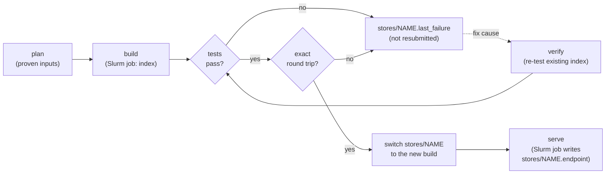

# Knowledge store (SPARQL)

panAtlas keeps its graph in RDF as well as in the served JSON, and loads it, together with mirrored public knowledge
graphs, into local QLever SPARQL stores on the HPC cluster. A store is a **query view**: it lets agents and jobs join
panAtlas to other graphs. It is not the record. Exact recreation always comes from the verified raw files, because
QLever cannot keep every literal verbatim (see [Exactness](#exactness-the-round-trip)).

This page is operational: what the stores hold, how they are built, proven, served and queried. The vocabulary of
panAtlas's own graph (classes, properties, IRIs) is in [RDF vocabulary](../metadata/rdf-vocabulary.md).

## The stores

| Store | Contents | Size | State |
|---|---|---|---|
| `panatlas-okn` | panAtlas's own graph plus every NSF Open Knowledge Network graph whose mirror is proven exact, each in its own named graph | Build `panatlas-okn-20261003T0039`: **44 named graphs, 6,994,341,217 triples** | Every graph round-tripped exactly; live since 2026-10-03 07:43. Served by job 226412 until 2026-10-08 (cancelled when all jobs were stopped), and again by job 237423 since 2026-10-16 08:06, checked at the same count |
| `wikidata` | The Wikimedia Wikidata dump (md5-verified), one graph | **21,350,107,674 triples**, indexed 2026-10-02 | **Not served** as of the last record. The first build failed a smoke test that assumed English labels; a verify-only rerun (job 237432) passed all six tests and was in the last stage of the exact round trip on 2026-10-17. It switches live only if the round trip is exact |

Code: `web/rdf/` (`build_rdf.py`, `qlever_build.py`, `qlever_serve.py`, `sparql_client.py`, `nt_canon.py`,
`qlever_fold.py`, `qlever_export.py`). Stores live under `<cluster project storage>/panatlas/qlever/stores/`.

## Named graph = source of record

Each source keeps its own named graph, so a query can always say where a fact comes from (`GRAPH ?g { … }`):

```
https://panatlas.net/graph/panatlas         panAtlas's own graph (the only one panAtlas curates)
https://purl.org/okn/frink/kg/<shortname>   read-only mirror of an OKN graph
http://www.wikidata.org/                    Wikidata (store `wikidata`)
```

panAtlas concepts link out with `skos:exactMatch` to the IRIs other graphs use: MeSH as `http://id.nlm.nih.gov/mesh/…`
(NLM mints `http`; `https` only redirects) and UMLS as `http://linkedlifedata.com/resource/umls/id/…` (the form the
OKN graphs use). The stems are registered in `web/codesystems.json` ([Code systems](../metadata/codesystems.md)).

Joins this enables, tested in the store on 2026-09-26: 3,373 of 3,377 panAtlas MeSH IRIs exist in NLM's MeSH RDF;
3,310 panAtlas concepts reach 3,313 Wikidata entities through the OKN identifier-mappings graph; 137 MeSH IRIs join
one OKN graph only through its `https` variant.

## Inputs

| Input | Produced by | Admission rule |
|---|---|---|
| `panatlas.nq` | `build_rdf.py` from the served graph | Each quad written once. Build of 2026-09-26: 213,647 quads (6,088 nodes, 16,891 edges; 361 duplicates suppressed), validated with rdflib |
| OKN mirrors `okn/raw/<sn>/current/part_*.nt` | `web/acquisition/okn/okn_agent.py` | Admitted only if the extraction is proven clean (lines = distinct = endpoint `COUNT(*)`, nothing malformed, or a strict re-check passes) **and** `PROOF.json` shows fingerprint, upstream and re-extraction checks all passed ([Acquisition](acquisition.md#nsf-open-knowledge-network-mirrors)) |
| Wikidata dump | The Wikidata agent | md5-verified; streamed through `lbzip2` into the indexer while the same pass counts lines |

`python3 qlever_build.py plan` prints what would be built, which graphs are admitted, and why the others are left
out. It is the one subcommand that may run without a job.

## Lifecycle: build, test, prove, switch, serve



1. **Build.** Inside a Slurm job, `qlever_build.py build` writes `stores/<name>-<stamp>/` (index, `manifest.json`,
   `tests.json`) and serves it on a private port inside the job.
2. **Test.** Every graph's triple count must equal its verified count exactly; no graph may appear that was not
   admitted; the panAtlas MeSH joins must hold. For Wikidata the triple count must lie within 0.1 % below the dump's
   line count (QLever drops exact duplicate triples) and known facts must answer (Q42 "Douglas Adams" in `en` or
   `mul`, Q5 "human", Q42 P31 Q5, items with a MeSH ID).
3. **Round trip** (below).
4. **Switch.** Only when every test passes and the round trip is exact does the `stores/<name>` link move to the new
   build.
5. **Serve.** `qlever_serve.py start` submits the serving job; the job writes an endpoint record once the server
   answers a real query.

A failed build writes `stores/<name>.last_failure` and is not resubmitted automatically. After fixing the cause,
`qlever_build.py verify <store dir>` re-runs the tests and round trip on the index already built (no re-index) and
removes the failure record when it passes. Builds are submitted with `SERVE_AFTER=1` to start serving on success.

**Automation.** The six-hourly OKN tick (`okn_agent.py tick`) submits a `panatlas-okn` build when no OKN job is
active and the held graph versions differ from the served store, and a Wikidata build when the Wikidata agent holds
a newer verified dump. Both serve only after an exact round trip.

```bash
# placeholders: <cluster project storage>, Slurm options omitted
STORE=panatlas-okn python3 qlever_build.py plan
sbatch ... --export=ALL,STORE=panatlas-okn,SERVE_AFTER=1 --wrap 'python3 qlever_build.py build'
sbatch ... --export=ALL,STORE=<name>,SERVE_AFTER=1 --wrap 'python3 qlever_build.py verify <store dir>'
python3 qlever_build.py roundtrip <store dir> [graph ...]      # inside a job
python3 qlever_serve.py start|status|query|stop [store]
```

## Exactness: the round trip

QLever folds literals into value identifiers and prints the value on export, and has no setting to stop it. Six
folding rules, each read from QLever's source and confirmed on data:

| Rule | Effect |
|---|---|
| integer | `xsd:integer` becomes `xsd:int` (60-bit range) |
| decimal / double | Stored as a double minus its 4 lowest mantissa bits; printed `%.1f` or `%.13g` as `xsd:decimal` (lossy past 13 significant digits) |
| point | WKT `POINT` quantised to a 30-bit grid per coordinate, printed `%f` (sub-metre loss; two stored points can print alike) |
| dateTime | A year beyond four digits loses its `Z` |
| unparseable | A folded-type literal QLever cannot parse (a leap second, a point out of range) loses its datatype |
| spelling | `\uXXXX` escapes, `^^xsd:string`, language-tag case (same RDF term) |

The round trip exports every graph back out of the store (a `CONSTRUCT` over its named graph) and requires:

- the sorted, distinct, non-blank triples of `canon(export)` hash identically (sha256) to `canon(fold(source))`, where
  `nt_canon.py` gives one spelling per RDF term and `qlever_fold.py` applies the rules above to the source;
- blank-node triple counts are equal (the store assigns its own blank-node labels);
- `COUNT(*)` equals the distinct stored values of the source (`nt_canon.py --qlever-fold-ids`).

Anything a rule does not explain blocks the switch, and the differing lines are written to
`roundtrip/<graph>.diff`. The round trip is recorded per graph in `roundtrip/roundtrip.json`, which the `describe`
action reports as `round_trip_exact` and `lossy_folds`.

## Serving

`qlever_serve.py start` submits a CPU-only Slurm job named `qlever_serve_<store>` with no time limit, on a CPU
partition so it never holds a GPU node. Inside the job the server runs from a container image of QLever (commit
d5b7eb2), bound to a free port, with a one-hour limit on any single query. Once a real query answers, the job writes
`stores/<store>.endpoint`:

```json
{"store": "...", "store_dir": "...", "host": "<cluster node>", "port": "<port>", "job": "<job id>",
 "started": "YYYY-MM-DD HH:MM:SS", "url": "http://<cluster node>:<port>/"}
```

The record is removed when the job ends. **The address moves** whenever a new build is switched live or the server
restarts, so always read it from the record. `status` reports a record whose server no longer answers as `STALE`.
The endpoint is reachable only inside the cluster network; nothing is exposed outside it.

## Querying

**From inside a Slurm job only.** Never run queries, tests or scripts on the login node. Attach to the serving job
and query from there:

```bash
srun --overlap --jobid <serve job> -n1 -c1 --mem=1G bash
cd <cluster project storage>/panatlas/qlever
python3 qlever_serve.py status panatlas-okn                 # endpoint record + live total triple count (~140 s)
python3 qlever_serve.py query panatlas-okn 'SELECT ...'     # TSV
curl -s "$(python3 -c 'import json;print(json.load(open("stores/panatlas-okn.endpoint"))["url"])')" \
     --data-urlencode 'query=SELECT ...' -H 'Accept: application/sparql-results+json'
```

**From an agent:** Astral's `query_knowledge_graph` tool ([Astral](astral.md#query_knowledge_graph-how-astral-reaches-the-store)).

**From the public site:** only the store manifest, through `GET /kg/graphs` on the [public API](public-api.md). The
public API accepts no SPARQL.

Examples, run against the live store on 2026-10-08:

```sparql
# panAtlas concepts with their NLM MeSH labels (1.2 s)
PREFIX skos: <http://www.w3.org/2004/02/skos/core#>
PREFIX rdfs: <http://www.w3.org/2000/01/rdf-schema#>
SELECT ?c ?m ?label WHERE {
  GRAPH <https://panatlas.net/graph/panatlas> { ?c skos:exactMatch ?m }
  GRAPH <https://purl.org/okn/frink/kg/biobricks-mesh> { ?m rdfs:label ?label } } LIMIT 3
# -> panatlas:fa-dis-C531609  mesh:C531609  "Diffuse alopecia"@en

# panAtlas concepts to Wikidata entities through OKN identifier-mappings (7.2 s)
PREFIX skos: <http://www.w3.org/2004/02/skos/core#>
SELECT ?c ?w WHERE {
  GRAPH <https://panatlas.net/graph/panatlas> { ?c skos:exactMatch ?m }
  GRAPH <https://purl.org/okn/frink/kg/identifier-mappings> { ?w skos:exactMatch ?m } } LIMIT 3
# -> panatlas:fa-dis-C531609  wd:Q9394945
```

### Know before you query

- **Folded literals.** Decimals print at 13 significant digits; WKT points are quantised. Take exact values from the
  raw files.
- **Slow scans.** A count over every graph, or a `GROUP BY` over all triples, takes minutes on 7 billion triples;
  the server stops any query at one hour.
- **Wikidata labels.** A name shared by every language is stored once under the language code `mul` (Q42 has 75
  labels and none `@en`). For English use `FILTER(LANG(?l) IN ('en', 'mul'))` and prefer `en`.
- **Two stores.** `panatlas-okn` and `wikidata` are separate stores, joined at query time with `SERVICE`.

## Tests

```bash
python3 -m unittest test_nt_canon test_qlever_fold test_qlever_build   # in web/rdf; run on the cluster
```

The cases come from the observed round trips and the Wikidata store. The digest step uses GNU `sort` and
`sha256sum`, so the tests are meant to run on the cluster.

## Planned

A separate restricted store for licensed data, built with the same exact round trip and kept apart from
`panatlas-okn`, is planned (`PLAN-restricted-data-umls.md`, phase P2). It is not built.
